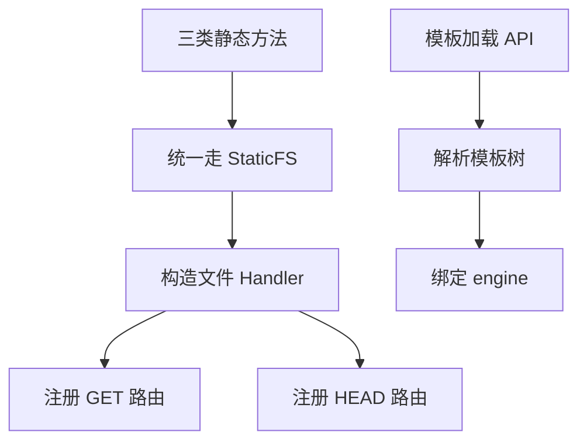

> 关联主卡：708-gin-static-methods / 708-http-dir-filesystem / 708-gin-template-loading / 708-template-syntax / 708-debug-release-mode
> 深挖门槛命中：L3（接口机制 + 调试/发布性能权衡）+ 源码层（StaticFS 实现）

## 思路与架构
静态资源加载的本质是"把本地文件树映射成 HTTP 路由树"。Gin 把三类 API 统一收敛到 `group.StaticFS`，再注册成标准 `http.HandlerFunc`，对外暴露 GET 与 HEAD 两条路由。模板加载则是把文件树解析成 `*template.Template` 并绑定到 engine。

文字版：① 三个静态方法最终都走 `StaticFS` 一个实现；② handler 内部用 `http.FileServer` 语义按 URL 找本地文件；③ 同时注册 GET/HEAD，所以静态资源可被 HEAD 探测；④ 模板在 Load 时一次性（Release）或每次（Debug）解析。

## 方案取舍
| 维度 | Static/StaticFS | StaticFile | 独立 CDN/对象存储 |
|---|---|---|---|
| 适用 | 整目录静态资源 | 单文件（favicon/固定图） | 生产前端资源 |
| 路由控制 | 目录级 | 单点精确 | 域名级 |
| 性能 | 中（本地磁盘） | 中 | 高（边缘缓存） |
| 运维 | 后端带资源 | 后端带资源 | 解耦、可缓存 |
| 安全 | 需防目录穿越 | 路径固定较安全 | 与后端隔离 |

选型结论：小项目/演示用 Static 快速起；单文件用 StaticFile；生产前端应前后端分离、静态资源走 CDN。不适用边界：高并发静态读不应压在 API 服务进程内。

## 性能量级与实测数据
Debug 模式每次渲染重解析模板，单请求额外一次磁盘读+解析 `[源码] render/html.go`；Release 仅启动期一次。具体耗时随模板体积变化，未实测标记 `[存疑]`。验证：`go test -bench` 对比两种模式 QPS（需真实模板）。

## 答题技巧

## 细节与核心 API
- `r.Static(rel, root string)`：目录→路由，递归可访问。
- `r.StaticFile(rel, filepath string)`：精确单文件路径。
- `r.StaticFS(rel string, fs http.FileSystem)`：接任意 `http.FileSystem`（含 embed.FS）。
- `http.Dir`：`type Dir string`，实现 `Open` 隐式满足接口。
- `r.LoadHTMLFiles(...string)` / `r.LoadHTMLGlob(pattern)`：模板加载。
- `gin.SetMode(gin.ReleaseMode)`：关闭模板热加载，生产必设。

- 30 秒版：Static/StaticFS 管目录、StaticFile 管单文件；生产设 Release 避免模板每请求重解析。
- 3 分钟版：补 http.Dir 隐式满足 http.FileSystem、Glob 的 `/**` 层级、define 防重名、子模板 `template "x" .` 传参。
- 白板版：画"本地文件树 → StaticFS handler → GET/HEAD 路由"与"模板树 → engine"两条线。
- 话术模板："小项目用 Static 快速起，生产我一定前后端分离+CDN，并 SetMode(Release)。"
- 不会怎么接：诚实说"目录穿越防护细节我回去确认"，不编安全结论。

## 广度与深度延伸
- 横向：标准库 `http.FileServer`/`http.ServeMux`、`embed` 内嵌静态资源、Nginx/对象存储。
- 纵向：gin `render.HTMLDebug` 与 `HTMLProduction` 实现差异、`html/template` 自动转义与 XSS 防护。

## 反问环节
可反问："咱们前端资源是跟后端一起发还是走独立域名/CDN？模板热加载在生产怎么关？"——体现部署与性能意识。
