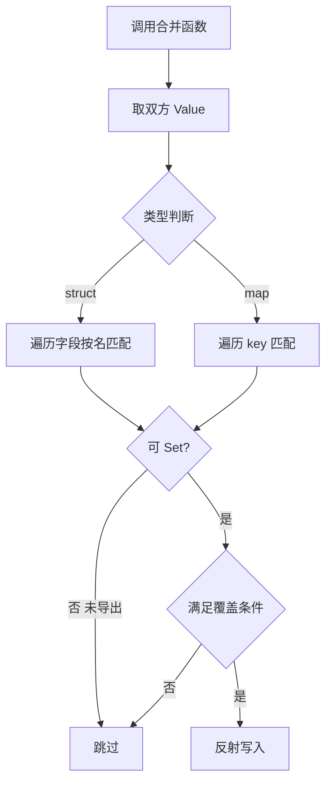

> 关联主卡：710-map-struct-convert / 710-struct-merge / 710-map-merge / 710-merge-options / 710-custom-transformer
> 深挖门槛命中：L3 选项权衡 + L4 反射扩展 + 多方案对比（mergo vs mapstructure）

## 思路与架构
mergo 的核心是一条"反射遍历 + 按名匹配 + 条件写入"的流水线：打开 dst/src 的 reflect.Value，递归下钻结构体/map/slice，对每个字段按 Config（Overwrite、OverwriteWithEmptyValue、是否深拷贝 slice 等）决定写不写。

文字版：① 入口统一为 `Merge`/`Map`，差异只在是否允许 map 参与；② 字段匹配靠名字+可赋值性；③ 写不写由 Config 决定，未导出字段在 `CanSet()` 阶段就被筛掉；④ 命中 Transformer 时改走自定义 `Transform`。

## 方案取舍
| 维度 | mergo（反射） | mapstructure（反射+标签） | 代码生成（如 easyjson 类） |
|---|---|---|---|
| 使用成本 | 低，零标签 | 中，需 struct tag | 高，需生成 |
| 灵活性 | 高，支持选项/转换器 | 中，靠 tag 声明 | 低，固定结构 |
| 性能 | 反射，较慢 `[经验]` | 反射，相近 `[经验]` | 最快，但丧失动态性 `[经验]` |
| 未导出字段 | 不可改 | 不可改 | 取决于生成规则 |
| 适用 | 配置合并、默认值填充 | 反序列化（JSON/YAML→struct） | 高频固定结构序列化 |

选型结论：配置/默认值合并、动态 struct↔map 用 mergo；做"外部数据→struct"的反序列化用 mapstructure 更对口；二者都不能替代彼此。不适用边界：超高频热点路径、需要改未导出字段的场景都不该用反射方案。

## 性能量级与实测数据
未实测，标记 `[存疑]`。反射方案相对代码生成慢一到两个数量级是常见经验判断 `[经验]`，但 mergo 多用于启动期/配置期而非请求热路径，通常不构成瓶颈。验证命令（如需实测）：`go test -bench` 对比 mergo.Merge 与手写的逐字段赋值。

## 答题技巧

## 细节与核心 API
- `mergo.Map(dst, src)`：至少一端为 map 时按名映射，常用于 struct↔map。
- `mergo.Merge(dst, src, opts...)`：合并两同构容器，默认零值才覆盖。
- `mergo.WithOverride`：无条件用 src 覆盖 dst 同名字段。
- `mergo.WithOverwriteWithEmptyValue`：仅 dst 为零值时覆盖。
- `mergo.WithTransformer(t Transformer)`：注册字段级自定义逻辑。
- 坑：dst 必须传指针且可寻址，否则反射写不进；不同类型合并结果难预期。

- 30 秒版：mergo 用反射按名合并，默认零值才覆盖，未导出字段不动，要强制覆盖用 WithOverride。
- 3 分钟版：补 map 并集语义、类型不符保留目标、WithOverwriteWithEmptyValue 区别、Transformer 扩展点。
- 白板版：画"反射遍历→按名匹配→Config 判定→写入/跳过"流程。
- 话术模板："我用 mergo 做配置默认值填充，踩过未导出字段不合并的坑，特殊类型用 Transformer 处理。"
- 不会怎么接：诚实说"未导出字段靠反射改不了，若必须改要换方案或改结构"，别编。

## 广度与深度延伸
- 横向：mapstructure（反序列化）、reflect 包的 `CanSet`/`CanAddr`、接口与反射边界。
- 纵向：Go 反射 `reflect.Value` 可寻址规则、struct tag 解析、代码生成（go:generate）原理。

## 反问环节
可反问面试官："我们配置合并用 mergo 还是写显式赋值？有没有热路径性能顾虑？"——表现你对方案取舍有主动性。
