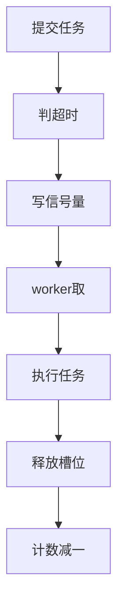

> 原文：7-11 如何使用 ants 管理 goroutine（二）—— 实为手写协程池

## 思路与架构
主线：并发度信号量 + 任务队列 + 固定 worker 三件套，再叠加超时提交、panic 恢复、原子计数三项加固。



- 提交先走 select 判超时
- 通过后写并发度信号量
- worker 从任务队列取函数执行
- 执行完释放信号量与计数

## 方案取舍
| 维度 | 手写池（本文） | 真实 ants 库 |
|---|---|---|
| 引入依赖 | 无，纯标准库 | 需第三方包 `[第三方]` |
| 提交 API | submit/submitWithTimeout | Submit/Invoke `[经验]` |
| 固定参数 | 手写 PoolWithFunc 思路 | 原生 PoolWithFunc `[第三方]` |
| panic | 手写 recover+Stack | PanicHandler 回调 `[第三方]` |
| 调优 | 自己维护 | 暴露更多指标 `[第三方]` |

选型结论：学习原理用手写池；生产直接用 ants，别重复造轮。
不适用边界：超轻量场景标准库 channel 信号量已够，不必引池。

## 性能量级与实测数据
手写池本身无额外开销，瓶颈在 channel 竞争：并发度=5、worker=1 时任务严格 5 个一组执行（原文 demo `[经验]`）。
> 验证：原文 main2.go 提交 100 任务、每任务 sleep 100ms，counter 最终 100（修复释放时机后）。
真实 ants 在高并发下靠对象复用降低 GC 压力，量化数据需另测 `[存疑]`。

## 答题技巧

## 细节与核心 API
- `chan struct{}`：零字节信号量，控制并发度上限 `[源码]` 标准库
- `chan func()`：任务队列，worker 循环消费 `[源码]` 标准库
- `select + time.After`：提交超时范式 `[源码]` 标准库
- `recover` + `debug.Stack`：worker 兜底并打印堆栈 `[源码]` runtime/debug
- `atomic.AddInt32/LoadInt32`：并发安全维护运行计数 `[源码]` 标准库

- 30 秒版：channel 信号量限并发 + chan func 排队 + worker 消费，叠超时/恢复/原子计数。
- 3 分钟版：按"限流→排队→消费→加固三件套"逐层展开。
- 白板版：画信号量、队列、worker 三者关系图。
- 话术模板：先说三件套骨架，再补三个加固点。
- 不会怎么接：承认未读 ants 源码，迁移到"标准库 channel 信号量"这一通用手法。

## 广度与深度延伸
横向：Java 线程池、Python concurrent.futures 同理是"队列+worker"。
纵向：真实 ants 用 `ants.NewPool(size)`、`p.Invoke(func())`、`ants.NewPoolWithFunc(size, fn)` 与 `PanicHandler` `[第三方]`；本文手写池未调用这些 API。

## 反问环节
可反问面试官：团队用 ants 还是自管 channel 池？PoolWithFunc 与 Submit 在你们场景怎么选？

## 关键代码
```go
// 示意，未验证：最小可跑协程池骨架
type Pool struct {
    sem     chan struct{}
    tasks   chan func()
    running int32
}

func New(size, queue, workers int) *Pool {
    p := &Pool{sem: make(chan struct{}, size), tasks: make(chan func(), queue)}
    for i := 0; i < workers; i++ {
        go func() {
            for t := range p.tasks {
                t()
            }
        }()
    }
    return p
}

func (p *Pool) Submit(t func()) { p.sem <- struct{}{}; p.tasks <- t; <-p.sem }
```

## ⚠️ 原文纠错
原文标题为"如何使用 ants 管理 goroutine（二）"，但正文是**手写协程池**（自比 ants 功能），并未调用 ants 库 API（如 `ants.NewPool` / `p.Invoke` / `PoolWithFunc` / `PanicHandler`）。若面试被问真实 ants 用法，本文未覆盖，需另补 `[经验]`。其余技术点（信号量、队列、超时、recover、原子计数）描述准确，未做更正。
