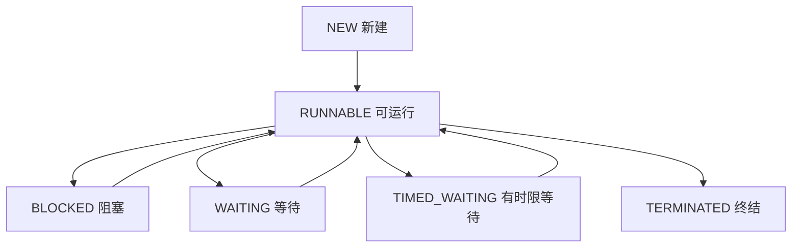

# Java 线程有哪几种状态：六种状态和它们之间的转换

面试题：线程有哪些状态？

这题是并发篇的入门题，也是分水岭。能把六种状态的名字报全，面试就算过了；真正出彩的答法，是把状态之间的转换条件讲清楚，再带上常见场景。这题还埋着一个暗坑：资料上既有「六种状态」的说法，也有「五种状态」的说法，被追问区别的时候不能懵。

## 先给结论

- Java 的线程状态定义在 `Thread.State` 里，一共六种：NEW（新建）、RUNNABLE（可运行）、BLOCKED（阻塞）、WAITING（等待）、TIMED_WAITING（有时限的等待）、TERMINATED（终结）。
- 只有 RUNNABLE 状态的线程能拿到 CPU 执行代码，其余五种状态都没有 CPU 执行资格。
- 核心转换就几条：`start()` 让 NEW 变成 RUNNABLE；代码执行完，RUNNABLE 变成 TERMINATED；抢锁失败，RUNNABLE 变成 BLOCKED；调用 `wait()`，RUNNABLE 变成 WAITING；调用 `sleep(long)` 或 `wait(long)`，RUNNABLE 变成 TIMED_WAITING。
- 「六种状态」说的是 Java 对线程的分类，「五种状态」是操作系统层面的分类，两套说法不矛盾，别混为一谈。

## 是什么

逐个说这六种状态代表什么。

**NEW，新建。** 用 `new Thread()` 创建出线程对象，还没调用 `start()` 之前，它就是新建状态。这个状态下线程只是个普通的 Java 对象，没有和操作系统底层的真正线程关联起来，操作系统不会分 CPU 给它执行代码。

**RUNNABLE，可运行。** 调用了线程的 `start()` 方法之后，线程由新建变成可运行，这时候它才和一个真正的操作系统线程关联上，里面的代码才会被交给 CPU 执行。一个线程只有处在可运行状态时，代码才跑得起来，其他状态的线程都拿不到 CPU 执行资格。

**TERMINATED，终结。** 可运行线程的代码全部执行完毕，就进入终结状态，意味着线程生命周期走到了尽头，底层关联的真正线程和相关资源都会释放掉。

**BLOCKED，阻塞。** 线程运行的时候可能多个线程争抢同一把锁，锁是互斥的，同一把锁只有一个线程能抢到，其他抢锁失败的线程，就会由可运行变成阻塞。阻塞状态的线程同样分不到 CPU，因为代码没法继续往下走。等持锁线程释放锁，这些阻塞的线程会被唤醒，参与下一轮抢锁：这一轮抢到锁的，恢复成可运行；还是抢不到的，继续待在阻塞状态。

**WAITING，等待。** 有一种情况是线程已经抢到锁了，但继续往下执行的条件还不满足，这时候可以调用锁对象的 `wait()` 方法，线程进入等待状态。`wait()` 会把手里这把锁放掉，让别的线程有机会去抢，等将来条件满足了，再由其他线程调用 `notify()` 把它唤醒。唤醒之后它还要重新抢一次锁，抢到了才恢复成可运行。

**TIMED_WAITING，有时限的等待。** 它和等待状态的区别就在调用的方法：调用的是带参数的 `wait(long)`，参数是要等待的毫秒数。这种线程醒来的条件有两种，一种是等待时间到了自己醒来，比如等一千毫秒，时间一到没人唤醒它也会醒；另一种是被其他线程调用 `notify()` 提前唤醒。醒来之后同样要重新抢锁，抢到才恢复可运行。另外 `sleep(long)` 也会让可运行线程进入这种状态，但 `sleep` 和锁、条件都没关系，纯粹是时间到了自己醒。

## 深入细节

有三个细节值得单独记住。

**第一，NEW 到 RUNNABLE、RUNNABLE 到 TERMINATED 都是单向转换。** 不可能由可运行退回到新建，也不可能由终结退回到可运行，线程生命周期整体是朝前走的。

**第二，右边这三种状态（阻塞、等待、有时限的等待）有个共同点：都拿不到 CPU 执行资格。** 它们要恢复成可运行，都必须满足各自的条件，这些恢复条件就是上面说的那些。

**第三，六种和五种的差别在哪。** 操作系统层面通常把线程分成新建、就绪、运行、阻塞、死亡五种；Java 把就绪和运行合并成了 RUNNABLE，把等待细分成了 WAITING 和 TIMED_WAITING，再把等待锁的阻塞单独列成 BLOCKED，就成了六种。所以以后看到「线程有五种状态」的说法，别急着否定，它说的是另一套分类体系。

## 面试怎么答

建议按这个顺序答：

1. **先报总数和分类**：Java 线程状态有六种，NEW、RUNNABLE、BLOCKED、WAITING、TIMED_WAITING、TERMINATED，定义在 `Thread.State` 里。
2. **再讲转换条件**：`start()` 进 RUNNABLE，代码执行完进 TERMINATED，抢锁失败进 BLOCKED，`wait()` 进 WAITING，`sleep(long)`、`wait(long)` 进 TIMED_WAITING，反过来各自的恢复条件也一并说清。
3. **补一句运行资格**：只有 RUNNABLE 能拿到 CPU，其他五种都不参与调度。
4. **有余力再展开**：主动提一句五种状态和六种状态的区别，显示自己知道两套分类的渊源。

常见追问：

- **问：BLOCKED 和 WAITING 有什么区别？**
  **答**：BLOCKED 是抢锁失败，在锁门外等着，手里没锁；WAITING 是已经抢到锁，但条件不满足，主动调 `wait()` 把锁放掉，等别人通知。一个没拿到锁，一个拿到了又放下了。
- **问：RUNNABLE 是不是就代表线程正在运行？**
  **答**：不一定。RUNNABLE 把操作系统的就绪和运行两个阶段合并了，线程可能正在 CPU 上执行，也可能在排队等 CPU，这两种都算 RUNNABLE。

## 常见误区

- **误区一**：把 RUNNABLE 理解成「正在运行」。它还包含就绪状态，调度不到 CPU 时照样是 RUNNABLE。
- **误区二**：以为 BLOCKED 是所有等待的统称。只有抢锁失败才是 BLOCKED，`wait` 和 `sleep` 是另外两种状态。
- **误区三**：认为 TIMED_WAITING 只能等超时。`wait(long)` 是可以被 `notify()` 提前唤醒的，只有 `sleep` 才纯粹靠超时。

## 课件配图
> 以下配图取自阶段七课件对应讲义，与上文讲解一一对应，可作为图文对照辅助理解。
**并发问题**（课件讲义图示）

**线程状态**（课件讲义图示）

