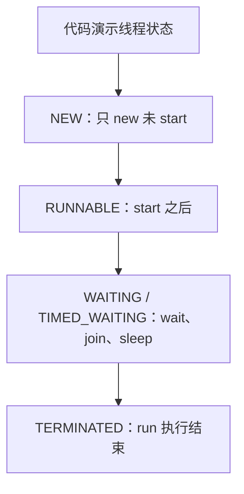

# Java 线程状态转换：用调试的方式亲眼验证

面试题：线程状态之间是怎么转换的？

状态转换的图背十遍，不如拿着代码调一遍。这篇用调试的方式，把三条主线逐个验证：NEW 到 RUNNABLE 再到 TERMINATED、RUNNABLE 和 BLOCKED 的互转、RUNNABLE 和 WAITING 的互转。重点回答一个高频困惑：线程被 notify 唤醒之后，为什么不是立刻回到 RUNNABLE。

## 先给结论

- 用 `Thread.getState()` 可以在任意时刻拿到线程状态，配合断点分线程调试，能精确控制观察时机，亲眼看到每一次状态跳转。
- 三条主线：`start()` 前后 NEW 变 RUNNABLE，代码执行完变 TERMINATED；抢锁失败 RUNNABLE 变 BLOCKED，拿到锁恢复；调用 `wait()` 后 RUNNABLE 变 WAITING，`notify()` 唤醒。
- 关键发现：notify 只负责把线程从等待中唤醒，唤醒后它还要重新抢锁；抢不到就进入 BLOCKED，只有抢到锁才回到 RUNNABLE。
- 主线程和子线程是并行执行的，想按固定顺序观察状态，靠的是断点的挂起策略选 Thread，再分线程放行。



## 深入细节：三个演示逐个看

演示代码在一个叫 TestThreadState 的文件里，分三个方法。调试有个前提设置要注意：断点的挂起策略要选 Thread，不要选默认的 All。选 All 一断就把所有线程全挂住，没法分线程控制执行次序，这个demo 就废了。

### 演示一：NEW、RUNNABLE、TERMINATED

```java
Thread t1 = new Thread(() -> {
    logger4.debug("running...");
}, "t1");
t1.start();
```

创建线程对象、启动，然后在各个阶段打印它的状态，用的就是 getState：

```java
logger6.debug("state: {}", t1.getState());
```

按注释里标的顺序放行断点：主线程停在自己的断点上，t1 线程也停在自己的断点上。先看启动前，状态是 NEW，此时 t1 还没和真正的操作系统线程关联。放行到 `start()` 之后再看，状态变成 RUNNABLE，说明这时候才真正关联上底层线程。接着切到 t1 线程放行，它打印完 running 之后没有更多代码，进入终结；回到主线程再打印，拿到的就是 TERMINATED。NEW 到 RUNNABLE、RUNNABLE 到 TERMINATED，两条转换都验证完了，而且都是单向的。

### 演示二：RUNNABLE 和 BLOCKED

```java
synchronized (LOCK) {
    // 等待锁
}
```

案例里有第二个线程 t2，它想抢一把锁，锁对象是前面定义好的共享变量；主线程也想拿这把锁。调试时刻意让主线程先进入同步块拿到锁，t2 后抢，必然失败。

跟着断点走：主线程停在同步块之前，t2 也停在自己的同步块之前。先放主线程，它进入 synchronized 块，锁到手；这时候打印 t2 的状态，还是 RUNNABLE，因为它还没进同步块，没触发抢锁失败。再切到 t2 放行，它开始执行 synchronized，但锁在主线程手里且没释放，它只能抢锁失败进入阻塞，表现就是打印了 before sync 却没有 in sync。这时回主线程打印 t2 状态，BLOCKED。继续放主线程退出同步块，锁释放，阻塞的 t2 被唤醒重新抢锁，这次没有竞争，它抢到了，状态从 BLOCKED 恢复成 RUNNABLE。

### 演示三：RUNNABLE 和 WAITING，以及 notify 的真相

t2 线程拿到锁之后，发现条件不满足，没法继续往下运行，于是调用锁对象的 wait，把锁放掉，让其他线程有机会拿锁：

```java
synchronized (LOCK) {
    LOCK.wait(); // 等待并释放锁
}
```

主线程负责在各个阶段打印 t2 的状态，并在合适的时机唤醒它：

```java
synchronized (LOCK) {
    LOCK.notify(); // 唤醒一个等待的线程
}
```

调试过程是这节课的精华。t2 先拿到锁，此时打印它的状态，是 RUNNABLE；放行 t2 执行 wait，它打印 before waiting，然后进入等待，状态变成 WAITING，同时锁被让出来，主线程得以进入自己的同步块。这时打印 t2 状态，确认是 WAITING。接着主线程调用 notify 唤醒 t2。问题来了：这时候 t2 是什么状态？直觉是 RUNNABLE，但实际打印出来是 BLOCKED。原因是主线程还持着锁，同步块还没执行完，t2 虽然被唤醒了，却抢不到锁，只能进入阻塞。等主线程退出同步块把锁释放，t2 才真正恢复，从 wait 之后的代码继续执行，状态回到 RUNNABLE。

这就是最值得记的一条结论：notify 之后线程不会立刻回到 RUNNABLE，中间很可能还要经历一次 BLOCKED，直到它重新抢到锁。TIMED_WAITING 和 sleep 的状态转换比较简单，有前面的基础，自己动手试一遍就能复现。

## 面试怎么答

被问状态转换，按这个顺序答：

1. **先给全景**：六种状态加各自的核心转换条件，用一张嘴画出状态图。
2. **再讲验证方法**：getState 随时可取状态，断点挂起策略选 Thread 可以分线程控制观察时机。
3. **重点讲 notify 的真相**：唤醒不等于可运行，唤醒后还要重新抢锁，抢不到先阻塞，这是最能体现理解深度的一点。
4. **有余力补 wait 和锁的关系**：wait 会释放锁，这也是它和 sleep 在状态表现上必须分开讲的原因。

常见追问：

- **问：notify 之后线程为什么不是立刻变回 RUNNABLE？**
  **答**：notify 只是把线程从等待集合里唤醒，让它重新参与抢锁。如果这时候锁还被别的线程持着，它抢锁失败，状态是 BLOCKED；只有抢到锁，才恢复 RUNNABLE。调试里能亲眼看到这个中间态。
- **问：BLOCKED 和 WAITING 都能恢复成 RUNNABLE，区别到底在哪？**
  **答**：恢复路径不同。BLOCKED 是从头到尾没拿到锁，等锁释放后去抢；WAITING 是拿到过锁、主动 wait 放掉，等 notify 唤醒后再去抢。两者恢复的前提都是重新获得锁。

## 常见误区

- **误区一**：认为 notify 之后线程马上可运行。中间还可能经历 BLOCKED，这是面试高频追问点。
- **误区二**：以为 wait 之后锁还在自己手里。wait 会释放锁，notify 也只是唤醒、不转让锁，要等持锁线程退出同步块。
- **误区三**：调试时用挂起所有线程的方式观察状态。那样所有线程一起停，分不清执行次序，必须用 Thread 级挂起加分线程放行。
