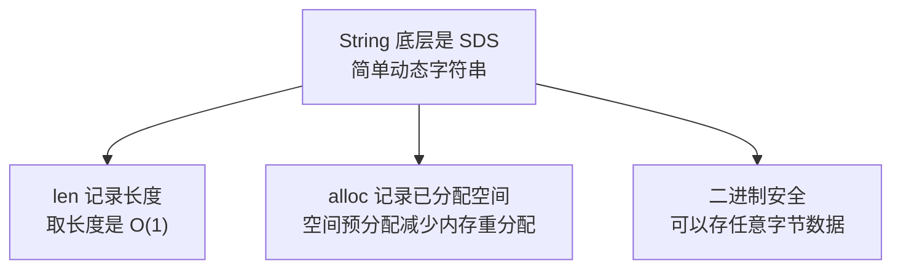

# Redis String 数据类型：三种编码和 SDS

面试题：Redis 的 string 类型底层是怎么实现的？

这题答「就是个字符串」就等于没答。完整的答案分两层：外层看内容选编码，整数场景用 int，非整数场景按长度分 embstr 和 raw；内层看表示，非整数场景统一走 SDS。而 SDS 的四个特点，才是这题的真正考点，大多数面经都只讲了一半。

## 先给结论

- string 的底层编码分三种：保存的全是整数时用 int；非整数时按长度分，长度不超过 39 字节用 embstr，超过 39 字节用 raw。
- int 编码名字叫 int，底层实际用 long 类型存储，最大能存 8 字节的整数，不是 4 字节。
- embstr 和 raw 底层都是 SDS（简单动态字符串），区别只在内存布局：embstr 把 redisObject 和 SDS 连在一起存，raw 是两块分开、用指针相连。
- SDS 有四个特点：单独存储长度、支持动态扩容、预留空间、二进制安全。前三个和 Java 的 StringBuilder 思路类似，二进制安全是它独有。

## 是什么：三种编码怎么选

**int 编码。** 字符串里保存的字符全部都是整数时，底层可以用 int 编码，存储时直接存成数字，不存字符。这样做有两个好处：一是数字占用的空间少一些；二是将来做数学运算方便，不用临时把字符串转成数字类型再算。这里有个细节要注意：编码名叫 int，看起来好像只占 4 个字节，但它底层用的是 long 类型，最大能到 8 字节，别被名字骗了。

**embstr 编码。** 保存的是非整数值，比如小数，或者包含其他非数字字符，就不能再用整数方式编码，必须用字符方式。字符方式的实现在 Redis 里叫 SDS。当字符串长度不超过 39 字节时，用 embstr 编码：Redis 会把 redisObject 结构体和 SDS 结构体当作一个整体连续存放，分配内存一次完成，将来释放也只需要一次，而且数据在内存里是连续的。

**raw 编码。** 长度超过 39 字节，改用 raw 编码：redisObject 和 SDS 分开存储，两块各自分配内存，用指针相连。代价是分配要分配两次，释放也要释放两次。数据量小就一次做完，数据量大就分两次做，区别就在这。

注意 embstr 和 raw 底层是一样的，都是 SDS，变的只是外层 redisObject 和 SDS 的组合方式。

## 深入细节：SDS 的四个特点

Redis 是 C 语言写的，C 语言里没有类、只有结构体，字符串本来可以直接用 C 原生的 char* 表示，但 char* 有不少毛病，SDS 就是对这些毛病的改进，相当于对原生 C 字符串的一个扩展。

**第一，单独存储长度。** char* 要知道长度，得一个字符一个字符去数，效率低；SDS 在每次增删字符时会重新计算长度，存到一个专门的字段里，取长度直接读字段，不用数。Java 的 StringBuilder 也有一个 length 成员记录长度，思路完全一样。

**第二，支持动态扩容。** 拼接、截取这些操作，SDS 都能方便支持，容量不够就扩容，在原有容量基础上翻倍。char* 要做这些就麻烦多了：空间不够得重新分配一个新变量，再把旧内容复制过去。

**第三，预留空间。** SDS 分配空间时会按字符数预留一部分空闲，减少内存分配和释放的次数：将来追加新字符，只要预留的空间还够，就不用再临时分配内存。分配规则是：字符串长度小于 1MB 时，每次分配实际长度的两倍；大于 1MB 时不翻倍了，每次在原有容量上加 1MB。StringBuilder 也是这个套路。

**第四，二进制安全。** 这是 SDS 独有的特点。char* 以一个特殊的反斜杠 0（\0）作为结束字符，如果存的视频、图片里恰好出现这个字节，char* 就认为字符串结束了，读取时会丢失内容，所以 char* 存不了二进制数据。SDS 不靠结束符，靠长度字段决定读多少，所以能安全保存图片、视频、音频这类二进制数据。

所以 Redis 的 string 类型几乎是万能的，存图片、存视频都行。但这不代表应该这么用：不建议在 Redis 里存过大的数据，一个键的值还是要相对小一些。

## 面试怎么答

按这个结构答：

1. **先分两层**：外层三种编码，int、embstr、raw；内层非整数统一是 SDS。
2. **编码选择条件说清楚**：全整数用 int（底层 long，8 字节），非整数 39 字节以内 embstr、以外 raw，区别是 redisObject 和 SDS 连续存还是分开存。
3. **SDS 四个特点展开**：单独存长度、动态扩容、预留空间、二进制安全，顺带和 StringBuilder 对比，点明前三个类似、二进制安全独有。
4. **补一句使用建议**：string 能存二进制，但键值不宜过大。

常见追问：

- **问：embstr 和 raw 会互相转换吗？**
  **答**：会。字符串长度是动态的，一旦发生修改导致长度跨过 39 字节这条线，比如在 embstr 的字符串后面追加内容超长了，就会转成 raw，因为 raw 才适合大尺寸下分开管理的布局。
- **问：int 编码会变吗？**
  **答**：也会。整数编码的前提是内容全是整数，一旦值被改成非整数形式，比如追加了字符，编码就跟着从 int 转成 embstr 或 raw。编码永远跟着当前的内容和长度走。

## 常见误区

- **误区一**：以为 int 编码只占 4 字节。名字叫 int，底层是 long，最大 8 字节。
- **误区二**：把 embstr 和 raw 当成两种不同的字符串结构。底层都是 SDS，区别是内存布局：一个连续存放，一个分开用指针连。
- **误区三**：以为 Redis string 存不了二进制数据。SDS 二进制安全，图片视频都能存，只是从工程习惯讲不建议存太大的值。
