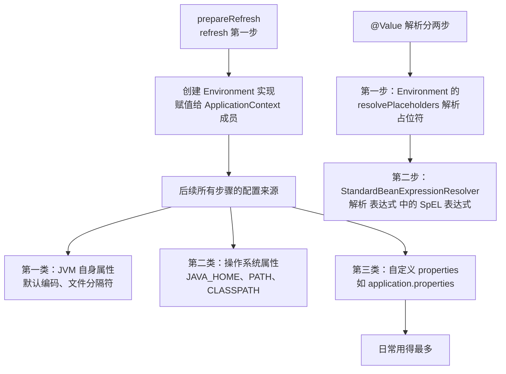

# refresh 第一步 prepareRefresh：Environment 和 @Value 解析

面试题：refresh 流程里 prepareRefresh 这一步做了什么？

十二步里第一步往往被一句「做准备工作」带过，但它其实是整个 refresh 的地基：这一步创建出 Environment 对象，而后面 @Value 注入的配置值，归根到底都从这个对象里来。围绕它最常见的追问是：@Value 里的 ${} 和 #{} 到底在哪解析、分几步。这篇把这两个问题一次说清。

## 先给结论

- prepareRefresh 的核心就一件事：创建一个 Environment 实现，赋值给 ApplicationContext 的成员变量，为后续所有步骤提供配置信息。
- Environment 管三类配置：JVM 自己的属性（默认编码、文件分隔符等）、操作系统提供的属性（JAVA_HOME、PATH、CLASSPATH）、自定义 properties 文件里的配置。
- 日常用得最多的是第三类，比如 SpringBoot 应用里的 application.properties。
- @Value 的解析分两步：先用 Environment 的 resolvePlaceholders 解析 ${} 占位符，再用 StandardBeanExpressionResolver 解析 #{} 里的 SpEL 表达式。



## 是什么：Environment 管什么

回到 refresh 的视角看：ApplicationContext 刚创建出来时，内部是空空如也的，成员变量都没赋值，没法正常工作。第一步 prepareRefresh 就是创建 Environment 这个对象的实现，并把它赋给 ApplicationContext 的一个成员变量。后续步骤都会用到它。

Environment 的作用说白了就是管理各种配置信息，程序其他地方要用配置，都从它这里取。它管理的配置分三类：

第一类是 JVM 的属性，由 JVM 提供，比如 Java 的默认编码、文件分隔符这些；第二类是操作系统的属性，比如 JAVA_HOME、PATH、CLASSPATH。这两类平时用得相对少；第三类用得最多：自定义的 properties 文件里的配置。大家最熟悉的就是 SpringBoot 应用里的 application.properties，文件里的配置项最终都会被读进 Environment 对象。

最能体现它价值的场景是 @Value 注入。注入时会写 ${键} 这种占位符，根据键取一个值，值从哪来？就从 Environment 来。

## 深入细节：@Value 的解析全过程

先看这个类上的三个 @Value 字段，覆盖了三种典型写法：

```java
@Value("hello")
private String name;
@Value("${JAVA_HOME}")
private String javaHome;
@Value("#{class version} + '${java.class.version}'")
private String expression;
```

要拿到 @Value 里的值，用的是 QualifierAnnotationAutowireCandidateResolver 这个类。它是 Spring 子类名的特点，超长，不用记，记住作用就行：拿到 @Value 里的值。调用它的 getSuggestedValue 方法，并且要用 DependencyDescriptor 告诉它取哪个位置上的 @Value，是哪个类的哪个成员变量，required 表示这个值是必须的还是可选的。

```java
public static void main(String[] args) throws NoSuchFieldException, IOException {
    // 1) 获取 @Value 注解
    System.out.println("==================================== 仅获取 @Value 值");
    QualifierAnnotationAutowireCandidateResolver resolver = new QualifierAnnotationAutowireCandidateResolver();
    Object name = resolver.getSuggestedValue(new DependencyDescriptor(Bean1.class.getDeclaredField("name"), required: false));
    System.out.println(name);
    // 2) 解析 @Value 的值
    System.out.println("==================================== 获取 @Value 值，并解析#{}");
    Object javaHome = resolver.getSuggestedValue(new DependencyDescriptor(Bean1.class.getDeclaredField("javaHome"), required: false));
    System.out.println(javaHome);
    // 3) 解析 SpEL 表达式
    System.out.println("==================================== 获取 @Value 值，并解析#{}");
    Object expression = resolver.getSuggestedValue(new DependencyDescriptor(Bean1.class.getDeclaredField("expression"), required: false));
    System.out.println(expression);
}
```

跑一下看输出：name 字段拿到的是 hello，普通字符串，不用解析；javaHome 字段拿到的是 ${JAVA_HOME} 的原文；expression 字段拿到的是 #{} 表达式的原文。注意，getSuggestedValue 拿到的仅仅是最原始的值，${} 和 #{} 还要继续解析，才是最终想要的结果。

**第一步，解析 ${}。** 先拿一个 Environment 对象，接口的标准实现是 StandardEnvironment，直接创建实例即可。调它的 resolvePlaceholders 方法，作用是把 ${} 里的内容当成一个键，去 Environment 里按这个键找值。把 ${JAVA_HOME} 传进去，解析出来的就是本机 JAVA_HOME 的路径。

如果换成自定义 properties 文件里的配置，直接解析会失败。因为 StandardEnvironment 默认只能查 JVM 的属性和系统的属性，它不知道你的自定义文件在哪，得显式告诉它：

```java
private static Environment getEnvironment() throws IOException {
    StandardEnvironment env = new StandardEnvironment();
    env.getPropertySources().addLast(new ResourcePropertySource("jdbc", new ClassPathResource("jdbc.properties")));
    return env;
}
```

用 addLast 加一个 ResourcePropertySource，它封装的就是 properties 这种配置文件。加上之后再运行，${jdbc.username} 就能解析成对应的值 root。实际开发里这步不用手工编程，都是用注解指定 properties 文件的位置。

**第二步，解析 #{}。** SpEL 表达式可以和 ${} 混在一起用，顺序是先解析 ${}，把解析的结果再交给外面的解析器处理 #{}，分两步走。演示里 #{class version} + '${java.class.version}' 这个表达式，先用 resolvePlaceholders 把 ${java.class.version} 解析掉：java.class.version 是系统属性，当前运行在 Java 16 上，值是 60.0（Java 15 对应 59，都是 class 文件的内部版本号）。再把得到的结果交给 StandardBeanExpressionResolver，调它的 evaluate 方法做 SpEL 求值，最终效果是把前后两段字符串拼成完整结果。

## 面试怎么答

按这个顺序答：

1. **第一步只干一件事**：prepareRefresh 创建 Environment，为后续步骤提供配置。
2. **Environment 管三类配置**：JVM 属性、系统属性、自定义 properties，重点说第三类。
3. **@Value 分两步解析**：先 resolvePlaceholders 解析 ${}，再交给 SpEL 解析器处理 #{}，顺序不能反。
4. **补一个细节**：getSuggestedValue 拿到的只是 @Value 里的原始字符串，不是最终值。

常见追问：

- **问：${} 和 #{} 有什么区别？**
  **答**：${} 是占位符，去 Environment 里按键取值；#{} 是 SpEL 表达式，能做表达式运算，比如拼接。两者可以嵌套，解析顺序是先 ${} 后 #{}。
- **问：new 一个 StandardEnvironment 能读到 application.properties 吗？**
  **答**：默认不能，它只带 JVM 和系统两个属性源。自定义文件要用 addLast 挂一个 ResourcePropertySource 告诉它位置，SpringBoot 里这步由自动配置代劳了。

## 常见误区

- **误区一**：以为 ${} 和 #{} 一起解析。分两步，先占位符后 SpEL，顺序反了结果就是错的。
- **误区二**：以为 new 个 StandardEnvironment 就能读自定义 properties。必须手动添加属性源，否则它只认 JVM 和系统配置。
- **误区三**：把 getSuggestedValue 的结果当最终值。那只是 @Value 里的原始字符串，占位符和表达式都还没动。
