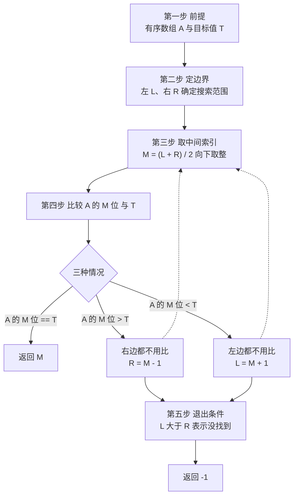

# 二分查找：五步思路与代码实现

面试题：请手写一个二分查找。

二分查找是面试场上的常客，代码本身不难，难的是每一步的边界都不出错。很多候选人一上来就默写，结果循环条件、边界更新、取整方式里藏着一个坑。这篇先把思路拆成五个步骤，再照着步骤一步步落成代码，最后留一个伏笔：这个实现还有一个细节没处理好，后面单独拿出来讲。

## 先给结论

- **前提**：数组必须已经排好序，这一步一般由题目保证，不用自己做。
- **五步**：定左右边界 L、R；循环里取中间索引 M；比较 A[M] 和目标值 T；三种情况分别处理；L 大于 R 还没找到就返回 -1。
- **时间复杂度**：O(log n)，每比较一次，搜索范围砍一半。
- 中间索引用 `(L + R) / 2` 计算，整数除法本身向下取整；这个公式还藏着一个整数溢出的坑，后面解决。



## 是什么：二分查找的五个步骤

把编写二分查找代码拆成五步。

**第一步，前提**：有一个已经排好序的数组 A。这一步不需要我们做，面试题都会假设数组已有序。数组里有一个目标值 T，就是要查找的元素，它一般在数组里，将来能找到。

**第二步，定左右边界**：左边界叫 L，右边界叫 R，它们用来确定搜索范围。在这个范围里循环执行二分查找。

**第三步，取中间索引**：左右边界有了，中间索引 M 的计算就是左右边界相加除以 2。有同学会问这里的取整是什么意思，这跟实现的语言相关。比如 Java 里 L、R 都是整数，整数除法的结果还是整数，不加取整效果也一样；但像 JavaScript 这种语言，数值除法得到的是小数，不取整就没办法当下标索引，所以要用向下取整，算出中间索引 M。

**第四步，比较**：通过中间索引拿到 A[M]，和待搜索的值 T 比较，分三种情况。如果二者相等，表示已经找到了，直接返回中间索引 M。如果中间值大于 T，说明中间值右侧的其他元素也都大于 T，无需比较，只要去左边找，把右边界设置为 M - 1，重新查找。如果中间值小于 T，说明中间值左侧的元素都小于 T，去右边找，把左边界设置为 M + 1，重新查找。

**第五步，退出循环**：什么时候结束？如果 L 已经大于 R 了，表示没有找到。左边界都超过右边界了，搜索区间已经空了，这时候退出循环，返回 -1。

## 为什么这样设计

二分查找每一步都把候选范围砍掉一半，靠的就是数组有序这个前提。中间值和目标一比大小，就能知道目标只可能在哪半边：中间值大了，目标在左半边；中间值小了，目标在右半边。每次排除一半，n 个元素最多比较 log n 次，这就是 O(log n) 的来源。顺序查找要挨个看，二分查找每步都在做排除，效率差出一个量级。

## 深入细节：照着步骤写代码

回到 IDE，把五步落地。

第二步先定边界：左边界 L 的初始值是 0，右边界 R 的初始值是数组长度减一，再定义一个变量 M 代表中间索引。

第三步和第四步要放在循环里，循环的条件是 `L <= R`，表示左边界还没有超过右边界，这时候就不断执行取中和比较。循环体里先算 `M = (L + R) / 2`，然后三种情况：`A[M] == T`，找到，返回 M；`A[M] > T`，右边的都不用比了，`R = M - 1`；否则 `L = M + 1`。

如果循环走完还没找到，L 已经大于 R，退出循环返回 -1，表示没有找到。

来验证一下。用数组 `{1, 5, 8, 11, 19, 22, 31, 35, 40, 45, 48, 49, 50}`，查找 48，返回的索引是 10，数一下 0 到 10 正好是 48，正确。再换一个数组里不存在的值 47，返回 -1，也符合预期。

落成的代码就是这样：

```java
// 二分查找：找到返回元素索引，找不到返回 -1
public static int binarySearch(int[] a, int t) {
    int l = 0, r = a.length - 1, m;
    while (l <= r) {
        m = (l + r) / 2;
        if (a[m] == t) {
            return m;
        } else if (a[m] > t) {
            r = m - 1;
        } else {
            l = m + 1;
        }
    }
    return -1;
}
```

这段代码出自课件 day01 的 binarysearch 包，可以直接编译运行。

这个代码非常简单，对照着步骤就能写出来。不过留一个问题：它在一个细节上处理得还不够好，我们接下来做一个改进。

## 面试怎么答

1. **先给前提和复杂度**：数组有序，O(log n)，一下把题目的边界条件说清楚。
2. **分步讲**：边界初始值 L=0、R=长度-1，循环条件 `L <= R`，中间索引取中，三种比较分支，`L > R` 返回 -1。
3. **点出易错点**：整数语言的除法自动向下取整，遇到只有小数的语言要显式取整，否则下标是小数。
4. **主动留钩子**：提一句 `(L + R)` 在边界很大时有整数溢出风险，标准写法是 `L + (R - L) / 2`，把话题引向自己准备好的深度话题。

## 常见误区

- **误区一**：边界更新写反。中间值大于 T 时该缩右边界 `R = M - 1`，写成了动左边界，范围永远缩不对。
- **误区二**：循环条件写成 `L < R`。L 等于 R 时区间里还有一个元素没排除，必须再比一次，写成小于会漏掉这种情况。
- **误区三**：没找到时中途返回。必须等 `L > R`、区间真正空了才返回 -1，提前返回会把还没找完的情况误判成不存在。
