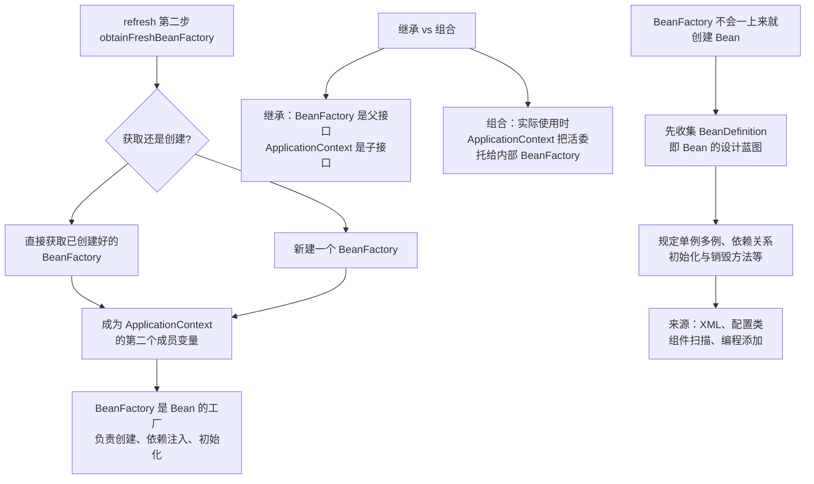

# Spring refresh 第二步：获取 BeanFactory

面试题：ApplicationContext 和 BeanFactory 是什么关系？

refresh 方法从第二步到第六步都在准备 BeanFactory，这一步是整条容器初始化主线的地基。这道题表面在问两个接口的关系，实际考的是你有没有分清「继承关系」和「组合关系」：BeanFactory 是父接口，ApplicationContext 是子接口，但真正干活的时候，ApplicationContext 是把活委托给自己内部组合的那个 BeanFactory。答清这一点，再展开 BeanDefinition 的来源，这题就稳了。

## 先给结论

- **BeanFactory 是 Bean 的工厂**，真正负责 Bean 的创建、依赖注入、初始化。
- **两者是组合关系**：ApplicationContext 里有一个 BeanFactory 类型的成员变量，创建 Bean、依赖注入、初始化这些功能是借助这个成员变量完成的。
- **继承关系上**，BeanFactory 是父接口，ApplicationContext 是子接口，扩展了更多功能，但实际使用上是组合。
- BeanFactory 不会一上来就创建 Bean，它先收集 **BeanDefinition**，也就是 Bean 的设计蓝图，规定单例多例、依赖关系、初始化和销毁方法等。
- BeanDefinition 的来源有多种多样：XML、配置类、组件扫描，也可以是编程添加。



## 是什么：refresh 第二步在做什么

第一步在 ApplicationContext 里面创建好了第一个成员变量 Environment，第二步要做的事情，就是拿到第二个成员变量 BeanFactory。

结合类图看这两个接口的关系：虽然继承关系上 BeanFactory 是父接口、ApplicationContext 是子接口，ApplicationContext 扩展了一些 BeanFactory 的功能，但在实际使用上，它俩是组合关系：ApplicationContext 里面有一个成员变量是 BeanFactory。

为什么要这样摆？因为 ApplicationContext 里有些功能它并没有自己去实现，比如创建 Bean、依赖注入、初始化，这些功能还是借助它里面这个 BeanFactory 成员变量来完成。这点要记住：**管理 Bean 的活，ApplicationContext 是外包给自己组合的 BeanFactory 干的。**

## 深入细节：BeanDefinition 与它的四种来源

BeanFactory 要创建 Bean，得先有 Bean 的定义。它并不是说一上来就去创建 Bean，必须先有一些 Bean 的定义，它得知道这个 Bean 长什么样子：是单例还是多例、初始化方法是什么、有哪些属性需要依赖注入。这些信息在 Spring 中都用 BeanDefinition 这个类来描述，BeanFactory 里的 BeanDefinition Map 就是用来存储所有 BeanDefinition 的。

BeanDefinition 的来源多种多样，下面用代码逐一演示。

新建一个 DefaultListableBeanFactory，刚创建出来时里面没有任何 BeanDefinition，是空的。通过 `getBeanDefinitionNames` 方法可以拿到所有 Bean 定义的名称，它是一个字符串数组，用 `Arrays.toString` 打印出来。

**第一种来源，XML。** 通过 XmlBeanDefinitionReader 来读取，它专门负责解析 XML 文件，从里面读到 BeanDefinition，并把它们加入到当前的 BeanFactory 里。关联的方式在构造方法上：创建 XmlBeanDefinitionReader 的时候，构造方法就告诉了这个 Reader，将来要填充哪个 BeanFactory。XML 文件 bd.xml 里定义了一个 bean1，它的 class 是测试类里的静态内部类，静态内部类引用时用 `$` 分隔。运行后，BeanFactory 里就多出来一个 bean1 的定义。

```java
public class TestBeanDefinition {
    public static void main(String[] args) {
        DefaultListableBeanFactory beanFactory = new DefaultListableBeanFactory();
        System.out.println("============== 1) 从 xml 获取 ===============");
        XmlBeanDefinitionReader reader1 = new XmlBeanDefinitionReader(beanFactory);
        reader1.loadBeanDefinitions(new ClassPathResource("bd.xml"));
        System.out.println(Arrays.toString(beanFactory.getBeanDefinitionNames()));
        System.out.println("============== 2) 从配置类获取 ===============");
        beanFactory.registerBeanDefinition("config1", BeanDefinitionBuilder.genericBeanDefinition(Config1.class).getBeanDefinition());
        ConfigurationClassPostProcessor postProcessor = new ConfigurationClassPostProcessor();
        postProcessor.postProcessBeanDefinitionRegistry(beanFactory);
        System.out.println(Arrays.toString(beanFactory.getBeanDefinitionNames()));
        System.out.println("============== 3) 扫描获取 ===============");
        ClassPathBeanDefinitionScanner scanner = new ClassPathBeanDefinitionScanner(beanFactory);
        scanner.scan("day04.refresh.sub");
        System.out.println(Arrays.toString(beanFactory.getBeanDefinitionNames()));
    }
}
```

对应的 XML 文件：

```xml
<?xml version="1.0" encoding="UTF-8"?>
<beans xmlns="http://www.springframework.org/schema/beans"
       xmlns:xsi="http://www.w3.org/2001/XMLSchema-instance"
       xsi:schemaLocation="http://www.springframework.org/schema/beans
       http://www.springframework.org/schema/beans/spring-beans.xsd">
    <bean id="bean1" class="day04.refresh.TestBeanDefinitionBean1"/>
</beans>
```

**第二种来源，配置类。** 提前准备好一个配置类 Config1，内部用 `@Bean` 注解标注了一个方法，这个方法会生成一个 Bean2。要把配置类里的 Bean 定义读取出来，分两步。

先用编程的方式往 BeanFactory 里添加配置类的信息，调用 `registerBeanDefinition` 方法，第一个参数是给配置类起个名字，第二个参数通过 Spring 提供的工具方法 `BeanDefinitionBuilder.genericBeanDefinition(Config1.class)` 创建一个 BeanDefinition 对象。`@Configuration` 注解加不加都能识别。

但配置类里用 `@Bean` 标注的方法，Spring 的标准功能并不能识别，不能自动把它当成一个 BeanDefinition，所以要用一个 BeanFactory 的后处理器来解析这些注解。以后见到的 `@Import`、`@ImportResource` 等等注解，也都要额外的代码来解析。负责解析 `@Bean` 注解的，就是 ConfigurationClassPostProcessor，它是个 BeanFactory 的后处理器，说白了就是对 BeanFactory 先做些功能增强，把一些注解标注的类也作为 BeanDefinition 添加进来。用法很简单：创建后处理器对象，调用它的 `postProcessBeanDefinitionRegistry` 方法，解析的结果同样填充到 BeanFactory 里。

运行后可以看到，BeanFactory 里多出了两个 BeanDefinition：一个是配置类本身，通过编程的方式加进来的；另一个是后处理器解析配置类识别出来的 bean2。

```java
@Configuration
static class Config1 {
    @Bean
    public Bean2 bean2() { return new Bean2(); }
}
```

**第三种来源，包扫描。** 通过 ClassPathBeanDefinitionScanner 扫描器，给它指定一个包名，它就会扫描这个包下标注了 `@Component` 注解的类，把这些类也作为 BeanDefinition 添加到 BeanFactory 里。用其他注解也行，比如 `@Service`、`@Repository`、`@Controller` 都可以。这里扫描 day04.refresh.sub 包，包里的 Bean3 用 `@Component` 标注了。扫描完打印，可以看到又多了一个 bean3。

有同学可能注意到，输出里后面还出现了一些名字比较长的 BeanDefinition，那些是 Spring 内部包扫描需要用到的类型，比如一些 Bean 的后处理器，暂时不用关注。

## 面试怎么答

1. **先答 BeanFactory 的职责**：负责 Bean 的创建、依赖注入和初始化，它是 Bean 的工厂。
2. **再答关系**：继承上 BeanFactory 是父接口、ApplicationContext 是子接口；实际使用上是组合关系，ApplicationContext 里持有 BeanFactory 成员变量，Bean 管理借助它完成。
3. **展开 BeanDefinition**：它是 Bean 的设计蓝图，规定单例多例、依赖关系、初始化和销毁方法等特征，来源有 XML、配置类、组件扫描、编程添加。
4. **加分项**：`@Bean`、`@Import` 这类注解标准功能不识别，要靠 ConfigurationClassPostProcessor 这类 BeanFactory 后处理器解析；包扫描还会带入一些 Spring 内部的后处理器定义。

## 常见误区

- **误区一**：以为 ApplicationContext 自己实现了全部 Bean 管理功能。实际创建、依赖注入、初始化都委托给内部组合的 BeanFactory。
- **误区二**：以为 BeanFactory 一上来就创建 Bean。它先收集 BeanDefinition，真正的 Bean 创建在后面的阶段。
- **误区三**：漏掉后处理器这一步。只注册配置类不跑 ConfigurationClassPostProcessor，`@Bean` 标注的方法不会被解析成 BeanDefinition。
