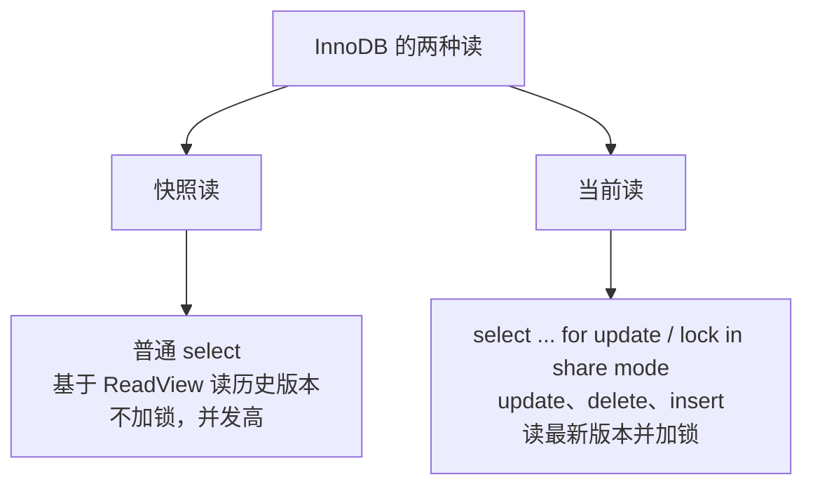

# 隔离级别：快照读与当前读

面试题：什么是快照读和当前读？

这是隔离级别话题的延伸高频题。能把这两个概念讲清楚，MVCC 和锁两条路线就分清了：快照读读的是过去，当前读读的是现在，增删改和带锁查询走的都是当前读。出彩的答法是按隔离级别分别说明 select 的行为，尤其是 RR 下快照建立的三种时机。

## 先给结论

- **当前读**：读取最新提交的数据。`select ... for update` 是当前读，insert、update、delete 这些增删改操作，执行前也要先做一次当前读，把最新提交的数据找出来，在此基础上再改。
- **快照读**：读取某一个快照建立时的数据，相当于对某个时间点的数据状态拍了张照片，后续查询读的都是快照建立时的状态。快照读主要体现在普通的 select 语句上。
- 隔离级别不同，select 的行为不一样：**Serializable 下普通 select 也是当前读**；RC 每次 select 都建立新的快照；RR 的快照建立分三种时机。

## 是什么：两个概念的定义

**当前读**比较简单，就是指查询的时候，要查询最新提交的数据。

哪些操作属于当前读？分几种情况。如果执行的是 select 后面跟了 `for update` 子句，那么这个 select 查询就是当前读，它查到的是最新提交的数据。实际上接下来的 insert、update、delete，也就是这些增删改操作，你可以认为执行它们之前也要做一次当前读，也就是它得把最新提交的数据先找到，然后在这个基础上再做增删改。所以增删改其实也会触发当前读。

**快照读**跟当前读就不一样了，它不是去查询最新提交的数据，而是查询某一个快照建立时的数据。

怎么理解这个快照？可以理解成：针对某一个时间点，我对这些数据拍了张照片，记录了它们当时的状态，后续的查询就查询快照建立时这些数据的状态。

快照读主要体现在 select 语句执行的时候，注意，是不带 `for update` 的单纯 select 语句。不过它的情况稍微复杂一些，因为在不同的隔离级别下，select 的行为有些不一样。

## 为什么这样设计

数据库的读操作要同时满足两个有点矛盾的需求：一方面，同一个事务里多次读，结果要稳定，不能前脚读完后脚就变；另一方面，写操作必须基于最新的数据，不然就会覆盖别人的修改。快照读负责第一个需求，把某个时间点的数据状态固定下来；当前读负责第二个需求，增删改之前先把最新提交的数据拿到手。隔离级别调节的，就是这两条路线的配比。

## 深入细节：不同隔离级别下 select 的行为

**Serializable 串行隔离级别**是个例外。普通 select 在这个级别下其实不是快照读，还是当前读。因为前面讲过，串行读的隔离级别下，它会把普通的 select 也加上共享读锁，因此它也是要读取最新提交的数据。这种情况下普通 select 也是当前读。

主要体现在快照读的，是下面两种隔离级别：**RC（提交读）**和 **RR（可重复读）**。这两种隔离级别下，select 读的数据才可以称得上是快照读。但它俩的区别在于建立快照的时机不太一样。

对于 RC，每次查询它其实都会建立新的快照。每次查询都建新快照，也就意味着每次查询时还是要按最新提交的数据去查，行为上其实还是类似于当前读，这正是 RC 会出现不可重复读的原因。

对于 RR，就更为复杂一些，快照的建立时机分成三种情况：

1. 事务启动以后，并不是一开始就建立快照，而是接下来的首次查询时会建立快照。
2. 如果事务启动的时候选择了一个选项，也就是 `start transaction` 的时候带上 `with consistent snapshot`，那么事务一启动，这个快照就建立了。
3. 如果在事务的运行过程中，基于旧的数据进行了一些修改操作，这个时候会导致快照重新建立。

光这样说可能不太好理解，接下来会通过例子把 RR 下这三种建立快照的时机逐一演示。

## 面试怎么答

1. **先分别定义**：当前读读最新提交的数据，快照读读某个快照建立时的数据，像给数据拍照片。
2. **列当前读的操作**：`select ... for update`，以及 insert、update、delete，增删改执行前都会先做一次当前读。
3. **按隔离级别说 select 行为**：Serializable 下普通 select 也加共享读锁，是当前读；RC 每次 select 都建新快照，接近当前读；RR 首次 select 建快照、`with consistent snapshot` 启动即建、基于旧数据的修改会触发重建。
4. **加分项**：指出 RC 每次建新快照正是不可重复读的来源，RR 靠快照固定实现可重复读，把两个概念和隔离级别的现象串起来。

## 常见误区

- **误区一**：以为普通 select 在所有隔离级别下都是快照读。Serializable 是例外，普通 select 会加共享读锁，变成当前读。
- **误区二**：以为 RR 下一启动事务就建快照。默认是事务启动后首次查询时才建立，除非启动时显式选了 `with consistent snapshot`。
- **误区三**：以为增删改也是快照读。增删改执行前要先做一次当前读，拿到最新提交的数据再改。
