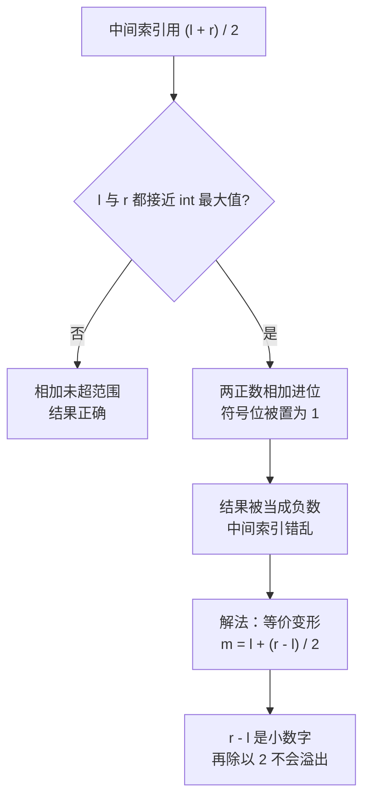

# 二分查找的整数溢出问题与第一种解法

面试题：手写二分查找有什么坑？怎么避免？

上一篇留了个伏笔：二分查找的实现在一个细节上处理得不够好。这个细节就是计算中间索引用的 `l + r`，两个边界都很大时，相加会超过 int 能存的最大值，造成整数溢出，中间索引算出来是个负数，整个查找直接错乱。能不能讲清这个坑并给出安全的公式，是手写二分题的分水岭。

## 先给结论

- 中间索引用 `(l + r) / 2`，当 l 和 r 都特别大时，相加可能超过 int 的最大值，造成整数溢出，算出来的中间值变成负数。
- 解法一：把公式等价变形为 `l + (r - l) / 2`。l 和 r 虽然大，但它俩一减就变成比较小的数字，再除以 2 自然不会超范围。
- 溢出在字节层面看，就是两个正数相加的进位把符号位改成了 1，结果从正数变成负数。



## 是什么：溢出现象长什么样

先演示一下现象。假设待查找的数组长度已经是 int 的最大值，也就是 Integer.MAX_VALUE，取值 20 亿多。这时候左边界 l 刚开始是 0，右边界 r 是长度减一，也就是 20 亿减一。

第一次计算其实还没有问题。虽然 r 已经非常大了，但 l 很小，是 0，两者相加再除以 2，并不会超过 int 的存储范围，第一次算出来的中间值大约是 10 亿多，没问题。

但如果我们查找的值在中间值的右侧，就要修改左边界，l 等于 m 加 1。m 已经是 10 亿多，再加 1 还是 10 亿多。这时候 l 是 10 亿多，r 是 20 亿左右，两个相加 int 存不下吗？存不下，因为 int 最大也就 20 亿多，再加个 10 亿，已经超过存储范围了，所以就会产生一个溢出。按现在的 l 和 r 再套用公式计算中间值，就会发现溢出导致它变成一个负数，这就是溢出的现象。

## 为什么这样设计

有同学对「两个正整数相加超过了范围变成负数」这个现象不太了解，用 byte 演示一下，不用 int 是因为那个数值太大了。

byte 的最大值是 127。先看 126 减 1 等于 126，用二进制表示是 1111110，符号位是 0，表示它是个正整数。再看 126 除以 2 是 63，63 用二进制表示是 111111，符号位也是 0。

现在考虑 63 加 126 会发生什么，用二进制加法加一下。二进制加法逢 2 进 1。从最低位开始：0 加 1 是 1；然后 1 加 1 得 0 进 1 位；接下来连续几位都是 1 加 1，进一位；到符号位那一位，1 加 1 进一位等于 0，但是注意它进出了一位，这个进位会把符号位改变成 1。结果就是，刚才两个正数相加变成了负的 67。

本来 126 加 63 应该是正数 189，但发生溢出现象，最终得到的是一个负的 67。这就是为什么溢出会导致问题：正数相加的进位冲掉了符号位，正数就变成了负数。int 溢出是同一个道理，只是位数更多。

## 深入细节：解法一的公式变形

怎么解决这个问题？这里介绍两种做法，先说第一种，采用一些数学上的等价变换。

原来的公式是 `(l + r) / 2`。问题出在 l 和 r 都特别大的时候相加会溢出。换个看法：

`(l + r) / 2` 其实就是 `l/2 + r/2`。

它又可以变换成 `l - l/2 + r/2`，把后面这两个组合在一起加上括号，就变成了 `l + (r - l) / 2`。这是小学生都能算出来的等价变换，一个公式没变，只是加了减一项。

那为什么这个公式就能解决溢出问题？注意，l 和 r 虽然很大，但是它俩一减，是不是就变成一个比较小的数字了，再除以 2，自然就不会超过 int 的最大值范围。

把这个公式套进去，第二次计算的中间值就不会溢出了。代入数值验证：l 是 10 亿多，r 是 20 亿左右，`l + (r - l) / 2` 算出来大约是 16 亿多，结果正确，整数溢出问题就解决了。

回到 IDE 验证这个变形。课件 day01 的 IntegerOverflow 类里就是这么写的：

```java
private static void method1() {
    int l = 0;
    int r = Integer.MAX_VALUE - 1;

    int m = l + (r - l) / 2;  // l/2 + r/2 ==> l + (-l/2 + r/2) ==> l + (r-l)/2
    System.out.println(m);

    // 在右侧
    l = m + 1;
    m = l + (r - l) / 2;
    System.out.println(m);

    System.out.println(126 + 63);
}
```

第一次取中输出 1073741823，把左边界推到 m + 1 之后再取中，输出 1610612735，是正确的 16 亿多，没有变成负数。

作为对照，把公式换回原来的写法，第二次取中立刻溢出：

```java
int l = 0;
int r = Integer.MAX_VALUE - 1;
int m = (l + r) / 2;   // 1073741823，第一次没问题
l = m + 1;             // 往右半边找，左边界变大
m = (l + r) / 2;       // -536870913，溢出成负数
System.out.println(m);
```

中间索引变成负数之后，数组访问要么越界抛异常，要么查错方向。byte 上的现象是同一个机制：

```java
byte b = (byte) (126 + 63);
System.out.println(b);   // -67
```

三段代码出自课件 day01 的 binarysearch 包，可以直接编译运行。

## 面试怎么答

1. **先主动指风险点**：中间索引用 `(l + r) / 2`，l 和 r 都很大时会溢出，算出的中间值是负数，查找直接错乱。
2. **给标准公式**：`m = l + (r - l) / 2`，说明它是 `(l + r) / 2` 的等价变形，r 减 l 把数值范围缩小了，不会溢出。
3. **讲清原理**：两个正数相加超出表示范围时，进位会冲掉符号位，结果从正数变负数；int 溢出和 byte 溢出是同一个机制。
4. **加分项**：补一句数组长度达到 int 量级时第一次取中安全、往右半查找后 l 变大才暴露，说明这个坑只在极端数据下现形，日常小数组测不出来。

## 常见误区

- **误区一**：变形时写成 `(r - l) / 2`，把 l 丢了。少了一个基准偏移，算出来的索引整体偏左，结果全错。
- **误区二**：以为只有 int 才会溢出。任何固定位数的整数类型都一样，byte 加 byte 也能溢出成负数。
- **误区三**：以为进循环前判断一次就行。l 在循环里会不断增大，每次取中都必须用安全公式，不是只防第一次。
