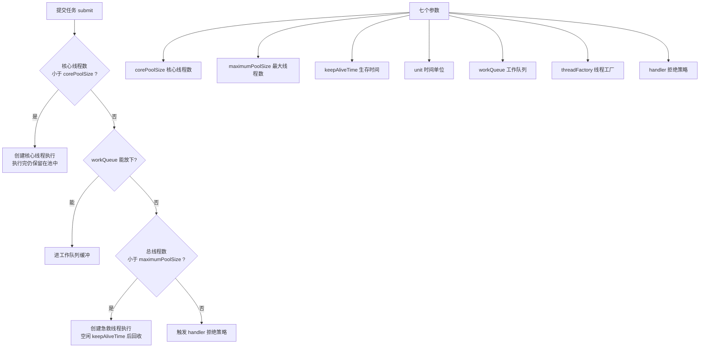

# 线程池核心参数：ThreadPoolExecutor 的七个参数

面试题：线程池的核心参数有哪些？

问线程池核心参数，考的是 Java 线程池的重要实现类 ThreadPoolExecutor，它参数最多的构造方法有七个参数，题目问的就是这七个参数的含义和作用。这题是后续线程池执行流程、拒绝策略题的地基。出彩的答法不是挨个报名字，而是按任务提交的流程把七个参数串起来。

## 先给结论

- 七个参数：**corePoolSize**（核心线程数）、**maximumPoolSize**（最大线程数）、**keepAliveTime**（生存时间）、**unit**（时间单位）、**workQueue**（工作队列）、**threadFactory**（线程工厂）、**handler**（拒绝策略）。
- 线程分两类：核心线程执行完任务后仍保留在线程池，急救线程执行完任务不保留。
- 提交流程：核心线程没满用核心线程，核心线程满了进 workQueue 缓冲，队列满了创建急救线程，急救线程到 maximumPoolSize 还满，走 handler 拒绝策略。
- corePoolSize 可以为 0，所有线程执行完任务都不保留，全部算急救线程。



## 是什么：线程池怎么工作

线程池本质上就是管理一组线程，用来执行提交给线程池的任务。提交任务调用线程池的 submit 方法，可以把一个实现了 Runnable 或者 Callable 接口的任务对象提交给线程池，线程池就可以创建出线程对象来执行任务。

创建的线程分成两类。

一类叫**核心线程**：线程执行完任务以后，仍然需要保留在线程池当中。

另一类叫**急救线程**：恰恰相反，线程执行完任务以后没啥用了，不需要保留在线程池中。

它俩的数目都可以控制。第一个参数 corePoolSize 控制核心线程的最大数；第二个参数 maximumPoolSize 叫最大线程数，控制核心线程加急救线程不能超过这个数。这里注意一点：核心线程数是可以为 0 的，也就是所有线程执行完任务都不保留，都属于急救线程，这也是可以的。

## 为什么这样设计

任务提交往往有突发性，线程池要在这两个矛盾之间找平衡：一上来就建满线程，闲时浪费资源；来一个任务建一个线程，突发流量下线程数失控。所以线程池分级处理：先用常驻的核心线程扛日常流量，突发流量先塞进队列缓冲，队列还扛不住才临时扩急救线程，扩容到顶还有任务来，只能拒绝。workQueue 的缓冲、急救线程的弹性、拒绝策略的兜底，都是围绕这个平衡设计的。

## 深入细节：七个参数逐个看

七个参数在代码里就是一次 ThreadPoolExecutor 的构造调用，课件 day02 的 TestThreadPoolExecutor 里是这样创建的：

```java
AtomicInteger c = new AtomicInteger(1);
ArrayBlockingQueue<Runnable> queue = new ArrayBlockingQueue<>(2);
ThreadPoolExecutor threadPool = new ThreadPoolExecutor(
        2,
        3,
        0,
        TimeUnit.MILLISECONDS,
        queue,
        r -> new Thread(r, "myThread" + c.getAndIncrement()),
        new ThreadPoolExecutor.DiscardOldestPolicy());
```

从上往下数正好七个：corePoolSize 为 2，maximumPoolSize 为 3，keepAliveTime 为 0，unit 是毫秒，workQueue 是容量为 2 的 ArrayBlockingQueue，threadFactory 把线程命名为 myThread 加一个递增数字，handler 用的是 DiscardOldestPolicy。这段代码出自课件 day02 并发篇，可以直接编译运行。

**corePoolSize 和 maximumPoolSize**。corePoolSize 控制核心线程的最大数，maximumPoolSize 控制核心线程加急救线程的总上限。比如 corePoolSize 是 3、maximumPoolSize 是 5，线程池最多可以有 5 个线程，3 个核心加 2 个急救。

**workQueue**，工作队列，对任务起到缓冲作用。比如有 3 个核心线程，都忙着自己的任务，这时候来了第四个任务，没有空闲的核心线程，注意，这时候暂时还不会去创建急救线程，而是把这个新任务添加到 workQueue 里先缓冲起来。以后核心线程把手头的活忙完了、空闲下来，就会从任务队列里获取刚才添加的那个任务来执行。任务队列一般要选有上限的，因为如果容量不加控制，很有可能造成内存紧张，所以一般要加一个上限。

**keepAliveTime 和 unit**。核心线程有上限，任务队列也有上限，如果所有核心线程都在忙、任务队列也放满了，这时候又来了一个新任务，急救线程就派上用场了：再添加的新任务会由急救线程来执行，创建新的急救线程。急救线程执行完这些任务以后不会保留在线程池中，它有一定的生存时间，这个生存时间由第三、第四个参数控制：第三个是生存时间的具体数字，第四个是具体的时间单位，比如秒、毫秒。如果在这个时间范围内没有任务可以执行，这个急救线程就会从线程池中去掉。

**threadFactory**，线程工厂。这个参数不太重要，它的作用是创建线程时，可以给线程对象起一个比较好的名字，仅此而已。

**handler**，拒绝策略。再想一种场景：核心线程耗尽了、任务队列放满了、急救线程也到 maximumPoolSize 上限了，这时候再来新任务怎么办？就用第七个参数拒绝策略，决定对这个新来的任务怎么处理：直接把它丢弃，还是抛异常，还是替换掉任务队列中现有的任务，或者由调用 submit 的线程自己来执行。这就是多种拒绝策略，一共四种：AbortPolicy 直接抛异常，DiscardPolicy 直接丢弃，DiscardOldestPolicy 替换掉队列里最老的任务，CallerRunsPolicy 由提交任务的线程自己执行。具体下一节用代码演示。

## 面试怎么答

1. **先报七个参数的名字和作用**：corePoolSize 核心线程数、maximumPoolSize 最大线程数、keepAliveTime 加 unit 控制急救线程存活时间、workQueue 工作队列、threadFactory 线程工厂、handler 拒绝策略。
2. **按提交流程串起来**：核心线程没满交给核心线程，满了进队列，队列满创建急救线程，到 maximumPoolSize 还满走拒绝策略。这样答不是背参数，是在讲线程池的行为逻辑。
3. **点两个细节**：corePoolSize 可以为 0；keepAliveTime 和 unit 是搭配使用的，只对急救线程生效。
4. **加分项**：补一句四种拒绝策略各自的行为，说明队列要有上限，无界队列会让急救线程和拒绝策略形同虚设。

## 常见误区

- **误区一**：以为任务来了先创建急救线程。顺序是先塞队列，核心线程满了、队列也满了，才轮到急救线程。
- **误区二**：以为 workQueue 可以无界。无界队列永远塞不满，急救线程和拒绝策略都不会触发，流量高峰时内存先扛不住。
- **误区三**：以为 keepAliveTime 单独生效。它必须配 unit 这个时间单位才有意义，秒还是毫秒取决于 unit。

## 课件配图
> 以下配图取自阶段七课件对应讲义，与上文讲解一一对应，可作为图文对照辅助理解。
**线程池**（课件讲义图示）

