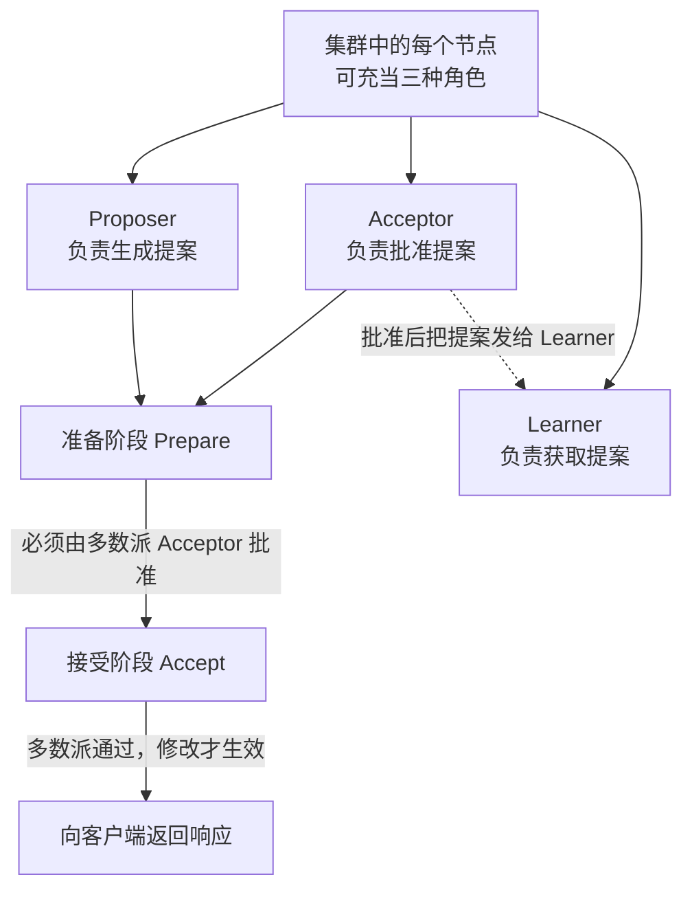

# Paxos 的角色划分与两个阶段

面试题：Paxos 算法中有哪些角色？执行一个修改要经过哪些阶段？

上一篇讲了 Paxos 要解决什么问题：多数派写成功之后，多个写操作之间的顺序性还没解决。这一篇进入算法本身，先把骨架立起来：三种角色、两个阶段。角色划分和阶段划分是 Paxos 所有细节的总纲，后面讲提案编号、活锁，都是往这个骨架上填肉。

## 先给结论

- Paxos 是一种**共识算法**，目的是解决强一致性问题，让集群中多个机器达成一致，共同决定把某个值改成什么新值。
- 节点分三种角色：**Proposer**（提案者，生成提案）、**Acceptor**（批准提案者）、**Learner**（获取并学习提案）。一致性写只涉及前两个角色。
- 执行一个修改操作分两个阶段：**准备阶段**，Proposer 发起提案，必须由多数派 Acceptor 批准通过；**接受阶段**，Proposer 把具体修改操作广播给 Acceptor，多数派执行成功，修改才生效，才能响应客户端。
- Paxos 允许多个 Proposer 同时提案，可能引起活锁问题；Acceptor 应当有多个，只有一个会存在单点问题。

## 是什么：共识算法与三种角色

共识的意思就是字面意思：达成一致。让集群中多个机器达成一致，大家都决定了要把某个值修改成一个什么新的值，达成共识。Paxos 的目的就是解决前面提到的强一致性问题，注意它是一个强一致性的算法。

Paxos 把集群中的每个节点划分成三种角色。

**Proposer**，提案者，负责生成提案。我想执行一个修改操作，由 Proposer 发起一个提案，说我接收到客户端一个修改请求了，我想把某个变量改成一个新的值。

**Acceptor**，批准提案者，负责批准提案。具体这个值能不能修改，Proposer 说了不算，它只是发起说有这么一个修改请求，最终由 Acceptor 说了算，它可以对这个提案进行批准。

**Learner**，负责获取并学习提案。Acceptor 批准提案后，会把提案发送给所有 Learner。Learner 跟一致性读有关系，这里只关心一致性写，所以暂不展开。

## 为什么这样设计

为什么要分成两个角色、两个阶段？因为「想改」和「同意改」必须分开。如果 Proposer 自己说了就算，那任何一个节点都可以单方面宣布新值，集群立刻分裂。把批准权交给多个 Acceptor，并且要求多数派同意，写入操作就必须争取集群中过半节点的认可，这是强一致的基础。而准备和接受分两阶段，是为了先把「改什么」这件事敲定，再统一执行修改，避免大家各改各的。

## 深入细节：两个阶段的具体流程

执行一个修改操作，不是一上来就能把这个值更新成最新的，必须经历两个阶段。

**准备阶段。** 由 Proposer 发起一个提案，说接收到客户端的修改请求，想把某个变量改成新的值。它接下来要去问这些 Acceptor 行不行。因为值能不能改，Proposer 说了不算，Acceptor 说了算。在这个准备阶段，必须由多数派的 Acceptor 批准通过，才能执行后续的操作。也就是说，Acceptor 在整个集群里面超过半数了，大家都觉得这个修改能做，才能做；如果没有超过半数，这个修改相当于就不会做。

**接受阶段。** 准备阶段完成，假设提案被通过了，就进入接受阶段。这个阶段再由 Proposer 把要执行的那个具体的修改操作进行广播，这回大家就可以执行这个修改了。如果这回仍然是多数派都修改成功了，这个修改才会生效，才会告诉客户端，响应这个修改完成了。

除了两阶段，还有两个注意点。

**注意一：Paxos 允许多个 Proposer 同时提案。** 后面还会介绍其他的一致性算法，在那些算法里，是不允许有多个角色同时去做修改的。Paxos 算法里相当于允许有多个 Proposer 同时提案，当然这会引起一个叫活锁的问题，后面细讲。

**注意二：Acceptor 显然应该有多个。** 因为如果只有一个 Acceptor，那是会存在单点问题的。

## 面试怎么答

1. **先定性**：Paxos 是共识算法，目的是解决强一致性问题，让集群多个节点对修改达成一致。
2. **报三种角色**：Proposer 生成提案，Acceptor 批准提案，Learner 获取学习提案；并说明一致性写只涉及 Proposer 和 Acceptor。
3. **讲两个阶段**：准备阶段 Proposer 提案、多数派 Acceptor 批准才能继续；接受阶段 Proposer 广播修改、多数派执行成功修改才生效，才响应客户端。
4. **加分项**：提 Paxos 允许多个 Proposer 同时提案、可能引起活锁；Acceptor 要多个避免单点。这两点是容易漏的细节。

## 常见误区

- **误区一**：以为 Paxos 只有一个 Proposer。Paxos 允许多个 Proposer 同时提案，代价是可能活锁，很多改进算法就是冲着这个来的。
- **误区二**：以为 Learner 参与写共识。Learner 与一致性读相关，批准后的提案会发给所有 Learner，写的生效不经过它。
- **误区三**：把两阶段记混顺序。必须先准备、后接受：准备阶段定「改什么」，接受阶段才真正执行修改。
