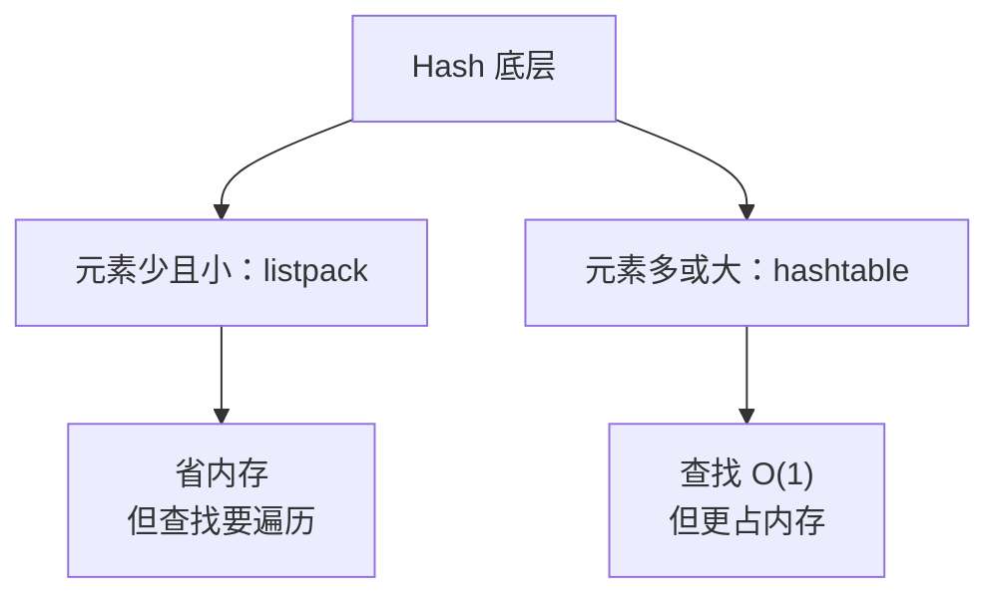

# Redis 数据类型：Hash

面试题：说一下 Redis 的 Hash 数据类型，它的底层是怎么实现的？

这道题很多人答到「Hash 就是 field-value 的映射，用哈希表存的」就结束了。这样只能算及格。真正出彩的答法，是把两条线索讲清楚：一是编码，Hash 有两种编码，小数据用 ziplist，大数据转 hashtable，转换条件是多少；二是 hashtable 编码内部的机制，哈希函数用的什么、冲突怎么解决、rehash 什么时候触发、怎么做到不阻塞主线程。这篇按这个层次过一遍。

## 先给结论

- Hash 底层有两种编码：数据量小时用 ziplist（压缩列表），数据量大时转成 hashtable（哈希表）编码。
- 转换条件有两个，满足其一就转：单个 field 或 value 长度超过默认的 64 字节，或者键值对个数超过 512。
- hashtable 编码的哈希函数按 Redis 版本而不同，以 Redis 5.0 为例用的是 SipHash；哈希冲突用拉链法解决。
- rehash 有四个时机：元素数小于桶个数不扩容；超过 5 倍桶个数一定扩容；1 到 5 倍之间且没有 AOF 或 RDB 操作时才扩容；元素数小于桶个数的十分之一时缩容。
- rehash 是渐进式的，每次只迁移一个桶，不会一次性把所有桶从 ht[0] 迁到 ht[1]；再配合 active rehash，在 server 主循环里每 100 毫秒留出 1 秒主动迁移，避免长时间阻塞其他命令。

## 是什么

Hash 是一种 field-value 形式的数据结构，一个 key 下可以挂多个 field，每个 field 对应一个 value。它和 Java 里的 HashMap 用法很像，但底层编码是 Redis 根据数据量动态选择的。

数据量小的时候，Hash 采用 ziplist 作为编码。可能有同学会问：ziplist 是个压缩列表，本质是一块连续内存里的 entry 序列，它怎么存键值对？其实不复杂。上一节讲 List 时说过，ziplist 的底层可以存放一到多个 entry。Hash 的做法就是：把一个键值对看成两个连续的 entry，先存一个 key 的 entry，再存一个 value 的 entry。这样用 ziplist 照样能表示多个键值信息。

数据量大起来之后，ziplist 这种连续内存就不合适了，这时会转成 hashtable 这种哈希表的编码，增删改查都回到 O(1) 的效率。

## 为什么这样设计

小数据量选 ziplist，是因为它是一整块连续内存，没有指针开销，内存利用率高，读写缓存也友好；而数据量一旦大起来，ziplist 插入和查找都要逐个 entry 遍历，成本越来越高。hashtable 的增删改查平均 O(1)，正好接棒。两种编码各管一段，是 Redis 在内存和效率之间的常规取舍。

## 深入细节

### ziplist 什么时候转 hashtable

有两个条件，只要满足其中之一，编码就会从 ziplist 转换成 hashtable：

1. 单个 field 或者 value 的长度过大，超过默认值 64 字节；
2. 键值对的个数过多，超过 512 个。

### hashtable 编码的哈希函数与冲突

hashtable 编码下，哈希函数根据 Redis 版本不一样，用的算法也不一样。以 Redis 5.0 为例，它的哈希函数用的算法叫 SipHash。

面试接着会问：哈希表出现哈希冲突怎么解决？解决办法大家都知道有多种，Java 里通常采用拉链法，比如 Java 的 HashMap、HashTable 都是用拉链法解决冲突的。Redis 也不例外，发生哈希冲突时同样采用拉链法来解决。

### rehash 的触发时机

Redis 里 rehash 的时机和 Java 里有比较大的区别，这里是面试的重点。Java 里是元素个数超过了桶个数（数组容量）的四分之三，就触发扩容。Redis 不一样，分四种情况：

1. 元素个数小于桶个数时，不扩容。
2. 元素个数超过 5 倍桶个数时，一定扩容。超过 5 倍意味着平均每个桶里链表的长度已经在 5 以上了，再不扩容性能就比较低。
3. 元素数在 1 倍到 5 倍桶个数之间时，要看与此同时有没有 AOF 或者 RDB 的操作：如果没有，就开始进行 rehash；如果正好有 AOF 或 RDB 操作，就暂时不进行 rehash。
4. 元素个数小于桶个数的十分之一时，会缩容。Redis 认为元素个数太少，还占这么大的数组有点浪费。

第四点又是和 Java 完全不同的地方：Java 里的 rehash 只有扩容没有缩容，不断变大不会缩小，而 Redis 里是可以缩容的。

### rehash 的执行要点

Redis 中表示哈希表的结构叫字典（dict），每个字典里实际是有两个哈希表，也就是两个数组。桶的个数是 2 的 n 次方，这跟 Java 里一样，都是为了计算桶下标时更加高效。

平时用的是 ht[0]，ht[1] 刚开始是空的，扩容的时候才会用到 ht[1]。扩容时新的数组有多大？是元素个数乘以 2。但请注意这里做了简写：元素个数乘以 2 以后，还会找到一个与它最接近的 2 的 n 次幂的值，因为要满足桶个数必须是 2 的 n 次方这个约束。

第二个要点请务必记住：Redis 中的 rehash 是一种渐进式的哈希。它不是一次性的把所有桶从 ht[0] 迁移到 ht[1]，而是每次只迁移一个桶。什么时候迁这一个桶？你对这张哈希表做增删改查的时候，每做一次增删改查，迁移一个桶。为什么这样设计？就是为了不要让 rehash 影响其他命令的正常性能。如果 rehash 占用时间比较长，就会造成其他命令明显的阻塞，因为 Redis 执行命令毕竟是单线程的，一个命令时间长了，其他命令全都得等。

渐进式 rehash 是被动式的：默认情况下，只有后续又对这张哈希表做了增删改查，才会发生迁移。为了对被动式做个补充，Redis 也做主动式的 rehash：在 server 的主循环里，默认每隔 100 毫秒，会留出 1 秒钟进行主动的迁移，不再依赖有没有增删改查。所以抛开主动 rehash，只依赖被动的话，只有对同一张哈希表做增删改查时才会迁，每次只迁一个桶；而有了主动 rehash，这 1 秒钟里就有可能迁移多个桶。

rehash 过程中，如果有新增操作，新增的数据直接放到 ht[1] 这个新哈希表里。因为要保证新加的记录能够被找到，旧的里面不用加新的键值对了，只加到 ht[1] 里就可以。如果是查询、删除、修改操作，采用的策略是：先到旧的 ht[0] 里面找，如果没有，那有可能这个桶已经被迁到 ht[1] 里了，那就再到 ht[1] 里做相同的删除、查询或修改操作。

最后一点：Redis 中所有的增删改查都是单线程的，所以 rehash 肯定也是线程安全的，这是常识。但一定要注意，它为了防止 rehash 占用时间过长，用的是渐进式 rehash，不是一次迁移所有的桶，这点面试时一定要说出来。

## 面试怎么答

建议按这个顺序组织答案：

1. **先讲编码**：Hash 有 ziplist 和 hashtable 两种编码，小数据用 ziplist，键值对看成两个连续 entry 存放。
2. **再讲转换条件**：field 或 value 超过 64 字节、键值对超过 512 个，满足其一就转 hashtable。
3. **然后讲 hashtable 细节**：Redis 5.0 用 SipHash，冲突用拉链法。
4. **重点讲 rehash**：四个时机（小于桶个数不扩、超 5 倍一定扩、1 到 5 倍看 AOF/RDB、小于十分之一缩容）；渐进式每次迁一个桶；主动 rehash 每 100 毫秒留 1 秒；新增进 ht[1]，查删改先 ht[0] 后 ht[1]；单线程所以线程安全。

常见追问：

- **问**：Redis 的 rehash 和 Java HashMap 的扩容有什么区别？
  **答**：三点区别。触发线不同，Java 是超过桶个数四分之三，Redis 是超过 5 倍桶个数；Redis 支持缩容（小于桶个数十分之一），Java 只扩不缩；Redis 是渐进式 rehash，每次只迁一个桶，靠增删改查和主循环定时任务分摊迁移成本，Java 是一次性全量迁移。
- **问**：为什么 Redis 要用渐进式 rehash？
  **答**：Redis 的命令执行是单线程的，如果一次性把所有桶迁完，耗时会长，期间其他命令全部阻塞。渐进式把迁移成本摊到每次增删改查和主循环的空闲时间里，避免明显阻塞。
- **问**：rehash 期间数据在哪个表里，怎么保证都能找到？
  **答**：迁移期间两张表各有一部分数据，新增只进 ht[1]，查删改先查 ht[0] 再查 ht[1]，所以新旧数据都不会漏。

## 常见误区

- **误区一**：以为 ziplist 存不了键值对。ziplist 靠「一个键值对等于两个连续 entry」的方式存储，先 key 的 entry 再 value 的 entry，完全可以表示多个键值信息。
- **误区二**：把 rehash 时机和 Java 记混。Java 是四分之三触发且只扩不缩，Redis 是 5 倍才一定扩、1 到 5 倍之间看有没有 AOF/RDB、十分之一还会缩容。
- **误区三**：以为 rehash 会阻塞主线程很久。Redis 用渐进式加主动迁移，就是为了避免这个问题。
