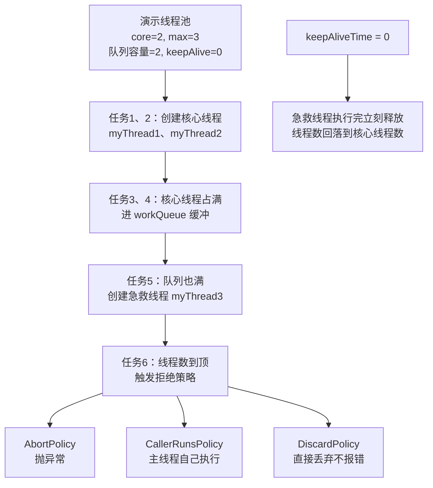

# 线程池核心参数演示

面试题：线程池的核心参数有哪些，分别起什么作用？

上一节把七个参数过了一遍，这一节用一段代码把它们跑起来，看每个参数在任务提交过程中实际发生了什么。参数背得再熟，不如亲手看一眼线程数和队列数的变化曲线。

## 先给结论

- 演示的线程池：核心线程数 2，最大线程数 3，keepAliveTime 为 0，队列是容量为 2 的 ArrayBlockingQueue，线程工厂负责给线程命名，拒绝策略用 AbortPolicy。
- 任务提交流程：先创建核心线程，核心线程占满后进队列，队列满后才创建非核心线程，非核心线程也满才触发拒绝策略。
- keepAliveTime 为 0 意味着非核心线程执行完任务后立刻从线程池移除，线程数回落到核心线程数。
- 拒绝策略演示了三种：AbortPolicy 抛异常，CallerRunsPolicy 由调用者（主线程）自己执行，DiscardPolicy 直接丢弃不报错。



## 是什么

演示用的线程池对象参数是这么设置的：核心线程数最多两个，最大线程数是三个，这其实就决定了非核心线程数最多一个。keepAliveTime 设为 0，意味着当非核心线程没有更多任务时，只会生存 0 秒，也就是没任务了它就立刻从线程池里被释放掉，不会保留在线程池中。工作队列的容量设置为了 2，将来这个队列里最多缓冲两个任务。线程工厂用来控制线程的创建过程，这里主要控制线程的名字：线程名字都是 myThread 打头，后面跟一个用计数器生成的数字，从一开始递增，所以线程分别叫 myThread1、myThread2、myThread3。最后是拒绝策略，用到时再讲。

```java
ThreadPoolExecutor threadPool = new ThreadPoolExecutor(
    corePoolSize: 2,
    maximumPoolSize: 3,
    keepAliveTime: 0,
    TimeUnit.MILLISECONDS,
    queue,
    r -> new Thread(r, name: "myThread" + c.getAndIncrement()),
    new ThreadPoolExecutor.AbortPolicy()
);
```

为了看清内部状态，专门写了一个工具方法显示线程池状态，因为有些内部结构得用反射打印出来才好理解。showState 会显示线程池中有几个线程、队列中有几个任务。

```java
private static void showState(ArrayBlockingQueue<Runnable> queue, ThreadPoolExecutor threadPool) {
    System.out.printf("[%s] - pool size: %d, queue: %s\n",
        Thread.currentThread().getName(),
        threadPool.getPoolSize(),
        queue);
}
```

任务用一个自定义的 MyTask 类表示，实现了 Runnable 接口。它有个名字和执行时间，执行时间不给就是 0，任务会立刻执行完；给了的话，就以这个执行时间为准，会执行一个 sleep 操作，模拟一个需要长时间运行的任务状态。

```java
static class MyTask implements Runnable {
    private final String name;
    private final long duration;

    public MyTask(String name, long duration) {
        this.name = name;
        this.duration = duration;
    }

    @Override
    public void run() {
        try {
            LoggerUtils.get("myThread").debug("running..." + this);
            Thread.sleep(duration);
        } catch (InterruptedException e) {
            e.printStackTrace();
        }
    }
}
```

## 深入细节：跟着任务提交看参数怎么起作用

演示提交的任务名字是任务一到任务六，执行时间给得很长，模拟长时间运行。每提交一下任务，就打印一下状态，观察线程数和队列的变化。

**初始状态**：线程池中零个线程，队列中也没有任务。

**提交任务一**：创建了一个新的线程叫 myThread1 来执行这个任务。这时候线程池有一个线程，队列还是空的。

**提交任务二**：又创建一个新的线程叫 myThread2，运行任务二。这时候线程池中的线程数目变成了二，队列仍然是空的。前面两个任务创建出来的线程属于核心线程，因为没有超过核心线程的数目。

**提交任务三、任务四**：核心线程都忙着呢，它们要执行一小时才能执行完，已经没有空闲的核心线程了。所以任务三、任务四来了之后，并没有新的线程被创建出来，任务三被放入了队列，任务四又放在了队列的尾部。这个队列是先进先出的，总是往队列的尾部放入，从队列的头部取出。

**提交任务五**：核心线程都在忙，队列也放满了，这时候它会创建一个非核心线程，因为非核心线程的个数还可以再创建一个。可以看到多出了一个新的 myThread3，这就是新创建出来的非核心线程，它会先执行刚刚提交的任务五。把任务五执行完了以后，它发现队列里还有两个没有执行的任务，于是这个非核心线程继续从队列的头部取出任务三运行，再取出任务四运行。等所有的任务都运行完了，它发现没有更多的任务，就从线程池中被移除掉。移除以后，线程池中的线程数量仍然是 2，因为这个数量只反映了 myThread1 和 myThread2，myThread3 被移除掉了。

对比实验：让任务五的执行时间也长一些，这回任务五提交过来以后，创建了新的非核心线程 myThread3 来执行任务，但由于任务执行的时间比较长，所以它没有立刻执行完，这个时候队列里的任务三和任务四就还仍然继续排队等待。这时整个线程池的容量变成了 3，这 3 里就包括了刚才的非核心线程。两种对比正好说明 keepAliveTime 为 0 的语义：非核心线程闲下来就立刻走。

**提交任务六**：核心线程也用完了，非核心线程也忙着，队列也放满了，这时候再来提交任务六，就要触发拒绝策略。

### 三种拒绝策略

**AbortPolicy**：这是默认的策略，线程池对象中默认使用的就是它。遇到所有线程池资源都耗尽的情况，它会抛异常，表示新任务不能被执行。

**CallerRunsPolicy**：线程池已经忙不过来了，执行不了，就请调用者自己去运行这个任务。调用者是谁？谁做的提交操作谁就是调用者。当前调用 submit 方法的是主线程，所以如果是 CallerRunsPolicy，任务六就由主线程来执行。可以看到任务六确实被运行了，由主线程运行的，而线程池的其他状态并不变，还是三个线程、队列里两个任务。

**DiscardPolicy**：线程池资源已经耗尽，忙不过来了，这个新任务就直接丢弃掉。它不会报任何异常，也不会报告任何错误，只是把任务丢弃不运行。观察任务六有没有出现，没有，它就被丢弃掉了。

## 面试怎么答

按「参数 + 流程 + 策略」三段答：

1. **核心参数**：核心线程数、最大线程数、keepAliveTime、工作队列、线程工厂、拒绝策略，逐个说作用。
2. **提交流程**：核心线程 → 队列 → 非核心线程 → 拒绝策略，四步的顺序和触发条件必须说对。
3. **演示收尾**：用演示数据佐证，比如核心 2 最大 3 队列容量 2，前两个任务各占一个核心线程，任务三四入队，任务五触发非核心线程，任务六触发拒绝策略。

常见追问：

- **问**：keepAliveTime 设为 0 会发生什么？
  **答**：非核心线程一旦没有任务可做就立刻被回收，不会在线程池里保留，演示里任务五执行完后 myThread3 马上被移除，线程数回落到 2。
- **问**：CallerRunsPolicy 有什么适用场景？
  **答**：它让调用者自己执行被拒绝的任务，起到天然的限流和背压作用：提交线程被拖慢，生产端的速度就被压下来了，适合不能丢任务又不希望疯狂扩容的场景。
- **问**：AbortPolicy 和 DiscardPolicy 的区别？
  **答**：AbortPolicy 直接抛 RejectedExecutionException，让问题暴露；DiscardPolicy 静默丢弃，不报错，适合允许丢任务的场景。默认是 AbortPolicy。

## 常见误区

- **误区一**：以为任务多了就立刻加线程到最大线程数。正确顺序是先占核心线程，再进队列，队列满了才创建非核心线程。
- **误区二**：以为非核心线程会一直留着。keepAliveTime 为 0 时，非核心线程干完活立刻被移除。
- **误区三**：把拒绝策略的触发条件记错。是核心线程满、队列满、非核心线程也满，三者同时满足才触发拒绝策略。
