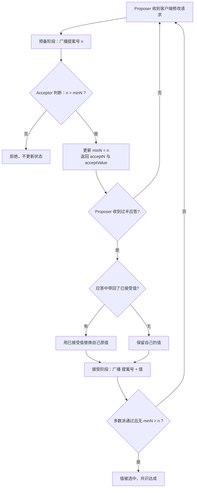

# Paxos 算法描述

面试题：描述一下 Basic Paxos 算法的流程。

Paxos 是分布式一致性算法的基石，面试考它，考的不是让你推导论文，而是能不能把两大阶段、四个节点、三个状态变量的协作讲清楚。前面已经讲了 Paxos 的角色划分和阶段，这一节对照流程图，把 Basic Paxos 的完整流程理一遍，为后面的实例分析打底。

## 先给结论

- Basic Paxos 分两大阶段：预备阶段（Prepare）和接受阶段（Accept），流程图中对应前两个节点和后两个节点。
- 预备阶段 Proposer 只发送提案号；接受阶段才发送提案号和要修改的值。
- Acceptor 维护三个变量：最小提案号（minN）、已接受提案号（acceptN）、已接受值（acceptValue）。
- Proposer 收到过半响应才认为修改可以执行；如果响应中带回已接受值，要用已接受值替换自己的值，这是保证一致性的关键。
- 提案号唯一且全局递增，更大的提案号有更高的优先级。
- 预备阶段的目的是拦截旧的提案，并找到最新的已接受值。

## 是什么

Basic Paxos 是最基本的 Paxos 算法，分成两大阶段。第一个叫预备阶段，英文对应 Prepare；第二个叫接受阶段，英文对应 Accept。对照流程图看：前两个节点属于预备阶段，后两个节点属于接受阶段。

Proposer 什么时候发起提案？当它接收到客户端的一个修改请求，要把某个变量更新成一个新的值时，就向集群中其他的 Acceptor 发起提案。

## 深入细节

### 预备阶段：只发提案号

第一次发起的提案非常简单，只包括一个提案号。这个提案号只要保证唯一，并且是递增的就可以。比如第一次提案提案号是 1，下一次提案就递增成 2。

提案发给 Acceptor 以后，Acceptor 会做这么一个判断：它记录一个叫最小提案号（minN）的值，然后看你新发过来的提案号是不是大于最小提案号，如果是的话，它就把最小提案号更新成这个 n 的值。看代码就明白，所谓最小提案号，记录的就是最新的提案号。

Acceptor 里除了最小提案号，还会保存两个值：一个叫 acceptN（已接受提案号），一个叫 acceptValue（已接受值）。但一开始这两个值是没有的，要到后面的接受阶段才会有。

如果 Acceptor 正确接收了这个提案，它就会返回一个响应，说「我批准了，你可以修改」。返回响应的时候，如果这时候有已接受提案号和已接受值，它会把这两个信息也随着响应返回；如果没有，那就直接返回。

响应返回给 Proposer 以后，Proposer 会检查：收到的响应是不是达到过半了，包括 Proposer 自己加起来的 Acceptor 响应是不是已经过半。如果过半，它就认为这个修改是可以执行的，因为多数派通过了。

这里有一个算法上的逻辑：如果 Proposer 收到了 acceptN、acceptValue，也就是已接受的提案号和已接受的值，那它就会用这里面最大的 acceptValue 来替换掉自己的 value。什么意思？比如 Proposer 一开始要修改的值是 5，但是 Acceptor 返回响应时，acceptValue 已经有值了，比如是 10，那这个 10 比 5 优先级要高，Proposer 就得保留 10 这个值，用 10 替换掉 5。因为 acceptValue 是已经到了接受阶段、已经被认可的值，比准备阶段的值优先级高。当然，如果 Acceptor 返回响应时并没有已接受值，那就还使用原来的 value 不变。例子中假设这两个值还没有，所以 Proposer 的值 5 不会被其他值替换掉。

至此，准备阶段完成，Proposer 认为这件修改的事可以做，于是把具体的修改的值，还有刚才的提案号，重新发送给集群中其他的机器。注意第一次发送时只发送了提案号，并没有发送具体的值，第二个阶段才会发送提案号加上值。

### 接受阶段：提案号加值一起发

Proposer 把值和提案号发送给 Acceptor 以后，Acceptor 的逻辑是这样的：它再次检查，看提案号是不是大于等于最小提案号。如果是大于等于，它就做下面的操作：把最小提案号和已接受提案号都更新成当前的 n，然后把已接受值更新成发过来的 value。并且这些信息都会被持久化保存，最小提案号、已接受提案号、已接受值都会持久化。持久化完了，相当于它就把这个修改操作做了。

做完以后，它把自己当前接到的最小提案号返回给 Proposer。同样，Proposer 这边如果收到的应答过半，并且这个最小提案号不大于 n，也就是说理想情况下 n 和 m 没有发生任何冲突的时候，两者是一样的，那这个条件就不成立，Proposer 就选中这个值。如果返回的最小提案号比当前的 n 还要大，那说明这次修改其实并没有达到最终的目的，也就是应答不应该过半。这些冲突情况后面会用具体例子分析，这里先把整个流程理一遍。

### 要点总结

**Proposer 侧的要点**：

- 预备阶段的目的是拦截掉旧的提案，然后找到新的已接受值。
- 预备阶段只发送提案号，接收阶段发送提案号和值。
- 提案号是唯一的、全局递增的，大的提案号就会有更高的优先级，因为只要有更新的提案号，大于等于的，都会把旧的覆盖掉。
- 如果 Proposer 在准备阶段见到了更新的已接受的值，它就会把当前的 value 替换掉。这个替换很重要，是保证一致性的关键。

**Acceptor 侧的要点**，重点就是三个变量：最小提案号、已接受提案号、已接受值。

- 最小提案号在准备阶段有可能被更新，在接受阶段也有可能被更新。
- 已接受提案号和已接受值都是在接受阶段有可能会被更新，条件满足了就会更新。
- 最后，最小提案号会被交给 Proposer 用来判断是不是能选中这个提案号，这是很重要的一个要点。

## 面试怎么答

按「两阶段四节点」的骨架答：

1. **先给全景**：Basic Paxos 分预备阶段和接受阶段，对应流程图的前两个节点和后两个节点。
2. **讲预备阶段**：Proposer 收到修改请求后只发提案号；Acceptor 比较并更新 minN，返回批准，若有已接受值一并带回；Proposer 收齐过半响应才继续，收到已接受值就用它替换自己的值。
3. **讲接受阶段**：Proposer 发提案号加值；Acceptor 校验 n >= minN 后更新 minN、acceptN、acceptValue 并持久化，返回 minN；Proposer 收齐过半且返回的 minN 不大于 n，提案被选中。
4. **点题两个设计动机**：提案号全局唯一递增保证优先级；用已接受值替换自己的值保证一致性。

常见追问：

- **问**：为什么预备阶段只发提案号，不发值？
  **答**：先用提案号探明各 Acceptor 的状态、拦截旧提案，并顺带发现是否已有被接受的值。如果此时就发值，在还不知道有没有已接受值的情况下，可能选出一个和已接受值冲突的值，破坏一致性。
- **问**：acceptValue 替换自己的 value，是为了什么？
  **答**：为了保证一致性。如果某个值已经在之前的接受阶段被多数派认可，后来的 Proposer 必须沿用这个值，否则同一个变量可能出现两个不同的被接受值。
- **问**：minN、acceptN、acceptValue 分别在什么阶段更新？
  **答**：minN 在准备阶段和接受阶段都可能更新；acceptN 和 acceptValue 只在接受阶段、条件满足时更新。minN 还会返回给 Proposer，用来判断提案是否被选中。

## 常见误区

- **误区一**：把两个阶段的消息内容记混。预备阶段只发提案号，接受阶段才发提案号加值。
- **误区二**：以为 Proposer 用自己的值直接进入接受阶段。如果响应里带回已接受值，必须用已接受值替换自己的值。
- **误区三**：以为收到过半响应就一定能选中。还要看 Acceptor 返回的最小提案号是否不大于自己的提案号，大于则说明提案已被更新的提案号压制，选中失败。

## 课件配图
> 以下配图取自阶段七课件对应讲义，与上文讲解一一对应，可作为图文对照辅助理解。
**Paxos 算法**（课件讲义图示）

**讲义配图**（课件讲义图示）

