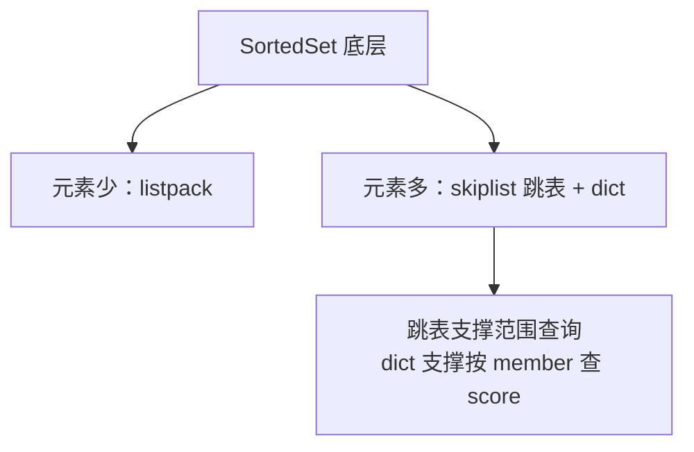

# Redis 数据类型：Sorted Set

面试题：说一下 Sorted Set 的底层实现。

Sorted Set（有序集合）是 Redis 里结构最讲究的数据类型：既要按分数排序，又要增删改查快。面试答这题，只说出「跳表」三个字不够，得讲清楚两种编码的分工、为什么大工程量下要 skiplist 加 hashtable 双结构并存，以及跳表每个部件的作用。这篇按这个层次展开。

## 先给结论

- Sorted Set 有两种编码：数量较小时用 ziplist，数量大时转成 skiplist 加 hashtable 的组合编码。
- ziplist 版的特殊之处：因为 Sorted Set 要保证有序，entry 插入时要按 score 排序。
- 转换条件：键或值长度超过 64 字节，或者元素个数超过 128，转成 skiplist 加 hashtable。
- 为什么两种结构同时用：只用 hashtable，增删改查是 O(1) 但无序，范围操作要先排序；只用 skiplist，有序和范围操作的优点能保留，但增删改查是 O(log n)。两者都用，各取所长。
- 两种结构里的元素只占一份，skiplist 和 hashtable 都用指针引用同一批元素，不会占双倍内存。
- 跳表是多层链表，用来加速查询；每个节点有 score、member、backward 指针和多层 forward，每层 forward 配 span 跨度用来算排名。

## 是什么

Sorted Set 和 Set 一样存储成员，但每个成员关联一个分数（score），整个集合按分数有序。它的底层编码同样随数据量变化：数量较小的时候采用 ziplist 作为编码；数量比较大的时候，转换成其他编码。

ziplist 版和普通 ziplist 还有一点点区别：因为 Sorted Set 需要保证有序，所以它要把 ziplist 里那些 entry 加入的时候，按照 score 进行排序。

当键或值长度过大，超过了 64 个字节，或者元素个数过多，超过了 128 个的时候，它就会转换成 skiplist 加 hashtable 的编码。这里要特别注意：它用了 skiplist 加 hashtable，也就是这两种数据结构同时工作、同时被采用。

## 为什么这样设计：为什么两种结构一起用

如果只用 hashtable，虽然这时候增删改查的效率是最高的，平均时间复杂度可以达到 O(1)，但是 Sorted Set 经常要做一些有序的操作，包括范围的操作，而 hashtable 中的数据是无序的，做有序操作就需要排序，一排序就会带来额外的时间空间复杂度，反而得不偿失。

反过来，只用 skiplist 行不行？skiplist 可以解决有序操作的问题，它保证元素排列是有序的，做一些范围操作也非常方便，这些优点都可以保留下来。但是 skiplist 的增删改查的效率不是最优的，时间复杂度是 O(log n)。虽然还可以，但是没有 hashtable 的增删改查效率好。

所以 Redis 索性两种数据结构都用上，同时采用两种结构。当然，这两种结构的元素还是只会占一份，因为 skiplist 中引用的元素和 hashtable 中的元素都是用指针去引用过去的，元素不会占双倍，这个可以放心。

## 深入细节：skiplist 的要点

skiplist 对照结构图来掌握，主要看这几部分。

**整体结构**：skiplist 下面这些是它的节点，每个节点存一条成员数据。skiplist 有一个头节点指向它的第一个节点，有一个尾节点指向它的最后一个节点。头节点里并不存储数据，从第二个节点开始真正存储数据。

**节点的数据组成**：每个节点有如下属性。一个是 score，就是 Sorted Set 要存的那个分数，排序靠它。一个是 member，就是具体要存储的、跟这个分数相关联的数据值。还有一个 backward，是反向指针。

图中上方标着 1、2、3、4 的这些，叫 level，也就是层。

skiplist 这个结构里还记录了最大层数（level）和元素个数（length）。length 是元素个数，不包括第一个节点，第一个节点实际上没有存数据，后面那些节点才存数据。

### 排序规则

整个 skiplist 中数据的存储是有序的，按 score 分数排好序。比如示例数据里 score 依次是 3、7、11、19、22、26、37，从小到大排好。

有没有可能两个 score 相同？有可能。比如示例中张三和赵六的 score 都是 11。score 相同的，排序规则就是再按它的 member 数据排。总之会先按 score 排，score 相同的再按 member 数据排。所以 skiplist 是有序的，将来可以方便地做范围查询或者排序操作。

### backward 反向指针

backward 这个反向指针，主要就是为了倒序遍历用。比如要从尾向头遍历，可以先通过 skiplist 找到它的尾节点，然后根据 backward 指针的指向找到它的上一个节点，再通过 backward 找到上一个节点，这样就实现了反向遍历。

### level 层与 forward、span

level 的层数可能不一样，有一层的、两层的、三层的，还有四层的，最大的层数会被记录到最外层的数据结构里，也就是结构里的 level 代表存储的最大层数。

level 内部存了两个属性。一个叫 forward，是前向指针，通过前向指针可以实现正序遍历。另一个叫 span，span 记录了两个节点之间的间隙，更好的翻译是跨度。相邻的两个节点，跨度是 1；如果两个节点中间多了其他节点，跨度就相应增加，比如中间多一个节点跨度就是 2，中间多两个节点跨度就是 3。

span 的用途是计算节点的排名。比如李四的跨度是 1，那它的排名就是 1，第一名。王五的排名呢？它把前面所有的跨度累加起来，两个 1 加起来，排名就是 2。再比如郑一，把沿途所有跨度累加，排名是 6。又如孙二，从第三层这个跨度开始看，这个跨度是 5，前面的跨度是 2，5 加 2 等于 7，所以它的排名是 7。所以 span 就是用来计算排名的，可以走第一层把跨度加起来算，也可以走第二层，都行。

### 为什么要分多层

这是跳表最关键的一点：它是一个多层链表，多层链表的作用就是为了加速查询。为什么多层链表能够加速查询，下节课用一个查询例子专门来讲。

## 面试怎么答

分三层组织答案：

1. **编码**：小数据 ziplist（entry 按 score 排序插入），超过 64 字节或 128 个元素转 skiplist 加 hashtable。
2. **双结构的理由**：hashtable 管 O(1) 增删改查，skiplist 管有序和范围操作，两者指针共享同一批元素，不占双倍内存。
3. **跳表要点**：多层链表加速查询；按 score 排序、score 相同按 member；backward 反向指针管倒序；forward 前向指针管正序；span 跨度累加算排名；头节点不存数据，length 不含头节点。

常见追问：

- **问**：为什么 Sorted Set 不只用 hashtable？
  **答**：hashtable 增删改查 O(1) 但无序，Sorted Set 的范围、排序操作需要有序结构，只靠 hashtable 每次现排，额外开销大。
- **问**：为什么两种结构的元素不占双倍内存？
  **答**：skiplist 和 hashtable 中的元素都是用指针引用过去的，指向同一批对象，所以只占一份。
- **问**：span 是干什么的？
  **答**：记录两个节点之间跨过的节点数，查询排名时把沿途 span 累加即可，不必逐个点数。

## 常见误区

- **误区一**：只记住「跳表」，不知道还有 ziplist 编码。小数据量下 Sorted Set 用的是 ziplist，而且 entry 按 score 排序。
- **误区二**：不知道转换阈值。键或值超过 64 字节、元素超过 128 个，才转 skiplist 加 hashtable。
- **误区三**：以为 skiplist 和 hashtable 各存一份元素。两者用指针共享元素，不会占双倍内存。
