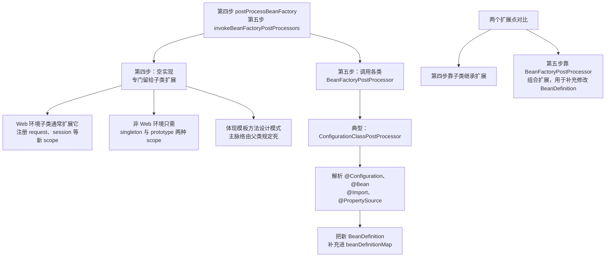

# Spring refresh 源码解析：扩展 BeanFactory

面试题：refresh 流程里第四步和第五步做了什么，它们和扩展 BeanFactory 有什么关系？

prepareBeanFactory 之后，refresh 还有两个和扩展 BeanFactory 直接相关的步骤：第四步 postProcessBeanFactory 是空实现，留给子类扩展；第五步 invokeBeanFactoryPostProcessors 则调用各类 BeanFactoryPostProcessor，是 Spring 最核心的扩展机制之一。这两步一个走继承，一个走组合，对比着记才记得牢。

## 先给结论

- 第四步 postProcessBeanFactory 是空实现，方法体什么都不做，专门留给子类扩展。
- Web 环境的 ApplicationContext 子类通常要扩展这个方法，注册新的 scope，完善 Web 下的 BeanFactory。非 Web 环境只需要 singleton 和 prototype 两种 scope，Web 环境下可能还需要 request、session 这样的 scope。
- 第四步体现的是模板方法设计模式：refresh 的主脉络由父类规定死，可以扩展的方法留空，调用位置固定在父类里，功能由子类去填。
- 第五步 invokeBeanFactoryPostProcessors 调用已注册的 BeanFactoryPostProcessor，是另一种扩展 BeanFactory 的方式。
- 常见的 BeanFactoryPostProcessor 有 ConfigurationClassPostProcessor，负责解析 @Configuration、@Bean、@Import、@PropertySource 这些注解，把解析出的新 BeanDefinition 补充进 beanDefinitionMap。
- 所以 BeanFactory 有两个扩展点：第四步的由子类扩展，第五步的由 BeanFactoryPostProcessor 扩展，后者主要用来补充和修改一些 BeanDefinition。



## 是什么：第四步，空实现留给子类

第四步比较简单，因为这一步内部是一个空的实现。可以看到 refresh 调用的第四个方法 postProcessBeanFactory 是一个空实现。

这个空实现主要就是留给子类来进行扩展的。因为 ApplicationContext 将来可能会有不同的子类，比如有一大类是非 Web 环境下的子类，另外一类是 Web 环境下的子类。Web 环境下的子类初始化 BeanFactory 时，就需要更多的一些信息，比如说它要注册一些新的 scope：非 Web 环境下只需要 singleton 跟 prototype 这两种 scope，但 Web 环境下可能还需要 request、session 这样的 scope。所以这个方法干脆就没有实现，留给子类扩展。

这在设计模式上体现的是一种叫模板方法的设计模式：refresh 方法主要的脉络都由父类规定死了，但有些可以扩展的方法它留空了，将来由子类去扩展；调用位置还是固定在父类里的这个位置，因为它们都是在这个 BeanFactory 的准备阶段来完成的。位置固定了，但是功能留给子类来扩展。

一般 Web 环境的 ApplicationContext 需要扩展这个方法，用它注册新的 scope，完善 Web 下的 BeanFactory。

这个方法的 Javadoc 也说明了它的定位：

```java
/**
 * Modify the application context's internal bean factory after its standard initialization.
 * All bean definitions will have been loaded, but no beans will have been instantiated yet.
 * This allows for registering special BeanPostProcessors etc in certain ApplicationContext implementations.
 *
 * @param beanFactory - the bean factory used by the application context
 * @since 3.0
 */
protected void postProcessBeanFactory(ConfigurableListableBeanFactory beanFactory) {
    // 空实现
}
```

注意注释里强调的时序：所有 bean definition 都已加载，但还没有 bean 被实例化。这正是第四步和第五步能改 BeanDefinition 的原因，此时动手还来得及。

## 深入细节：第五步，用后处理器扩展

第四步是说把一些功能留给子类扩展。但是实际上你将来真正工作的时候，不可能说为了扩展一点功能，就实现一个新的 ApplicationContext 子类。所以更好的一种扩展方式，就是通过后处理器的方式来扩展 BeanFactory 的功能。Spring 里专门有一类后处理器，叫 BeanFactoryPostProcessor，它就是对 BeanFactory 的功能做一些扩展。

比如说有这么一个后处理器，叫 ConfigurationClassPostProcessor，它就可以去解析 @Configuration 注解、@Bean 注解、@Import 注解，还有 @PropertySource 这些注解。这些注解的解析在正常的 BeanFactory 中是没有的，正常的 BeanFactory 没有这些功能。但是在这一步，如果调用了 ConfigurationClassPostProcessor 这个 BeanFactory 后处理器，那么就相当于由这个后处理器完成后续这些注解的解析。当然解析的目的就是为了多加一些 BeanDefinition：比如说把配置类里标注的 bean 解析了，它就会多出一些新的 BeanDefinition，补充到当前的这个 beanDefinitionMap 里来。

还有一个比较重要的后处理器，叫 PropertySourcePlaceholderConfigurer。它可以替换 BeanDefinition 中的 ${}，也就是提前对 BeanDefinition 中的 ${} 做一个解析。当然它借助的功能就是我们以前提到的 Environment 来完成。这个现在已经用得很少了，因为这是在以前 XML 那种 ApplicationContext 时代里用得比较多。

所以大家记着，BeanFactory 有两种扩展点，两个扩展点：第一个就是第四步提到的，由子类来进行扩展；第二个就是第五步，由 BeanFactoryPostProcessor 来充当 BeanFactory 的扩展点，主要用来补充和修改一些 BeanDefinition。刚才举的例子中，它实际上是补充了一些 BeanDefinition。

在 refresh 方法中，第四步和第五步以及后续步骤的调用顺序是这样的：

```java
// 在 refresh() 方法中
synchronized (this.startupShutdownMonitor) {
    // ... 其他初始化步骤 ...
    try {
        // 允许子类对 BeanFactory 进行后处理
        postProcessBeanFactory(beanFactory);

        // 启动一个步骤，用于标记 bean 的后处理阶段
        StartupStep beanPostProcess = this.applicationStartup.start(name: "spring.context.beans.post-process");

        // 调用所有已注册的 BeanFactoryPostProcessor
        invokeBeanFactoryPostProcessors(beanFactory);

        // 注册拦截 bean 创建的后处理器
        registerBeanPostProcessors(beanFactory);

        // 结束后处理步骤
        beanPostProcess.end();

        // 初始化消息源
        initMessageSource();

        // 初始化事件多播器
        initApplicationEventMulticaster();

        // 初始化其他特定子类的 bean
        onRefresh();

        // 检查并注册监听器 bean
        registerListeners();

        // ... 后续步骤 ...
    }
}
```

## 面试怎么答

分两个步骤答，再点一下设计模式：

1. **第四步**：postProcessBeanFactory 是空实现，留给子类扩展；Web 环境的子类用它注册 request、session 等新 scope；体现模板方法模式，主脉络父类定、扩展点位置固定、功能子类填。
2. **第五步**：invokeBeanFactoryPostProcessors 调用 BeanFactoryPostProcessor，以 ConfigurationClassPostProcessor 为代表，解析 @Configuration、@Bean、@Import、@PropertySource，把新 BeanDefinition 补进 beanDefinitionMap；PropertySourcePlaceholderConfigurer 处理 ${}，XML 时代用得多。
3. **总结**：BeanFactory 有两个扩展点，子类扩展和 BeanFactoryPostProcessor 扩展，后者不用改 Spring 源码也不用继承，是更常用的方式。

常见追问：

- **问**：为什么第四步要做成空实现，而不是直接把 Web 的逻辑写进去？
  **答**：Spring 的核心包不能依赖 Web 相关的内容，把 Web  scope 的注册留给 Web 子类，是保持核心包纯净的标准做法，这就是模板方法模式。
- **问**：BeanFactoryPostProcessor 和 BeanPostProcessor 有什么区别？
  **答**：BeanFactoryPostProcessor 作用在 BeanFactory 上，改的是 BeanDefinition，发生在 bean 实例化之前；BeanPostProcessor 作用在 bean 的创建过程上，对 bean 本身做增强，发生在实例化前后。名字像，作用阶段完全不同。
- **问**：为什么注解解析要放在 BeanFactoryPostProcessor 里，而不是在加载 BeanDefinition 时做？
  **答**：配置类里还有 @Import、@Bean 等间接产生的定义，必须先把配置类本身加载进来，再由后处理器统一扫描解析，才能把派生的 BeanDefinition 补齐。放在这一步，既拿到了全部原始定义，又赶在实例化之前。

## 常见误区

- **误区一**：以为第四步的扩展靠加代码实现。它是空实现，靠子类 override，体现的是模板方法模式。
- **误区二**：把 BeanFactoryPostProcessor 和 BeanPostProcessor 搞混。前者改 BeanDefinition，在实例化前；后者增强 bean，在实例化前后。
- **误区三**：忽略两个扩展点的区别。子类扩展要改继承体系，后处理器扩展是组合方式，日常开发几乎都用后者。
