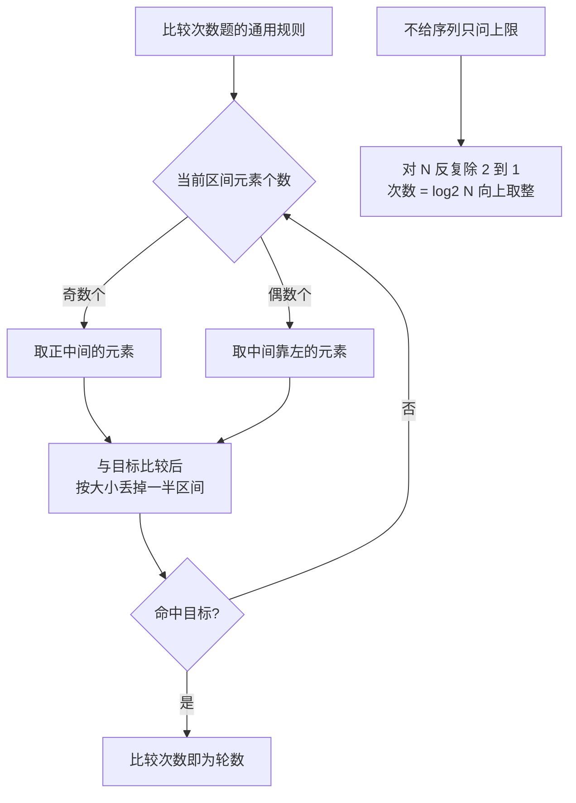

# 二分查找面试题：比较次数怎么数

面试题：在一个有序表中用二分查找某个值，查找成功需要比较多少次？

这类题是企业真题里的常客，京东实习生、美团点评校招都出过。它不考你写代码，考的是对二分查找中间值取法的理解：每次比较落在哪个元素上、下一轮区间怎么缩。数据稍有改动，考察点和解题思路都一样，拿下第一题，后面的题就是照方抓药。

## 先给结论

- 记住两句话：**奇数个元素取中间的值，偶数个元素取中间靠左的值**。这里的取值指的是中间索引、中间元素的位置。
- 第一题（京东实习生）：有序表 `1,5,8,11,19,22,31,35,40,45,48,49,50` 查找 48，依次和 31、45、49、48 比较，一共 **4 次**。
- 第二题（美团点评校招）：序列 `1,4,6,7,15,33,39,50,64,78,81,89,96` 查找 81，依次和 39、78、89、81 比较，一共 **4 次**。
- 不给具体序列、只问次数上限的题（如 128 个元素），思路是除二到 1 数次数，等价于算 log2 N：128 是 2 的 7 次方，答案是**最多不超过 7 次**。
- 不用每次都去推演左右边界，用这两条规则直接定位每轮的中间元素，数比较次数就行。

## 是什么：比较次数题在考什么

题目给一个有序数组，要用二分查找的方式找到其中一个元素，问最终找到这个元素需要经历几次比较。

常规解法当然可行：先找到每次的左右边界，左边界加右边界除以二，得到下一次的中间值的位置，这样一点一点去推演，最终能得出结果。但这种方法对解题的效率并不高，边写边算边界容易乱。

更高效的做法是先把规律总结成两句话：

1. 如果是奇数个元素，二分取中间的值。
2. 如果是偶数个元素，二分取中间靠左的值。

这里的取值指的是中间索引，也就是中间值的位置。给个例子就明白了。

## 深入细节：第一题逐步数

先读题：有一个有序表 `1,5,8,11,19,22,31,35,40,45,48,49,50`，当二分查找值为 48 的结点时，查找成功需要比较的次数是多少。

先看整个要二分的目标一共有多少个元素。数一下：2、4、6、8、10、12、13，一共 13 个，是奇数。奇数就取它的中间值，13 的中间值是第 7 个，也就是 31。这是第一次二分，中间值是 31。

48 比 31 大，所以在 31 右侧这部分继续找。右侧是 `35,40,45,48,49,50`，数一下：2、4、6，是偶数。偶数就找它中间靠左的值，6 个元素的中间靠左是第 3 个，也就是 45。这是第二次二分。

48 还是比 45 大，第三次在 45 的右边再找。右边剩 `48,49,50`，3 个元素，这回是奇数，找中间值 49。这是第三次。

48 比 49 小，往 49 的左边，最后一次自然就找到 48 了。

数一下：31、45、49、48，一共比较 **4 次**。

## 深入细节：第二题逐步数

第二题来自美团点评校招：使用二分法在序列 `1,4,6,7,15,33,39,50,64,78,81,89,96` 中查找元素 81 时，需要经过几次比较。

先看元素个数，一共 13 个。套用刚才的结论，取中间靠左的值，也就是第 7 个，是 39。这是第一次二分。

81 在 39 的右边，到右边再找：`50,64,78,81,89,96` 是偶数个，取中间靠左的 78。这是第二次。

81 还在 78 的右边，右边是 `81,89,96`，奇数个，取中间值 89。这是第三次。

81 比 89 小，再往左，第四次找到 81。

所以这道题也是经过 **4 次**比较得到最终要查找的元素。

以后遇到这类题就记着：奇数二分找中间值，偶数二分中间靠左，不用去一点点推演左边界右边界，直接定位每轮的中间元素数次数。

## 还有一类：128 个元素最多比几次

同类型的第三题（北京易道博识社招）：在已经有序的 128 个数组中二分查找一个数，需要比较的次数最多不超过多少次。

这题的思路是把前面的推演抽象成公式：初始元素二分，反正就是一次少一半，你就除二呗，直到把它除到了 1，中间数数一共除了几次，那就是最终比较的次数。128 个元素，2 的 7 次方是 128，也就是 log2 128 等于 7，结果是整数，7 就是答案，最多不超过 7 次。

如果面试官给的数字很大，手除不现实，就换成对数来算，取整规则是：算出来是整数，整数就是最终结果；算出来是小数，把小数部分舍掉、整数加一。拿前面两题验证一下这个规律：13 个元素，log2 13 约等于 3.7，舍小数加一是 4，和两道题数出来的 4 次一致。

## 面试怎么答

1. **先亮规则**：奇数二分取中间，偶数二分取中间靠左。一句话说明取的是中间索引。
2. **再逐步数**：从完整区间开始，每轮报出和哪个元素比较、目标在左还是在右、新区间是什么，数到最后一次命中。
3. **报答案**：把比较序列完整念出来，比如 31、45、49、48，共 4 次，让面试官看到你是数出来的，不是猜的。

常见追问：

- **问**：为什么偶数要取中间靠左，不能取靠右吗？
  **答**：这是二分查找中间索引的常规取法，左边界加右边界除以二向下取整，落点就是中间靠左。整套推演规则都建立在这个取法上，换成靠右，每一轮的落点和区间都会变，比较次数跟着变，取法必须统一。
- **问**：比较次数和元素个数什么关系？
  **答**：区间每比较一次就减半，所以比较次数由 log2 N 决定：算出来是整数就取整数，是小数就舍掉小数部分再加一。个数小的时候几次就够，个数越大优势越明显，这也是二分查找时间复杂度为 O(log n) 的由来。

## 常见误区

- **误区一**：偶数个元素时取中间靠右。靠左和靠右是两个不同的落点，比较序列和次数都不一样，默认取法是中间靠左。
- **误区二**：老老实实推演左右边界。能算对但慢，考场上一紧张就乱。先用奇偶规则定位中间元素，再验证区间，又快又稳。
- **误区三**：把「查找成功的比较次数」和「最多比较次数」混为一谈。指定了目标值的题数的是成功路径上的次数；问「最多不超过多少次」问的是所有可能路径里的上限，答案要对准问题。
