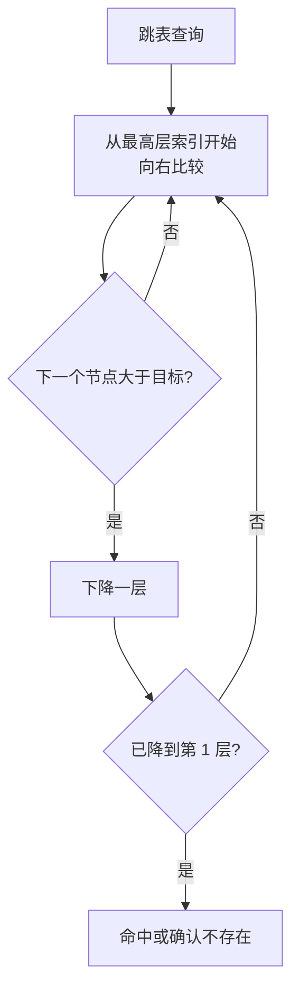

# 跳表查询：skiplist 的查找规则

面试题：Redis Sorted Set 底层的 skiplist，查询是怎么走的？

skiplist 的查询是 Sorted Set 篇的收尾问题。前面已经讲过它的编码切换和结构组成，这道题考的是把结构用起来：查询从哪开始、每一层怎么比、什么时候往下一层。规则只有三条，但面试时要把「多层链表为什么能像二分一样快」说明白，才算答透。

## 先给结论

- 查询从**顶层**开始，所以 skiplist 的头节点要记录最高层数。
- 每层先和**右边**的同层元素比：大于右边的，继续向右；等于，找到了；小于右边的、或者右边已经是 NULL，就**下一层**，重复刚才的步骤。
- 跳表底层是链表，不能像数组那样直接二分，只能一个挨一个比；多层索引的价值在于大量数据下把比较次数从 O(n) 压到 O(log n)，近似二分的效果。

## 是什么：查询规则

跳表的查询要点可以总结成两条线。

第一条是**起点**：从顶层开始。这也是为什么头节点里要记录整个 skiplist 的最高层数，不记录就没法知道该从哪层开始查。

第二条是**每层的走法**：先找同层元素，跟它右边的同层元素进行比较。

- 如果大于右边的，那就是继续向右查找；
- 如果等于了，那就表示找到了；
- 如果小于右边的元素，或者右边元素已经是 NULL 了，这时候就下一层，到下一层列表，然后重复前面的步骤。

这样说出来可能比较抽象，下面结合图走一遍。

## 深入细节：找 22 的过程

还是上一节那个跳表。查找之前先说明一点：虽然这个跳表是有序排列的，但它的底层实现是链表的方式，因此你不能用数组式二分法做优化的处理，只能一个挨一个去进行比较搜索。

先看普通链表找 22 是什么样：从第一个元素开始，先跟第一个比，不是；再跟第二个比，不是；一个一个比完，1、2、3、4、5，要比较五次才能找到最终的 22。

再看跳表找 22：从顶层开始，按「大于向右、等于命中、小于或到头就下一层」的规则走。整个过程一共也是五次比较：第一次、两次、三次、四次、第五次，同样找到 22。

从这个例子好像没看出来跳表的优势，这是因为我们的数量比较小。数量大的时候，就能明显看出来，跳表的效率要比从头到尾遍历的比较效率高很多。它的时间复杂度是 O(log n)，所以就近似于二分查询。

## 为什么这样设计

跳表用多层链表，本质上是给链表加索引。底层那一条链还是要一个一个走，这是链表改不掉的宿命；但高层链表每一步跳过的元素多，相当于把大区间快速切成小区间，切到底层时目标已经在一个很小的范围里。数据量小的时候，层数优势体现不出来，比较次数和普通链表差不多；数据量一大，每往下一层区间就缩小一圈，比较次数按对数增长，和二分查找同一个量级。这就是多层链表加速查询的原理。

## 面试怎么答

1. **先答起点**：从顶层开始查，头节点记录最高层数就是为了这个。
2. **再答每层规则**：和右边的同层元素比，大于向右、等于命中、小于或右边为 NULL 就下一层，循环往复。
3. **补一句本质**：底层是链表，没法真正二分，多层索引是在模拟二分的效果，所以时间复杂度是 O(log n)，近似二分查询。
4. **用例子佐证**：拿图上的查找过程走一遍，哪怕是五次比较的小例子，也能证明你是真看过结构图的，不是背概念。

常见追问：

- **问**：为什么头节点要记录最高层数？
  **答**：查询从顶层开始，没有层数信息就不知道该从哪层起步。记录最高层数，查询一上来就能落在最稀疏的那层，一步跨过最多元素。
- **问**：跳表能像数组那样二分吗？
  **答**：不能。二分依赖按下标随机访问，链表做不到。跳表的多层索引是用空间换时间，让查找路径近似二分的对折效果，复杂度同一个量级，但机制完全不同。
- **问**：那多层是不是越多越好？
  **答**：不是。层数越高，每层维护的前向指针和跨度越多，内存开销越大，插入删除时的维护成本也越高。实际实现会控制层数增量，在查询效率和内存、维护成本之间取平衡。

## 常见误区

- **误区一**：以为跳表能真正二分。它只是用多层索引逼近二分的效率，底层遍历还是一个一个走。
- **误区二**：每层比较完就往下走。要看比较结果：大于才向右，等于直接命中，只有小于或者右边为空才下移一层。
- **误区三**：小数据例子看不出优势就怀疑规则。例子数据量小，普通链表和跳表比较次数接近是正常的，数据量上来之后对数级的优势才显现。
