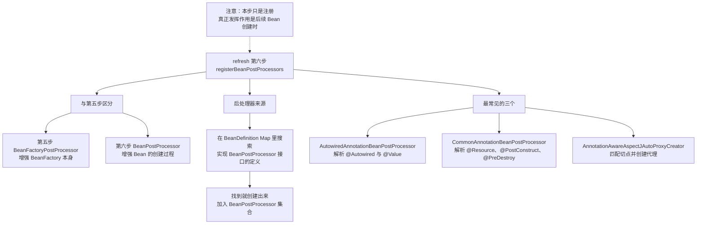

# Spring refresh 第六步：注册 BeanPostProcessor

面试题：refresh 方法里的 registerBeanPostProcessors 是做什么的？

refresh 走到第六步，主题换成了 BeanPostProcessor。面试问到这里，考的不仅是「注册后处理器」这个动作，更是能不能把它和第五步的 BeanFactoryPostProcessor 区分开，以及知不知道常见的 Bean 后处理器有哪些、各自负责什么。答出三个最常见的后处理器和它们的分工，这题就立住了。

## 先给结论

- 第五步的 BeanFactoryPostProcessor 增强的是 **BeanFactory 本身**；第六步的 BeanPostProcessor 增强的是 **Bean 的创建过程**，两者要区分开。
- 第三步 prepareBeanFactory 时已经加入了两个内置的 BeanPostProcessor，但作用不大；需要更多功能，就在第六步加入更多。
- 后处理器的来源：在 BeanDefinition Map 里搜索有没有实现 BeanPostProcessor 接口的 BeanDefinition，有就创建出来，加入 BeanPostProcessor 集合。
- 最常见的三个：AutowiredAnnotationBeanPostProcessor 解析 @Autowired 和 @Value；CommonAnnotationBeanPostProcessor 解析 @Resource、@PostConstruct、@PreDestroy；AnnotationAwareAspectJAutoProxyCreator 匹配切点并创建代理。
- 注意：第六步只是**注册**，把这些后处理器找出来加入集合，真正发挥作用是在后续 Bean 创建的过程中。



## 是什么：两种后处理器要分清

第五步提到了 BeanFactory 的后处理器，它是对整个 BeanFactory 的功能做一些增强的。

但第六步的 BeanPostProcessor 不一样，它是对接下来 Bean 的创建过程中做各种功能增强，这时候需要用到 Bean 的后处理器。大家要把它俩先区分开。

在第六步，就是添加一些 BeanPostProcessor。其实在之前第三步 prepareBeanFactory 的时候，已经加入了两个内置的 BeanPostProcessor，当然它俩的作用不大，我们接触得也比较少。但是如果要让你的 ApplicationContext 完成更多的功能，一般都会在第六步加入更多的 Bean 后处理器。

那这些后处理器从哪来？其实都是在 BeanDefinition Map 中去搜索，看看这些 BeanDefinition 里有没有人实现了 BeanPostProcessor 接口。如果实现了接口，Spring 就会识别出来：这是一个特殊的 Bean，是一个 Bean 的后处理器，那它就会把这样的 Bean 创建出来，把这个后处理器对象加入到 BeanPostProcessor 的集合里面去。将来在 Bean 真正创建的时候，就会用到这些后处理器了。

## 深入细节：一个演示

创建一个 GenericApplicationContext，通过它拿到内部的 BeanFactory，然后以编程的方式注册一些 Bean：bean1、bean2、bean3，另外还加了一个切面。都是以编程的方式加进来的。

加进来之后调用 refresh，然后 getBean 拿到 bean1，调一下它的方法，看看 bean1 的各项功能能不能正常运转。

```java
GenericApplicationContext context = new GenericApplicationContext();
DefaultListableBeanFactory beanFactory = context.getDefaultListableBeanFactory();
beanFactory.registerBeanDefinition("bean1", BeanDefinitionBuilder.genericBeanDefinition(Bean1.class).getBeanDefinition());
beanFactory.registerBeanDefinition("bean2", BeanDefinitionBuilder.genericBeanDefinition(Bean2.class).getBeanDefinition());
beanFactory.registerBeanDefinition("bean3", BeanDefinitionBuilder.genericBeanDefinition(Bean3.class).getBeanDefinition());
beanFactory.registerBeanDefinition("aspect1", BeanDefinitionBuilder.genericBeanDefinition(Aspect1.class).getBeanDefinition());

context.refresh();
beanFactory.getBean(Bean1.class).foo();
```

bean1 有几个功能。首先，它依赖 bean2 和 bean3：用 @Autowired 给它注入了 bean2，用 @Resource 给它注入了 bean3。为什么写在方法上而不是成员变量上？是因为接下来方法这儿可以打印一些信息，要是放在成员变量上，这个打印信息就不容易处理了，我们希望看到这个打印信息。

```java
static class Bean1 {
    Bean2 bean2;
    Bean3 bean3;

    @Autowired
    public void setBean2(Bean2 bean2) {
        System.out.println("发生了依赖注入..." + bean2);
        this.bean2 = bean2;
    }

    @Resource
    public void setBean3(Bean3 bean3) {
        System.out.println("发生了依赖注入..." + bean3);
        this.bean3 = bean3;
    }

    public void foo() {
        System.out.println("foo");
    }
}
```

此外还想做一件事：对 foo 方法的功能做一个增强，所以加了一个切面。切面里说，只要你将来执行的是这个 foo 方法，就在之前给它加一个前置通知，打印一个 before。

```java
@Aspect
static class Aspect1 {
    @Before("execution(* foo())")
    public void before() {
        System.out.println("before...");
    }
}
```

看一下运行结果：bean1 确实获取到了，也调用了 foo 方法，调用 foo 方法就是做一个很简单的打印。但是，刚才这几个依赖注入有没有执行到？没有。@Autowired 的依赖注入、@Resource 的依赖注入，都没有执行，包括前置通知是不是也没有加上去。

这是为什么？说白了，标准的 BeanFactory 容器上有些功能是没有的，它需要扩展才有这些功能。怎么扩展？就是要在 Bean 的创建过程中加入很多的 Bean 后处理器。这些后处理器功能不同：有的是用来去识别 @Autowired 注册的，有的是识别 @Resource 注册的，有的是给你创建代理、实现这种通知增强的。

## 深入细节：逐个加上后处理器

具体的添加方法，就是把它当成一个普通的 Bean 加上去，用 registerBeanDefinition 注册一个后处理器，起个名字，后面的代码都差不多。

```java
beanFactory.registerBeanDefinition("processor1",
        BeanDefinitionBuilder.genericBeanDefinition(AutowiredAnnotationBeanPostProcessor.class).getBeanDefinition());
beanFactory.registerBeanDefinition("processor2",
        BeanDefinitionBuilder.genericBeanDefinition(CommonAnnotationBeanPostProcessor.class).getBeanDefinition());
beanFactory.registerBeanDefinition("processor3",
        BeanDefinitionBuilder.genericBeanDefinition(AnnotationAwareAspectJAutoProxyCreator.class).getBeanDefinition());
```

**第一个，AutowiredAnnotationBeanPostProcessor**，用来解析 @Autowired 注解。把这个后处理器加完之后，第六步就会把它识别出来，添加到 BeanFactory 的集合里。后续真正创建 Bean 的时候，这个后处理器就能派上用场：它识别这里的 @Autowired 注解，帮我们完成依赖注入。再运行，可以看到发生依赖注入了，注的是哪个呢？注的是 bean2，说明这段注解确实工作了。

**第二个，CommonAnnotationBeanPostProcessor**，专门用来识别 @Resource 注解，当然它还能识别 @PostConstruct 跟 @PreDestroy 注解。想解析 @Resource 注解、注这个 bean3，就再添加一个后处理器，类型不一样，就是这个。加上它之后，第二个依赖注入也能正常完成了：可以看到 Bean 在创建的时候，bean3 的依赖注入也完成了。

**第三个，AnnotationAwareAspectJAutoProxyCreator**，这个名字超长，它的作用是帮我们解析 @Aspect 注解，包括里面的 @Before 注解，然后通过匹配 AspectJ 的切点表达式，看是不是有一个方法需要给它进行功能增强。结果匹配到了，匹配到以后，它创建 bean1 的时候就不会创建那个原始的 bean1 了，而是用一个代理对象替换掉原始 bean1。代理对象自然有功能上的增强：先调用我们的前置通知，然后再调目标对象真正那个方法，这样就可以实现 before 的功能增强了。把它加上以后，这个功能增强也有了。

所以每个 BeanPostProcessor 都有自己各自的功能，这三个是最常见的，可以要知道一下。

回到整体：BeanPostProcessor 其实就是 Bean 的一个扩展点，在它的各个阶段都会对它扩展。在 Bean 的实例化阶段、依赖注入阶段、初始化阶段，都可以扩展。不同的后处理器功能不一样：

- AutowiredAnnotationBeanPostProcessor，主要解析 @Autowired 注解和 @Value 注解；
- CommonAnnotationBeanPostProcessor，解析 @Resource、@PostConstruct、@PreDestroy 这三个注解；
- AnnotationAwareAspectJAutoProxyCreator，匹配那些切点表达式，匹配到切点的目标，就为它自动创建代理对象，代理对象就有了增强功能。

## 一个重要的收尾

最后注意一点：BeanPostProcessor 在第六步只是注册了，只是把这些找出来、加入到集合中；真正这些后处理器发挥作用，是在后续 Bean 创建的过程中才会使用到。我们现在只是注册，并没有用到它们。

## 面试怎么答

1. **先区分两种后处理器**：BeanFactoryPostProcessor 增强 BeanFactory，BeanPostProcessor 增强 Bean 的创建过程，这是第六步的主题。
2. **讲注册机制**：在 BeanDefinition Map 里搜实现了 BeanPostProcessor 接口的 BeanDefinition，创建后加入集合；第三步已经有两个内置的，不够用就在第六步加。
3. **报最常见的三个**：AutowiredAnnotationBeanPostProcessor 管 @Autowired 和 @Value，CommonAnnotationBeanPostProcessor 管 @Resource、@PostConstruct、@PreDestroy，AnnotationAwareAspectJAutoProxyCreator 管切点匹配和自动代理。
4. **点明注册和使用的时序**：第六步只注册，不生效；后处理器在 Bean 创建过程里才派上用场。

常见追问：

- **问**：不注册这些后处理器会怎样？
  **答**：就像演示里那样，Bean 能创建、方法能调用，但 @Autowired、@Resource 的注入不执行，切面前置通知也不生效。标准的 BeanFactory 只提供基本功能，注解解析和 AOP 增强都要靠后处理器扩展。
- **问**：为什么注册后处理器用 registerBeanDefinition，和注册普通 Bean 一样？
  **答**：因为后处理器本身就是 Bean，走的是同一套 BeanDefinition 机制。区别只在第六步搜索时多了一个条件：实现 BeanPostProcessor 接口的会被识别出来，单独加入后处理器集合。
- **问**：后处理器在哪些阶段扩展 Bean？
  **答**：实例化、依赖注入、初始化各个阶段都能扩展，不同后处理器各管一段，这也是 Spring 扩展性的核心设计。

## 常见误区

- **误区一**：把 BeanPostProcessor 和 BeanFactoryPostProcessor 混为一谈。前者增强 Bean 的创建过程，后者增强 BeanFactory，分属 refresh 的第五步和第六步。
- **误区二**：以为第六步加完后处理器马上就生效。第六步只是注册进集合，真正发挥作用要等后续创建 Bean 的时候。
- **误区三**：以为后处理器要特殊手段注册。它就是一个实现了接口的普通 Bean，registerBeanDefinition 加进去就行，识别和分组交给第六步。
