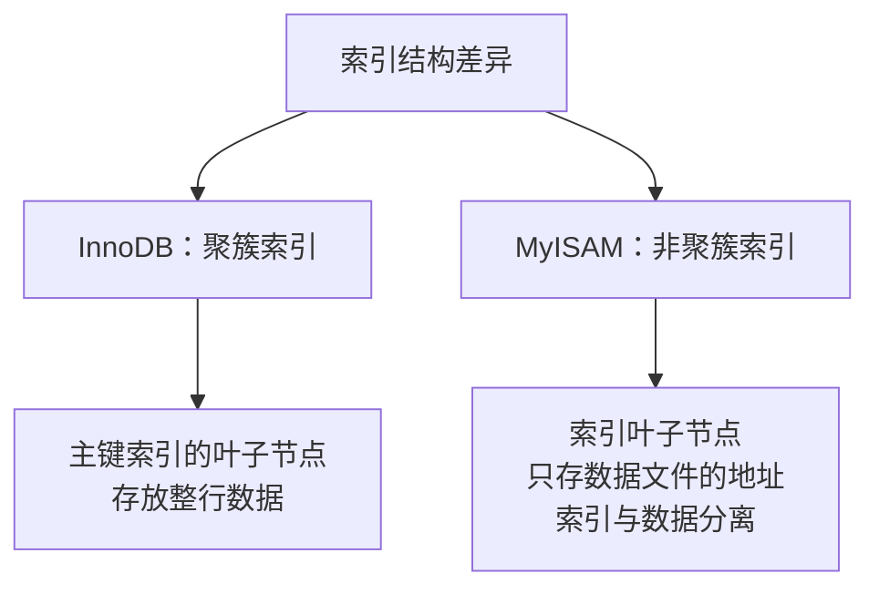

# 不同存储引擎的索引区别：InnoDB 与 MyISAM

面试题：InnoDB 和 MyISAM 的索引有什么区别？

存储引擎的对比题，索引部分是重头。考的不是背概念，而是三种索引结构能不能对着图讲出来：InnoDB 的聚簇索引叶子节点存什么、二级索引叶子节点存什么、MyISAM 的索引叶子节点又存什么。回表这个词能不能自然地说出来，是这题的分水岭。

## 先给结论

- InnoDB 的索引分两种：**聚簇索引**和**二级索引**，底层都是 B+ 树（一种多路平衡搜索树，MySQL 索引的底层结构，叶子节点成链、范围查询高效）。
- 聚簇索引针对主键建立，主键值作为索引数据，叶子节点里包含整行数据，索引和表合二为一。
- 二级索引针对其他字段建立，被索引的字段值作为索引数据，叶子节点里除了字段值还包含主键值；查二级索引里没有的字段，要拿主键值回聚簇索引再查一次，这就是回表。
- MyISAM 只有一种索引结构：索引数据和表数据分开存储，叶子节点不存数据，只存被索引的值和数据在表中的地址，按地址直接定位。

## 是什么：聚簇索引

InnoDB 里索引分成了两种，一种叫聚簇索引，一种叫二级索引。

什么是聚簇索引？它主要就是针对主键的，会把主键值作为索引的数据，然后其他字段的数据会包含在这个聚簇索引的叶子节点上。

对照图看一下。比如说这是一个员工表的数据，其中 7782、7521、7654、7369、7499 这些四位的数字，就是这张表的主键，是员工的编号。可以看到，针对这些员工的编号建立了这样一个 B+ 树的索引。再看树的叶子节点中，除了主键的值以外还多出了什么：这个表中其他字段的数据，比如说这里的史密斯，这是员工的姓名，还有工资的数据。这样一种索引就称之为聚簇索引。

它可以简单地理解为：把索引的数据和表中其他字段的数据都存储在一起，也就是把索引和表合二为一了，这种我们称之为聚簇索引。

## 深入细节：二级索引与回表

InnoDB 里除了聚簇索引以外，还有二级索引。聚簇索引是针对主键值，InnoDB 会自动建立；而如果是其他字段你要建立索引的话，建出来的就称之为二级索引。

二级索引是以被索引的字段值作为索引数据，然后叶子节点中除了这个字段值以外，还包含了主键值。

还是结合员工表来看。这回对他的工资这一列做了一个索引，也就是把 2850、1100、800、950 这些工资的值，也就是字段值，当成索引数据，建的一个 B+ 树。观察这棵 B+ 树的叶子节点：叶子节点里面除了工资的这个数据以外，还多出了主键值。所以对于二级索引来讲，它并不会存储所有的数据，只有被索引的字段的数据，加上主键的数据，主键的数据存在叶子节点。

那二级索引查询的时候怎么查？比如说想查一个工资等于 800 的员工。根据 B+ 树的特点，800 比 2850 小，所以到左边的区间找；左边区间里面我们看到 800 应该在 1100 的左侧，所以就在左侧区间找到了这个节点，进一步找到了 800。

但是如果只是找工资值和主键值，二级索引就已经有这些数据了。如果想找这个员工，也就是 7369 的剩余的一些字段信息，比如想知道员工的姓名，二级索引里有没有？没有。这时候查二级索引就不够了，它要再根据主键的信息，也就是工资 800 对应的是 7369 这个员工编号，然后根据 7369 回到聚簇索引里面，看 7369 这条数据的剩余信息。就是跟主键值进行对比：7369 比 7782 要小，所以到左侧区间找；又比这里的 7521 小，所以到 7521 的左侧区间找。这样就找到了 7369，进而就知道了它里面的剩余的字段信息。

所以这是 InnoDB 中二级索引的特点：如果你要查的数据在二级索引里没有，它还要进行一次回表操作，也就是到聚簇索引里才能进一步定位到其他的字段信息。

## 深入细节：MyISAM 的索引

最后来看 MyISAM 中的索引。MyISAM 的索引是把索引的数据跟表数据分开来进行存储。

图里上面这些是索引数据，下面这是表的数据。如果针对 MyISAM 的表的主键，也就是四位的员工编号建个索引，它就会多出来上面这个索引的结构。索引的结构还是 B+ 树的结构，只不过这回的索引叶子节点里并不存储任何数据，它只包含了这个被索引的主键值，以及这个数据在表中的一个地址。

比如说还是要找 7369，它是一层一层找到 7369，找到以后，叶子节点上还记录了表的一个数据地址，所以它就根据表的数据地址到表结构里面，找到 7369 剩余的数据信息。

所以 MyISAM 中，索引和数据表数据是分开来存储的。这就是不同存储引擎下索引结构上不一样的地方：InnoDB 分两种，聚簇和二级；MyISAM 中只有一种，不管是主键还是普通字段，建立的都是这种表数据跟索引数据分离的索引结构。

## 面试怎么答

1. **先分引擎**：InnoDB 两种索引，MyISAM 一种，一句话给出全局图。
2. **再讲 InnoDB**：聚簇索引针对主键，叶子节点存整行，索引即表；二级索引针对普通字段，叶子节点存字段值加主键值。
3. **点出回表**：二级索引查不到其他字段时，拿叶子里的主键值回聚簇索引再查，这是二级索引的固有开销。
4. **最后讲 MyISAM**：索引与数据分离，叶子节点存被索引值和数据地址，按地址直接定位，没有回表这个环节。

常见追问：

- **问**：为什么 InnoDB 的二级索引叶子节点存的是主键值，而不是数据地址？
  **答**：因为 InnoDB 的数据本身就组织在聚簇索引里，主键值就是行的定位符。存主键值，回表时直接按主键在聚簇索引里定位，一级一级找到整行。
- **问**：什么情况下不用回表？
  **答**：查询用到的字段刚好都在二级索引里。比如按工资查员工编号，工资和主键值二级索引都有，直接就能返回，不必回表。覆盖索引说的就是这种情况。

## 常见误区

- **误区一**：以为二级索引的叶子节点也存整行。它只存被索引的字段值和主键值，其他字段都要回表拿。
- **误区二**：以为 MyISAM 的主键索引也是聚簇的。MyISAM 只有一种索引结构，主键和普通字段建出来的索引一样，都是叶子存地址、数据另外放。
- **误区三**：忽略回表的代价。回表是二次查找，高频查询要么走覆盖索引，要么把查询字段设计进索引，否则比较次数和 IO 都要多一倍。
