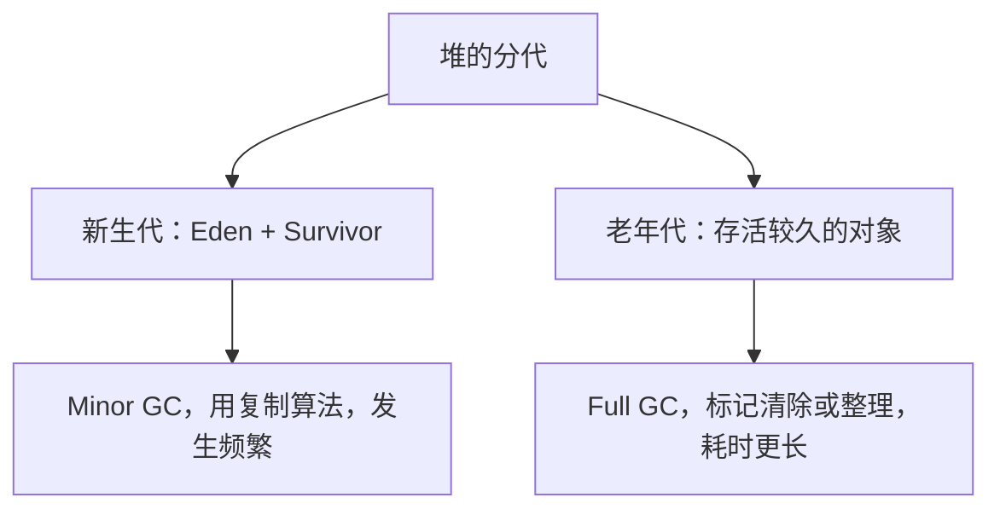

# JVM 垃圾回收：分代回收与 GC 规模

面试题：JVM 的分代回收是怎么回事？

分代回收是 GC 篇的骨架题。考三个点：新生代怎么细分、对象在伊甸园和幸存区之间怎么搬家、什么时候晋升老年代。能再补上 Minor GC、Mixed GC、Full GC 的规模区别，回答就有体系感。光说「新生代老年代」几个字，过不了这题。

## 先给结论

- 内存区分新生代和老年代；新生代进一步细分为**伊甸园（Eden）**和**幸存区（Survivor）**，幸存区又分 From 和 To 两个大小相等的部分。
- 伊甸园和幸存区之间采用**标记-复制**算法：沿 GC Roots（一组一定不会被回收的根对象，如方法局部变量、静态变量；可达性分析从它们出发）引用链标记存活对象，复制到 To 区，其余一次性释放，随后 From 和 To 交换位置。
- 幸存区对象熬过若干次回收会**晋升**老年代，最多不超过 15 次一定晋升；幸存区内存不足或大对象会提前晋升。
- GC 规模三种：Minor GC 只回收新生代，暂停短；Full GC 回收新生代加老年代，暂停长，要尽力避免；Mixed GC 回收新生代加老年代部分区域，是 G1 收集器特有的。

## 是什么：伊甸园和幸存区

分代回收的思想是把整个内存区划分成新生代和老年代。其实新生代的内存还可以进一步细分，分成了伊甸园和幸存区。

这里的伊甸园和幸存区，字面意思就表达了它们各自的功能。伊甸园是我们人类最初诞生的地方，在 Java 中，这些对象最初也是诞生在伊甸园区。将来伊甸园的内存不够了，发生了垃圾回收，回收之后，幸存的对象就会被转移到幸存区中去。

幸存区又可以分成两个大小相等的部分，分别叫做 From 和 To。

伊甸园跟幸存区之间，采用的是标记复制的算法来移动对象。下面演示一下。

## 深入细节：第一次垃圾回收

刚开始，对象都是诞生在伊甸园当中，图里 1 到 8 这些对象都在伊甸园。

随着对象越来越多，伊甸园的内存就不够用了。比如说它的空闲内存就剩一点，如果再创建一个新的对象，新对象的大小超过了这段空闲内存，它就发现内存不够了，要对它进行一个回收。

回收的时候，采用标记复制的算法。它是先从 GC Roots 的引用链去找，看看引用链能不能找到这些对象。如果能找到这些对象，就给他们加标记；标记好的保留下来，未标记的就可以当做垃圾。

比如说沿着 GC Roots 找了遍，发现只有 6 号对象还在被引用，其他对象都没有被引用了，因此就给 6 号对象加上标记。

加完标记以后，接下来一个步骤就开始复制了：从伊甸园把这个对象复制到幸存区的 To 这个位置。复制过来以后，幸存对象已经转移到安全的地方了，剩下这些对象还有用吗？没用了，可以把它的内存一下子全部都释放掉。这是完成了一次垃圾回收。

注意还有最后一步：From 和 To 两个区域，每次垃圾回收之后会交换位置。也就是原本的 From 会变成 To，原本的 To 变成 From。这样一次垃圾回收就完成了。

## 深入细节：第二次垃圾回收

接下来伊甸园里面又会创建新的对象，又过了一段时期，这里又放入了一大堆的对象，内存又不够了，这时候又会再次触发一次垃圾回收。

这次垃圾回收的思路差不多，也是先沿着 GC Roots，看看当前的这些对象里面，有没有被 GC Roots 所直接或者间接地引用到，被引用的要加标记。

这次加标记的时候，From 这里也可能有 GC Roots 引用到它，存活对象不一定全在伊甸园，From 里的存活对象我们也要考虑。假设现在 6 号对象仍然在被引用，还有一个 B 对象被引用了，那么它俩加上了标记。

加上标记的对象还是采用复制算法，会被复制到 To 这个区域中去，也就是 6 和 B 它俩都被复制过去了。剩下的内存就可以释放了，所以把伊甸园的内存和 From 内存全部释放掉。这是第二次垃圾回收，最后同样把 From 和 To 的位置进行一个交换。

这就是伊甸园和幸存区的工作方式。

## 深入细节：老年代与晋升

老年代里什么时候会有对象？就是当幸存区中的对象已经熬过了几次垃圾回收，那就认为这个对象价值比较高，好几次都没回收掉它，应该把它转移到更安全的一个区域去，也就是它会从幸存区晋升到老年代。

这个晋升的次数是变化的，但是最多不会超过 15 次。只要你这个幸存区的对象熬过了 15 次垃圾回收，那么你一定会被晋升到老年代去。

当然了也会提前晋升。提前晋升的情况就是幸存区的内存不够了，那这个对象可能会提前给它转移到老年代去。还有一种情况就是你的对象比较大，像一些大对象，我们应该把它提前晋升到老年代，否则大对象留在新生代的话，它要拷贝来拷贝去，那还不如提前给它晋升到老年代去。

## GC 的三种规模

讲完了分代回收，再来看 GC 的规模，也就是 Minor GC、Mixed GC 和 Full GC 这三个名词。

**Minor GC** 是发生在新生代的垃圾回收，刚才演示的都是新生代的 Minor GC。它们导致应用程序暂停时间比较短。

**Full GC** 是新生代加上老年代的一次完整的垃圾回收，暂停时间就比较长了，我们应该尽力避免。

**Mixed GC** 是新生代加上老年代的部分区域的垃圾回收，也就是新生代全部回收一遍，但是老年代又划分成了多个区域，然后我们挑其中回收价值比较高的这些区进行回收。它是后面会讲到的 G1 这个垃圾回收器特有的，其他垃圾回收器都没有 Mixed 这种混合收集的 GC。

## 面试怎么答

1. **先画结构**：新生代分伊甸园和幸存区，幸存区分 From 和 To；老年代单独一块。
2. **再讲算法**：伊甸园和幸存区之间用标记-复制，标记靠 GC Roots 引用链，复制到 To，剩下的全释放，From 和 To 交换。
3. **讲晋升**：幸存区对象熬够次数晋升老年代，上限 15 次；内存不够或大对象提前晋升。
4. **补规模**：Minor GC 管新生代暂停短，Full GC 管全堆暂停长要避免，Mixed GC 是 G1 特有的部分老年代回收。

常见追问：

- **问**：为什么幸存区要分 From 和 To 两个区？
  **答**：标记-复制算法需要一块干净的目标区。存活对象统一复制到 To，Eden 和 From 整体释放，不留内存碎片；下一轮 From 和 To 交换角色，两块轮着用。
- **问**：大对象为什么要提前晋升？
  **答**：大对象在新生代里跟着复制来复制去，拷贝成本太高，还可能频繁触发回收。直接放进老年代，省掉来回拷贝。
- **问**：Full GC 为什么要尽量避免？
  **答**：Full GC 是新生代加老年代的完整回收，暂停时间长，对延迟敏感的应用体验很差。控制堆大小、少创建大对象、让对象正常消亡，都是减少 Full GC 的手段。

## 常见误区

- **误区一**：以为幸存区只有一块。它分 From 和 To 两个大小相等的部分，每次回收后交换位置。
- **误区二**：以为所有对象都要在幸存区熬够 15 次。晋升次数是动态的，幸存区内存不足或对象太大都会提前晋升，15 次是上限，不是必经之路。
- **误区三**：把 Mixed GC 当成通用概念。它是 G1 收集器特有的混合收集，其他回收器只有 Minor GC 和 Full GC 两种规模。

## 课件配图
> 以下配图取自阶段七课件对应讲义，与上文讲解一一对应，可作为图文对照辅助理解。
**JVM 垃圾回收**（课件讲义图示）

