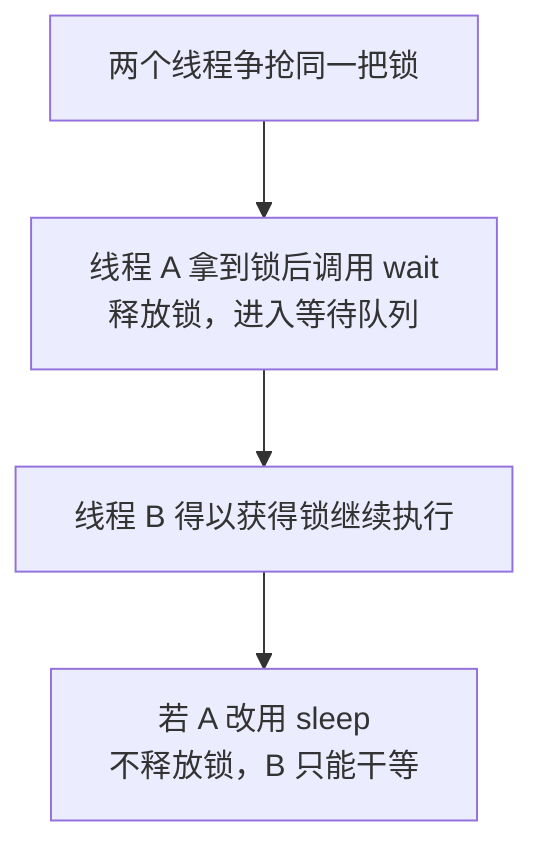

# wait 和 sleep 的代码演示：锁与中断

面试题：wait 和 sleep 有什么区别，用代码说明？

上一篇从概念上区分了 wait 和 sleep，这篇用代码把三个关键差异演示出来：wait 必须持有锁、wait 会释放锁而 sleep 不会，以及两者都能被 interrupt 打断。面试官让你「写个 demo 说明」的时候，考的就是这三个点。

## 先给结论

- wait 必须配合锁使用，直接拿对象调 wait 会抛 IllegalMonitorStateException；先拿到对象锁再调就没问题。sleep 没有这个问题。
- wait 等待期间会**释放锁**：拿到锁的线程调用 wait 后放弃锁，其他线程可以立刻获得锁。sleep 在同步代码块中**不会释放锁**，其他线程只能卡在 synchronized 上等着。
- 两者在等待过程中都可以被打断：对等待中的线程调用 interrupt，它不会睡足时间，会提前醒来并抛出异常。



## 演示一：wait 必须配合锁

先看 wait 方法。前面说过，它必须配合锁一起用。如果你直接拿到一个对象，调它的 wait 方法，这时候是会报错的。

直接调 `wait()`，可以看到它报了一个非法的监视器状态异常，也就是 IllegalMonitorStateException，提示当前线程不是锁的持有者。意思是你没有获得锁之前调 wait 肯定有问题。

那怎么办？可以先拿到这个对象锁，获得了锁以后，再调 wait 就没问题了，可以看到它并不报错了。sleep 就不演示了，它没有这个问题。

```java
static final Object LOCK = new Object();

private static void illegalWait() throws InterruptedException {
    LOCK.wait();          // 没拿到锁就 wait，抛 IllegalMonitorStateException
}
```

拿到锁以后再调就没问题了：

```java
private static void waiting() throws InterruptedException {
    Thread t1 = new Thread(() -> {
        synchronized (LOCK) {
            LoggerUtils.get("t").debug("waiting...");
            LOCK.wait(5000L);
        }
    }, "t1");
    t1.start();
}
```

## 演示二：wait 释放锁，sleep 不释放

这也是锁的特性：wait 的期间会释放锁。

先看代码。首先有一个 t 线程，t 线程它要获得一把锁，获得这个对象锁。获得之后，接下来它又调了 wait，去等待五秒钟。这是 t 线程。

还有主线程。主线程故意让它稍晚一点执行：就是先把 t 线程启动了，保证 t 线程先获得了锁，然后主线程过了 0.1 秒之后，再去执行下面的代码，它也想获得这把锁。

那主线程这边能不能获得这个锁呢？如果是两个人同时抢一把锁，那肯定只有一个人成功。但是我们这个场景下，主线程是可以立即获得这个锁的。为什么？因为 wait 虽然事先获得了锁，也就是 t 线程拿到的这个锁，但是接下来调了 wait 的方法，t 线程就会放弃锁，把这个锁解开，它自己到这个对象里歇着去。既然它把锁解开了，那主线程想获得锁时就可以成功，所以它里面的 other 可以立刻打印出来。

试验一下：首先是 t 线程获得了这个锁，打印了 wait；接下来它调了 wait，就把锁释放开了；因此主线程的代码不用在获取锁上一直等，它立马就会进入下一步执行它的事。所以我们看到这一前一后几乎是同时打印。

把同样的例子改成 sleep。这个例子跟刚才差不多，只是获得锁以后，t 线程是调了 sleep 睡眠了五秒钟，那执行结果有什么不一样？

可以看到 t 线程打印了 sleep 以后，它就进行了这个睡眠。但是睡眠的过程中，主线程那边能执行吗？不行，主线程一直卡在了 synchronized 之上。因为说了，sleep 如果是在同步代码块中被调用，它并不会释放锁。既然它不会释放锁，那主线程这个代码就卡住，不能执行，直到五秒之后 sleep 结束了，它退出了 synchronized 代码块，把锁才能释放开，这时候主线程的 other 才会被打印。

可以看到，两个打印之间差了大约是五秒钟。这就是 wait 在获得锁以后，会释放锁；而 sleep 如果在同步代码块内，它并不会释放锁。

```java
private static void waiting() throws InterruptedException {
    Thread t1 = new Thread(() -> {
        synchronized (LOCK) {
            try {
                get("t").debug("waiting...");
                LOCK.wait(5000L);          // 等待期间释放锁
            } catch (InterruptedException e) {
                get("t").debug("interrupted...");
                e.printStackTrace();
            }
        }
    }, "t1");
    t1.start();

    Thread.sleep(100);
    synchronized (LOCK) {
        main.debug("other...");            // 立即拿到锁，几乎与 waiting 同时打印
    }
}
```

改成 sleep 的版本：

```java
private static void sleeping() throws InterruptedException {
    Thread t1 = new Thread(() -> {
        synchronized (LOCK) {
            try {
                get("t").debug("sleeping...");
                Thread.sleep(5000L);       // 睡眠期间不释放锁
            } catch (InterruptedException e) {
                get("t").debug("interrupted...");
                e.printStackTrace();
            }
        }
    }, "t1");
    t1.start();

    Thread.sleep(100);
    /*synchronized (LOCK) {
        main.debug("other...");            // 卡在这里，直到 5 秒后
    }*/
}
```

## 演示三：等待中可以被 interrupt 打断

最后再来看 interrupt 的特性，也就是它们在等待的过程中是可以被打断的。

比如说 sleep 本来它要睡足五秒才能醒。现在我通过调用 t 对象的一个叫 interrupt 的方法，就可以让它提前醒来。也就是主线程这边等了 0.1 秒之后，就去打断它。打断之后，它就不会等足五秒才醒来了。

看一下效果：它先是 sleeping 了，但是接下来主线程那边一直就把它 interrupt 打断了。打断之后呢，它就抛出了异常，然后我们抓到这个异常，打印了一个被打断。所以可以看到它并没有睡足五秒就会被唤醒了。

wait 操作这个效果是类似的，大家可以自己去尝试：可以对 t 调用 interrupt，也可以把 wait 的这个线程提前给它唤醒。

## 面试怎么答

1. **先答锁的关系**：wait 必须持有对象锁，否则抛 IllegalMonitorStateException；sleep 不需要锁。
2. **再答锁的释放**：wait 等待期间释放锁，sleep 在同步代码块内不释放锁。这是两者最容易被追问的差异，用 t 线程和主线程抢锁的例子说明。
3. **补中断**：两者等待中都可以被 interrupt 提前唤醒，抛异常。
4. **收一句使用场景**：wait 用于线程间通信，要配锁；sleep 就是让当前线程睡一会儿，不涉及线程协作。

常见追问：

- **问**：为什么 wait 要设计成释放锁？
  **答**：wait 本身是线程间协作的手段，等待的正是别的线程来改条件。要是不释放锁，别的线程连锁都拿不到，条件永远改不了，等待的线程永远醒不过来，必然死锁。
- **问**：sleep 在同步代码块里不释放锁，会有什么后果？
  **答**：占着锁睡，其他需要同一把锁的线程全部阻塞，并行退化成串行，极端情况下还会死锁。所以持锁期间尽量不用 sleep 做定时。

## 常见误区

- **误区一**：以为 wait 能脱离锁单独调用。脱离锁调 wait 直接抛 IllegalMonitorStateException，必须先拿到对象锁。
- **误区二**：以为 sleep 也会释放锁。在同步代码块内 sleep，锁一直攥着，其他线程只能干等。
- **误区三**：以为等待中的线程叫不醒。对等待中的线程调用 interrupt，wait 和 sleep 都会提前结束并抛异常。
