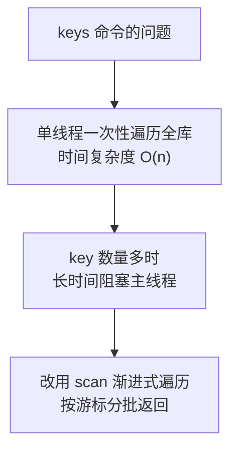

# Redis 有一亿个 key，还能用 keys 命令吗

面试题：Redis 中有一个亿的 key，使用 keys 命令是否会影响线上服务？

这题答案很明显：会影响。它考的是两个知识点的串联：keys 命令的时间复杂度，以及 Redis 执行命令的单线程模型。能顺下去把 scan 命令的特性和工作原理讲出来，这题才算答完整。只答一句「keys 慢，别用」，拿不到高分。

## 先给结论

- keys 命令的时间复杂度是 O(n)，n 是数据库中总的 key 数量。有一个亿 key，n 非常大，执行性能非常低。
- Redis 执行命令是单线程的，一个命令执行太慢，会阻塞其他命令；阻塞时间过长，甚至可能让 Redis 发生故障切换（课程里给的经验量级是 15 秒左右）。
- 结论：线上环境一定不要用 keys 命令，线下和测试环境用一下倒也罢了。
- 替代方案是 scan 命令：时间复杂度同样是 O(n)，但通过游标分步执行，一次只查一点，不会长时间阻塞。

## 深入细节：keys 命令的问题在哪

首先，keys 命令的时间复杂度比较高，是 O(n)，而且这个 n 是数据库中总的 key 的数量。现在有多少？有一个亿。那这个数量就非常大了，这种情况下就会造成 keys 命令的执行性能非常低，需要花较长的时间才能执行完。

如果单是 keys 命令自己执行慢点，那倒也罢了，等一等也等得起。但是大家别忘了，Redis 执行命令可是单线程执行命令。你一个命令执行得慢，会影响到其他命令。现在 keys 这个命令执行得太慢了，那其他的增删改查就必须等 keys 执行完了才能继续运行；keys 没执行完之前，它们都得阻塞住。阻塞时间过长了，甚至会让 Redis 发生故障切换，大概是 15 秒，超过 15 秒它就会主动切换。

那显然，这是我们 keys 命令带来的问题。所以我们不推荐大家在线上环境使用 keys 命令；线下环境、测试环境，你用一下 keys 倒也罢了，线上环境一定不要用。

## 深入细节：scan 命令怎么替代

有一个替代命令，可以用 scan 命令来替换 keys 命令。

那为什么 scan 命令就能替换它？scan 命令的时间复杂度也是 O(n)，跟 keys 是一样的。那为什么它就不会因为执行太慢阻塞其他命令呢？是因为它是通过游标分步执行的。它不是一次性地把 Redis 这个大的数据库中的所有桶都遍历一遍、把你要查找的 key 都找到，它是分布执行，一次只查一点，一次只查一点。这样的话它就不会导致长时间的阻塞了。

下面演示一下。打开一个 Redis 客户端，先用 keys 命令看一下当前数据库里有哪些 key。为了测试并没有加很多的 key，现在数据库里一共有 21 个 key。注意到 keys 命令就是把这 21 个 key 一次性的全部查出来。如果你的 key 的数量特别大，像题目中说的有一个亿，那这个速度就非常慢了。

scan 命令又是怎么工作的呢？它第一个参数接收一个 cursor，这个 cursor 叫游标。游标可以给它一个 0，然后后面跟上 match，跟上匹配的规则。现在也是查所有的 key。回车看一下：可以看到它并没有把这 21 个 key 全部查出来，只查出来 10 个。与此同时它还会返回一个游标，这个游标的用途就是说，你下一次从哪一个游标开始去查询。刚开始是从 0 开始查询的，下一次就从 1 这个游标开始查。

把这个游标换一下，其他部分不变，回车，它就把下 10 条 key 查询出来了，可以看到它们之间是没有重复的。它能够保证大部分情况下这个 key 不会重复。这回返回的游标是 31，意思就是说你下次再从 31 这个游标开始查。再把它改成 31，又查出来一条记录。10 加 10 加 1 等于 21，把这 21 条记录用三次查出来了。

如果我们发现查询出来的结果游标是 0 的话，那就表示这个 key 已经遍历结束了，不需要再去给它发这个请求了。

## scan 命令的六个特性

1. **时间复杂度虽为 O(n)，但通过游标分步执行**，不会导致长时间阻塞。这是它能替代 keys 的根本原因。
2. **可以用 count 参数提示返回 key 的个数**，默认值是 10，所以刚才每次返回的结果也是 10 条。但请注意，count 并不是精确地告诉你必须返回 10 条，它有的时候可能比这个少，有的时候可能比这个多，它是约为 10。换句话说，count 只是提示 Redis 应该一次返回多少个 key，但并不意味着一定返回这么多。
3. **返回值代表下次游标的起点**，下次从返回的游标开始继续遍历。
4. **rehash 的时候也能正常工作**。在 rehash 前、rehash 后，它不会漏掉某一个遍历的 key，或者让这个 key 重复。但是 key 有几率重复，重复有一种情况：它在缩容的时候，比如刚开始是 32，后来缩容成 16 了，缩容的时候会有这种重复 key 的情况；但是扩容的时候不会有重复 key。
5. **弱状态**。服务端那边基本上不维持这个状态，所以对服务端的影响不大。客户端只要维护它的游标就可以了，也就是记住它每次的返回结果，下次从返回的游标开始继续遍历。
6. **还是有可能重复**，缩容时会有重复，我们的应用程序应该自己处理这种重复的 key，但是这个一般问题都不大。

所以看出来，scan 命令是可以替换 keys 命令的，在各个方面都能够提供比 keys 命令更丰富更高效的功能。解决办法就是可以用 scan 命令代替 keys 命令，线上大家千万不要用 keys 命令。

## 面试怎么答

1. **先给判断**：会影响。keys 时间复杂度 O(n)，n 是总 key 数，一个亿的量级执行性能非常低。
2. **再讲阻塞链**：Redis 单线程执行命令，keys 慢会阻塞其他增删改查，阻塞过长甚至引发故障切换，所以线上禁用。
3. **给替代**：用 scan。时间复杂度同为 O(n)，但游标分步执行，一次只查一点，不长时间阻塞。
4. **补 scan 细节**：cursor 参数加 match 模式，返回结果加新游标，游标为 0 表示遍历结束；count 只是提示、默认 10；缩容可能重复，应用自己去重。

常见追问：

- **问**：scan 的时间复杂度和 keys 一样是 O(n)，凭什么说它更高效？
  **答**：单看总工作量是一个量级，但 scan 把工作量摊到多次调用里，每次只返回一小批，单次命令不会长时间占用线程，其他命令不会被堵住。keys 是一次性全量遍历，一个亿的 key 全压在一次命令里。
- **问**：count 设置成大一点，比如 1000，是不是就能一次多拿点？
  **答**：可以，但 count 只是提示值，不保证精确返回这么多，而且单次返回太多，阻塞时间又会变长，背离了用 scan 的初衷。一般保持默认或按业务取一个折中值。
- **问**：scan 遍历期间 key 重复了怎么办？
  **答**：缩容 rehash 时有几率重复，客户端或业务层自己做一次去重即可，影响不大。

## 常见误区

- **误区一**：只记得「keys 慢」，讲不出为什么慢会放大成事故。慢本身只是慢，单线程模型才把慢变成全局阻塞，甚至故障切换。
- **误区二**：以为 scan 时间复杂度低所以快。scan 也是 O(n)，它的优势在分步执行不阻塞，不在总工作量更小。
- **误区三**：以为 count 能精确控制返回条数。count 只是提示，实际返回可能多也可能少，默认 10。
