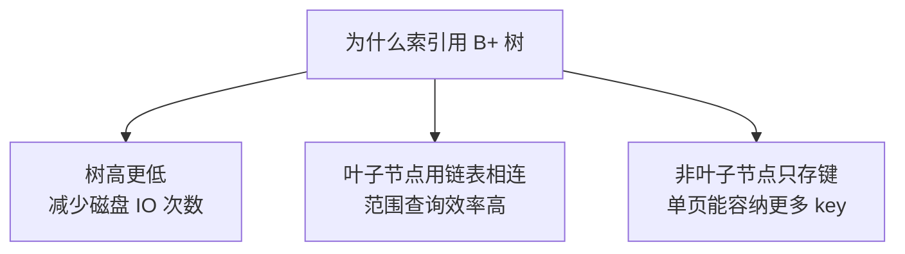

# 索引为什么用 B+ 树：从哈希推到 B+ 树

面试题：为什么 MySQL 采用 B+ 树作为索引的实现？

这题是索引篇的压轴题。先说明一点：MySQL 主要采用的是 B+ 树作为索引的实现，另外也有一些引擎采用其他的索引数据结构。这道题出彩的答法不是背结论，而是把推演过程走一遍：哈希索引为什么不行、平衡二叉树为什么不适合磁盘、B 树和 B+ 树又各自改了什么。链路走通，结论自然就立住了。

## 先给结论

- 推导链：哈希索引 O(1) 但不支持范围查询、只适合内存；平衡二叉树支持范围但树高约 20，百万数据要 20 次磁盘 IO；B 树用 n 叉把树高压到 3；B+ 树只存 key，分叉数更大，树高降到 2。
- 磁盘场景下，树的高度直接决定磁盘 IO 次数，树越低效率越高，这是整条推导链的主线。
- 局部性原理：IO 以页为单位，相邻 key 放同一页，读一个等于读一批，进一步减少 IO。
- 结论：B+ 树更适合磁盘数据的索引，而且等值查询、范围查询都支持，所以 MySQL 主要采用它。

## 是什么：哈希索引

先把一些常见的索引实现列举一下。

第一种是哈希索引，这个大家最熟。它的特点是增删改查的性能非常的高，哈希索引的理想情况下的时间复杂度甚至可以达到 O(1)。哈希索引适用的场景是等值查询的场景。

当然这是它的一个缺点：如果你想做范围查询，那么哈希索引就不再适用了。并且哈希索引也只适合内存数据的索引，如果你的数据比较大、有一些数据存储在磁盘上，那么哈希索引也并不适合。

哈希索引的一个典型实现呢，有 Redis 这种内存数据库，以及 MySQL 中 Memory 这种存储引擎，它们都是相当于实现了这种哈希索引。

## 为什么这样设计：平衡二叉树为什么不适合磁盘

针对哈希索引的缺点，也就是它不适合范围查询，那有没有一种索引结构适合范围查询呢？就是我们下面这种平衡二叉树索引。它不光支持等值查询，也支持范围查询。

当然，它的增删改查的性能要低一些，时间复杂度是 O(log2 N)。平衡二叉树索引的适用场景是适合内存数据的索引，仍然是不适合磁盘数据的索引。为什么呢？

因为数量较大的情况下，如果把数据存在磁盘中，那平衡二叉树里都是要通过父节点去找子节点。一般父节点、子节点，它们的距离在数量大的时候是非常远的，你可以认为它是存储在磁盘的不同位置。那这样的话，父节点找子节点，必然引发一次磁盘 IO。所以最终我们就推导出来：平衡二叉树的树的高度，决定了磁盘 IO 的次数。树越高，磁盘 IO 次数越多，性能也就越低了。

可以做一个简单的估算：如果是 100 万的数据量，那这个树高会达到 20。怎么算出来的呢？求以 10 为底的 100 万的对数，再除以以 10 为底的 2 的对数，得出的结果是 19.9，约等于 20。这个计算公式大家要记住：求以 2 为底的 100 万的对数，就是两个以 10 为底的对数相除。

## 深入细节：B 树，把树高压下来

针对平衡二叉树的缺点，它不适合磁盘。那我们能不能进一步提出解决方案呢？其实答案通过这个例子已经说出来了：只要我们能够让树的高度不要那么高，树的高度低一些，就越适合做磁盘数据的存储。

由此，我们就引入了 B 树。B 树实际上就是一个 n 叉平衡树，不是二叉平衡树了，是 n 叉的平衡树。分叉多，就意味着将来孩子多：二叉树一个节点只有两个孩子，n 叉树一个节点就有多个孩子。这样的话，树高自然就降低了。

那这个分叉数怎么算呢？它是由页大小除以行大小来决定。页大小就相当于固定的，都是由操作系统、数据库固定的，比如说 16k 这样的一个数值。行大小就是键和值加在一起，就是一行。页大小除以行大小，就是最终我们的分叉数。

简单算一下。MySQL 中默认它的页大小就是 16k，也就是它一次不是读取一个字节，而是一次就读取一页，16k 就是 16 乘以 1024，也就是 16384 个字节。这 16384 个字节里能分多少个叉呢？得看键和值，也就是每行数据占多少。假设每行数据是 40 个字节，那么就除以 40，得到约 409，也就是分叉数大约能达到 410。

分叉数等于 410 了，那么再来算一下树高，跟刚才差不多，只不过是 100 万除以 410 的对数关系：100 万以 10 为底的对数，再除以 410 以 10 为底的对数，大约是 2.29，那就给它进位为 3。也就是同样的 100 万的数据量，树高约为 3，最糟的情况你也只需要三次 IO 就能找到数据了。这就比 20 次 IO 找到数据，效率要快得多了。

另外，针对 B 树索引，大家还要知道一个局部性原理，它可以进一步减少 IO 次数。怎么理解呢？刚才说了，每次 IO 是以页为单位来读取数据的。那如果我们把多个相邻的 key、它们的数据放在同一页中，这样能不能进一步减少 IO 呢？答案是可以。因为一般来讲，找某一个 key 的时候，它相邻 key 的这个被查找到的几率也是非常高的。比如说想找 ID 大于等于 5 的这些数据，找到了 ID 等于 5 的数据以后，那它相邻的也就是比它大的那些 6、7、8、9，是不是也随着这一页读到内存中来了。这样的话，一次就能把这些数据都找到，不用再到磁盘上去找了，因为他们都在同一页中都被读到内存中了。这样就变相地减少了 IO 次数，提升了效率。这种我们就称之为局部性原理：你读取到一个数据的同时，那它相邻的数据读取到的几率也非常大。

## 深入细节：B+ 树，只存 key

讲完了 B 树，我们发现树的高度越低，磁盘 IO 越少，效率就越高。那能不能进一步降低这个树的高度呢？当然可以，这就有了下面的 B+ 树。

B+ 树是在 B 树的基础上又进一步做了改进。前面 B 树索引里，索引上存的是键和值。那如果我的索引上只存键的话，是不是就能进一步增加分叉数？因为你想，我的键和值加在一起是 40 个字节，按这个 40 个字节求出来的分叉数是 409。但是如果我不存值了，只存 key 的话，那就是 16k 除以这个 key 的大小。假设我每个 key 占 13 个字节的话，16k 除以 13 个字节，那就可以达到 1260，是不是分叉数就越来越多了呀。分叉数越多了，那树高就越来越少了，树高可以进一步下降到 2。

可以可以算一下：16k 除以 13 就约等于 1260。再来算树高，100 万以 10 为底的对数，除以 1260 以 10 为底的对数，最终就是 1.93，可以看到不到 2，也就是树高约等于 2。这是 B+ 树在树高上对 B 树的一个改进。当然它俩还有更多的区别，这个待会再详细对比。

## 面试怎么答

1. **先给结论**：MySQL 主要采用 B+ 树，因为它更适合磁盘数据的索引，而且等值查询、范围查询都支持。
2. **再走推导链**：哈希索引 O(1) 但不能范围查询、只适合内存；平衡二叉树支持范围但树高 20，百万数据 20 次 IO；B 树 n 叉平衡树，分叉数由页大小除行大小决定，16k 除 40 约 410，树高降到 3。
3. **讲 B+ 树的改进**：索引只存 key 不存值，分叉数从 410 提到 1260，树高进一步降到 2。
4. **补局部性原理**：IO 以页为单位，相邻 key 放同一页，读一个带一批，进一步减少 IO。

常见追问：

- **问**：为什么树的高度决定磁盘 IO 次数？
  **答**：磁盘上父子节点物理距离远，父找子就是一次 IO。从根走到目标要走多少步，就等于树高，所以树高直接对应 IO 次数，树每矮一层，IO 就少一轮。
- **问**：B+ 树只存 key，那值去哪了？
  **答**：值放在叶子节点，非索引节点只存 key 做路由。这样单页能塞下更多 key，分叉数上去，树高下来。具体 B 树和 B+ 树的完整区别还有一期专门对比。
- **问**：分叉数是怎么定出来的？
  **答**：页大小除以行大小。页大小由数据库和操作系统定，MySQL 默认 16k；行大小是键加值的字节数。16k 除 40 个字节约 409，除 13 个字节约 1260。

## 常见误区

- **误区一**：说 MySQL 所有引擎都用 B+ 树。是主要采用，Memory 引擎这类用的就是哈希索引，Redis 也是哈希索引的典型实现。
- **误区二**：把哈希索引说成一无是处。等值查询场景下它理想复杂度 O(1)，内存数据库用它很合适，只是不适合范围查询和磁盘。
- **误区三**：只背结论不讲推导。这题的分值在推演链路里：树高决定 IO 次数，这是从平衡二叉树的缺点一路推到 B+ 树的主线。

## 课件配图
> 以下配图取自阶段七课件对应讲义，与上文讲解一一对应，可作为图文对照辅助理解。
**索引基础**（课件讲义图示）

**讲义配图**（课件讲义图示）

