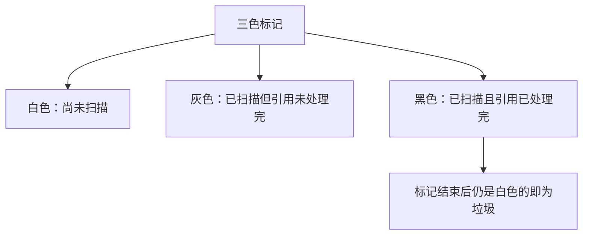

# JVM 垃圾回收：三色标记

面试题：说一下三色标记。

判断一个对象是否还有用，要靠根对象的引用链去找，找到就加标记，表示还有人在使用；没找到就不加标记，最后作为垃圾被回收掉。但添加标记这个动作不能一蹴而就，需要一个过程，三色标记就是用三种颜色记录对象在标记过程中所处的不同状态。它是并发垃圾回收器标记阶段的基础，这篇把三种颜色和标记过程讲清。

## 先给结论

- 用黑、灰、白三种颜色记录对象的标记状态。
- 黑色：沿着根对象的引用链已经找到这个对象，并且它内部的其他引用也都处理完成了，即已标记。
- 灰色：也沿着引用链找到了，但内部还有一些其他引用未被处理完成，即标记中。
- 白色：还未被处理的对象，标记结束后全部作为垃圾回收。
- 过程：灰色处理完成变黑，它引用的对象由白变灰，不断推进，直到没有灰色对象。

## 深入细节：三种颜色是什么

黑色表示：沿着根对象的引用链已经找到这个对象了，并且这个对象内部的其他引用也都处理完成了，这时把它标记为黑色。

灰色表示：也是沿着根对象的引用链找到了，但是内部还有一些其他引用还未被处理完成，这种情况标记为灰色，表示正在处理中。

最后剩下的还未被处理的对象，都是白色。

PPT 上把这一点总结为：用三种颜色记录对象的标记状态，黑色是已标记，灰色是标记中，白色是还未标记。

## 深入细节：标记过程怎么推进

看图加深理解。图上已经沿着根对象找到了三个对象，这三个对象还没处理完成，所以颜色是灰色的。

然后沿着引用链逐级处理：当处理完成的对象，颜色由灰色变成黑色；它们下一个引用的对象，就由白色变成灰色，表示正在处理中。这样不断进行：处理完成的变成黑色，正在处理的是灰色，还未处理的是白色。

等这个过程执行完毕，就是最终状态。所有黑色的对象都是沿着引用链能找到的，保留它们；剩下的白色对象已经没人再使用，作为垃圾被回收掉。

这就是三色标记的工作方式。

## 面试怎么答

1. 先给三色定义：黑是已标记，灰是标记中，白是还未标记。
2. 讲过程：灰色处理完成变黑，它引用的对象由白变灰，循环推进。
3. 讲终局：黑色的全部保留，白色的全部当垃圾回收。
4. 点一句延伸：三色标记是并发回收器标记阶段的基础，并发下会引出漏标问题，那是另一个专题。

常见追问：

- **问**：为什么需要灰色这个中间态？
  **答**：标记是渐进的过程，已发现但引用没处理完的对象，既不能算完成（黑），也不能算未发现（白）。灰色表示已发现、处理中，让过程可以一步一步推进。
- **问**：三色标记和并发漏标什么关系？
  **答**：三色标记本身描述的是标记过程；一旦标记和用户线程并发跑，用户线程改引用就可能造成漏标，这在下一次的并发漏标专题里专门讲。

## 常见误区

- **误区一**：以为黑色就是「还在用」。黑色是已标记完成，白色才是等待回收的，灰色是中间态。
- **误区二**：以为标记一次完成。标记是灰黑交替、逐级推进的过程，不是一步到位。

## 课件配图
> 以下配图取自阶段七课件对应讲义，与上文讲解一一对应，可作为图文对照辅助理解。
**JVM 垃圾回收**（课件讲义图示）

