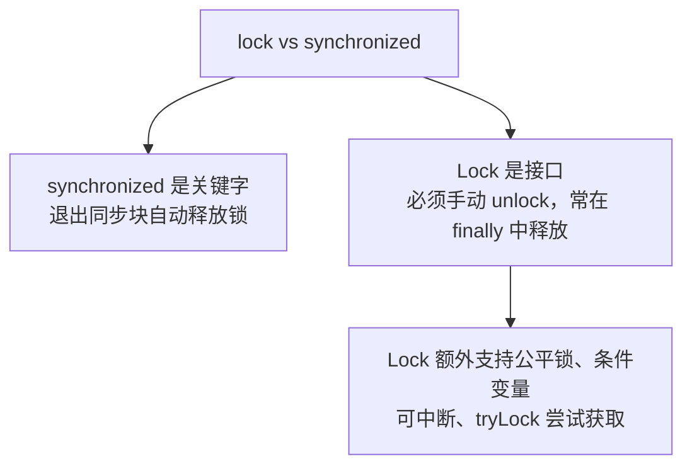

# Lock vs synchronized：三个层面的对比

面试题：对比一下 Lock 锁和 synchronized 锁。

这是并发编程的高频面试题。很多人只答得出「一个手动释放一个自动释放」，最多再加一句「Lock 功能多」，撑不起这道题。完整的答法分三个层面：语法层面、功能层面、性能层面，每层都有明确的对比点。这篇按这个结构展开。

## 先给结论

- 语法层面：synchronized 是 Java 关键字，源码在 JVM 里，用 C++ 实现，退出同步代码块自动释放锁；Lock 是 JDK 中的普通接口，源码用 Java 实现，要手动调 unlock 释放，一般配 try finally。
- 功能层面：二者都是悲观锁，都支持互斥、同步、可重入；Lock 还独有获取等待状态、公平锁、可打断、可超时、多条件变量，且有 ReentrantLock、ReentrantReadWriteLock 等不同实现适配不同场景。
- 性能层面：没有竞争或竞争很少时，synchronized 有偏向锁、轻量级锁等优化，性能不赖；竞争激烈时，Lock 的实现通常提供更好的性能。



## 深入细节：语法层面

synchronized 是 Java 中的关键字，它在语法层面实现了锁的功能，所以也被称之为 Java 中的内置锁。它的源码在 JVM 里，用 C++ 语言实现，要看原代码得看 JVM 的源码。退出同步代码块时，这个锁会自动释放，程序员不需要考虑锁的释放问题。

Lock 是 JDK 中的一个普通接口，源码直接看 JDK 的就可以，用 Java 语言实现。使用 Lock 时，程序员要考虑锁的释放问题，得手动调用它的 unlock 方法来释放。为了防止忘记释放锁，一般推荐写一个 try finally 块，在 finally 里调用 unlock。

synchronized 的写法长这样，锁的获取和释放由 JVM 在进、出 monitor 时自动插入指令，源码里看不到任何 lock、unlock 的痕迹：

```java
// 课件 day02/SyncVsCas.java：synchronized 写法，退出同步块自动释放锁
public static void sync(Account account) {
    Thread t1 = new Thread(() -> {
        synchronized (account) {
            int old = account.balance;
            int n = old - 5;
            account.balance = n;
        }
    },"t1");

    Thread t2 = new Thread(() -> {
        synchronized (account) {
            int o = account.balance;
            int n = o + 5;
            account.balance = n;
        }
    },"t2");

    showResult(account, t1, t2);
}
```

换成 Lock 就得自己成对写 lock 和 unlock，且 unlock 必须放 finally，否则中间抛异常锁就永远不释放了。这是语法层面最直观的差别，也是面试里最基础的一句。

## 深入细节：功能层面的相同点

二者都属于悲观锁，都具备锁的基本特性：互斥、同步、锁重入。

- **互斥**：多个线程争抢同一把锁，只有一个线程能成功，其他线程失败并陷入阻塞状态。
- **同步**：多个线程同时运行，一个线程运行到某一行代码时发现需要其他线程的结果，就不能继续往下运行，得等对方把结果算出来才能走下一步。synchronized 可以用 wait、notify 实现同步；Lock 可以用条件变量，也就是 await、signal 实现线程间的同步。
- **锁重入**：持锁的线程能不能对同一个对象重复加锁，加第二道、第三道。可以就叫可重入，不可以就叫不可重入。synchronized 和 Lock 都是可重入锁，加多道锁，解锁时也得解多道。

## 深入细节：功能层面的不同点

Lock 提供了很多 synchronized 不具备的功能：

- **获取等待状态**：synchronized 下一个线程成功了，其他线程失败阻塞住，但你想知道有哪些线程被阻塞了，synchronized 不行，Lock 有相应方法。类似地，很多线程在对象上调了 wait 等待，synchronized 没办法知道对象上有哪些线程在等待，Lock 也提供了方法。用 Java 语言实现，自然有接口能拿到更详细的信息；用 C++ 在 JVM 底层实现，想看这些信息就不方便。ReentrantLock 自带的 getOwner、getState 加上反射读 AQS 队列，就能把「谁拿着锁、谁在排队、谁在哪个条件上等」全打印出来：

```java
// 课件 day02/TestReentrantLock.java：把阻塞队列和条件等待队列打印出来
@Override
public String toString() {
    StringBuilder sb = new StringBuilder(512);
    String queuedInfo = getQueuedInfo();
    List<String> all = new ArrayList<>();
    all.add(String.format("| owner[%s] state[%s]", this.getOwner(), this.getState()));
    all.add(String.format("| blocked queue %s", queuedInfo));
    for (Map.Entry<String, Condition> entry : this.conditions.entrySet()) {
        String waitingInfo = getWaitingInfo(entry.getValue());
        all.add(String.format("| waiting queue [%s] %s", entry.getKey(), waitingInfo));
    }
    // 省略后续的对齐与边框输出
    return sb.toString();
}
```

同理，lock 对象上还有 hasQueuedThreads、getQueueLength、hasWaiters、getWaitQueueLength 这些现成方法，能直接问出有没有线程在等、等了多少个。synchronized 一个对象，除了 jstack 看线程栈，代码里拿不到任何等待信息。
- **公平锁**：公平与非公平看字面意思：多个线程抢锁，很多失败了，失败的线程将来获得锁的机会，是先来先得，还是允许别人插队。先来先得叫公平，允许插队叫非公平。synchronized 只支持非公平锁，Lock 两种都支持。但不要觉得公平锁就一定好，公平锁在吞吐量上通常不如非公平锁，插队效率更高，所以一般推荐用非公平的。公平与否在构造时用一个布尔参数决定：

```java
// 课件 day02/TestReentrantLock.java：true 表示公平锁；一个锁上可以开多个条件变量
static final MyReentrantLock LOCK = new MyReentrantLock(true);

static Condition c1 = LOCK.newCondition("c1");   // 条件变量一
static Condition c2 = LOCK.newCondition("c2");   // 条件变量二

// MyReentrantLock 只是在 ReentrantLock 基础上加了「给条件变量起名字」的能力
private static class MyReentrantLock extends ReentrantLock {
    private final Map<String, Condition> conditions = new HashMap<>();

    public MyReentrantLock(boolean fair) {
        super(fair);
    }

    public Condition newCondition(String name) {
        Condition condition = super.newCondition();
        conditions.put(name, condition);
        return condition;
    }
}
```

上面同时演示了两点：构造参数 true 打开公平锁；同一个锁 new 出 c1、c2 两个条件变量，对应两个独立的等待队列。synchronized 的 wait、notify 只有对象自带的那一个等待队列，想按条件区分唤醒，只能全唤醒再自己判断。
- **可打断、可超时**：synchronized 获取锁不支持打断、不支持超时。持锁线程拿到锁后，其他线程想获得锁就得死等，对方不释放就一直等，不能被打断，也没有等待超时的实现。Lock 提供了方法：等不到锁可以把它打断，不要无限制等待；也可以设置超时时间，规定时间内还拿不到就放弃。tryLock 带时间参数的写法：

```java
// 课件 day02/TestReentrantLock.java：tryLock 带超时，10 毫秒拿不到就放弃
try {
    boolean b = LOCK.tryLock(10, TimeUnit.MILLISECONDS);
    if (b) {
        System.out.println(Thread.currentThread().getName() + " acquire lock...");
        stop = true;
        sleep1s();
        LOCK.unlock();
    }
} catch (InterruptedException e) {
    e.printStackTrace();
}
```

注意 tryLock 拿到锁返回 true 才去 unlock，返回 false 说明压根没拿到锁，这时调 unlock 会抛 IllegalMonitorStateException。等待期间被打断则抛 InterruptedException，这就是「可打断」的落点。synchronized 没有对应的 API，进入 monitor 的等待只能死等。
- **多条件变量**：synchronized 的 wait、notify 相当于只对应一组条件变量，只有一个等待队列；Lock 可以有多个等待队列，也就是多条件变量。

另外，Lock 是接口，有很多实现，不同实现适合不同场景：最常用的 ReentrantLock 是基本的带重入功能的锁，reentrant 就是可重入的意思；ReentrantReadWriteLock 更适合读多写少的场景。按场景选实现能获得更好的性能。synchronized 没得选，只有一种实现，用 C++ 在 JVM 底层实现。

## 深入细节：性能层面

直接给结论：如果没有竞争或者竞争很少，synchronized 做了很多优化，比如偏向锁、轻量级锁，性能是 OK 的，不赖。但如果竞争比较激烈，Lock 的实现通常会提供更好的性能。

## 面试怎么答

按三层展开，每层先相同后不同，最后用性能结论收尾：

1. **语法**：synchronized 是 JVM 层关键字自动释放，Lock 是 JDK 接口手动 unlock。
2. **功能**：共同点是悲观锁、互斥、同步、可重入；Lock 多了等待状态、公平锁、可打断、可超时、多条件变量，还有多种实现。
3. **性能**：低竞争 synchronized 不差，高竞争 Lock 更好。

常见追问：

- **问**：为什么 Lock 要手动释放，synchronized 不用？
  **答**：synchronized 是 JVM 层面的关键字，退出同步块时由编译器和 JVM 保证释放；Lock 是普通 Java 接口，释放要显式调用 unlock，所以配 try finally 保证异常路径也能释放。
- **问**：公平锁不是更合理吗，为什么一般不推荐？
  **答**：公平锁按先来后到分配，吞吐量通常不如非公平锁，插队让线程少一次阻塞唤醒，效率更高。除非有明确的公平性需求，否则用非公平。
- **问**：Lock 的实现怎么选？
  **答**：默认用 ReentrantLock；读多写少的场景用 ReentrantReadWriteLock，让读读并发提升吞吐。

## 常见误区

- **误区一**：只答「一个自动释放一个手动释放」。语法只是三层里的一层，功能和性能才是拉开差距的地方。
- **误区二**：以为公平锁一定比非公平好。公平锁吞吐量通常更低，不特殊要求就用非公平。
