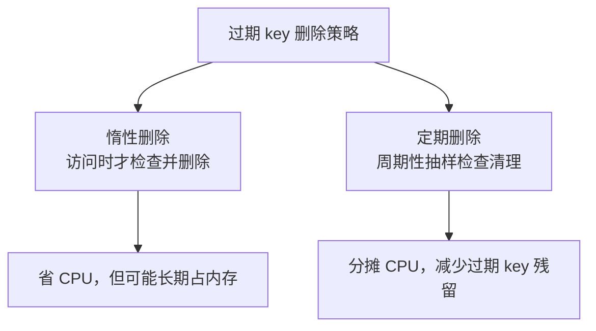

# Redis 过期 key 的删除策略：惰性删除加定期删除

面试题：说一下 Redis 过期 key 的删除策略。

Redis 的 key 不一定永久保存，可以设置过期时间，超过过期时间就会被清理掉。清理有不同的策略，这道题的标准答案是两种策略相结合：惰性删除和定期删除。答这道题要把过期时间记在哪、两种策略怎么干活、为什么必须结合，都说清楚。

## 先给结论

- Redis 采用惰性删除加定期删除相结合的策略。
- 惰性删除：key 过期了但没被访问，内存不释放；执行读写命令前才检查是否过期，过期才删。缺点是释放不及时。
- 定期删除：由 serverCron 定时任务处理器周期执行，默认 100 毫秒一次，随机抽查过期字典里的 key，删一点是一点。
- 两种结合的原因：惰性删除不够及时，定期删除每次能用的时间有限，互补才能兼顾内存和性能。

## 深入细节：过期时间记在哪

先回顾怎么设置过期时间，方法很丰富：

- 用 setEx 命令，设置键和值的同时添加过期时间，单位是秒。
- 用 set 命令，在 set 键值的时候指定 EX 参数设置过期时间，单位是秒；也可以指定 PX 参数，单位是毫秒。
- 如果 key 已经存在，想让它过期，用 expire 命令给已存在的 key 设置过期时间，单位是秒；用 pexpire 的话单位是毫秒。

设置了过期时间以后，过期时间的信息记录到哪里？Redis 有多个库，每个库都包含一个叫 expires 的过期字典。字典是哈希表结构，其中键是一个指针，指向真正的 key，值记录了那个过期时间，是 long 类型的时间戳，精度可以达到毫秒。当设置某个 key 有过期时间时，就会向 expires 过期字典里添加这个 key 的指针和对应的时间戳，相当于把过期时间记录到这个过期字典里。

## 深入细节：惰性删除

惰性删除就是：key 可能已经过期了，但如果没有访问到它，它占用的内存并不释放。什么时候真正释放？当你读写数据库的命令执行到这个 key，在执行它的增删改查操作之前，会检查这个 key 是不是过期，也就是当前时间是否已经大于它记录的时间戳。如果已经过期，就删除这个 key。

惰性删除的缺点显而易见：如果没有访问到这个 key，那它即使过期了，占用的内存也得不到释放，只有访问到并做增删改查时才检查、才删除。一句话，删除释放内存不够及时。

## 深入细节：定期删除

为了避免惰性删除释放不及时的问题，Redis 同时结合了定期删除。

Redis 有一个定时任务处理器叫 serverCron，专门负责周期性的任务处理，默认情况下 100 毫秒执行一次，也就是一秒钟执行 10 次。执行频率可以通过 Redis Config 里的 hz 参数控制。

这个周期性任务处理做的事情有若干：处理过期的 key，hash 表做 rehash 的时候那个渐进式 rehash，更新一些统计结果，做 AOF 和 RDB 的持久化，清理过期的一些客户端。处理过期 key 就相当于一种主动处理过期 key 的手段，每隔一段时间就执行一次、清理一次。

具体工作流程：它会依次遍历各个库，在规定时间内做如下操作。之所以规定时间，是因为不能让周期性任务里处理过期 key 的时间占用太长，太长了会阻塞正常业务的增删改查，所以每次执行一点点，没执行完就等下一轮 serverCron 接着做。

每一次的具体操作：从每个库的 expires 过期字典里随机选择 20 个 key 进行检查，如果挑到的这 20 个 key 里面有过期的，就真正删除掉，把占用的内存释放。如果删除达到了 5 个，也就是超过四分之一了，说明这个库过期 key 比较多，就重复刚才的步骤再删，直到删除的过期 key 个数少于 5 个，才认为这个库过期 key 的占比已经小于四分之一，可以遍历下一个库。

注意它的目标不是说一次把所有的过期 key 都删完，只要每个库的过期 key 占总 key 的比例降到四分之一以下，就先放过它。

如果规定时间内没做完，就等待下一轮 serverCron，再等 100 毫秒，重复这个事情，每次删一点。这个规定时间是动态变化的，默认情况下最大值是 2.5 毫秒，也就是每 100 毫秒执行一次清理操作，其中留 2.5 毫秒给过期 key 的删除。2.5 毫秒内没做完不着急，先暂停，等下一轮再做。

## 面试怎么答

1. 先给组合策略：惰性删除加定期删除，Redis 是两者结合。
2. 讲过期时间存哪：每个库一个 expires 过期字典，键是指向 key 的指针，值是毫秒精度的时间戳。
3. 讲惰性删除：访问时才检查，过期即删，缺点是不访问不释放。
4. 讲定期删除：serverCron 默认 100 毫秒一轮，每库随机抽 20 个，删除超 5 个就继续抽，目标是把过期占比压到四分之一以下；单轮时间有上限，默认最大 2.5 毫秒。
5. 收尾：两种结合，兼顾内存释放及时性和业务不被阻塞。

常见追问：

- **问**：为什么不能只用惰性删除？
  **答**：过期但不被访问的 key 会一直占内存，释放不及时，冷 key 堆积可能浪费大量内存。
- **问**：为什么不能全靠定期删除？
  **答**：清理要占用 CPU 时间，一次删太久会阻塞正常命令，所以只能每次删一点、分多轮，天然存在延迟。

## 常见误区

- **误区一**：以为 key 到点就删。惰性删除下不被访问就不会释放，还有定期删除的兜底也是抽检。
- **误区二**：以为定期删除一次删完。它的目标只是把每个库过期 key 的占比压到四分之一以下，而且单轮时间有上限。
