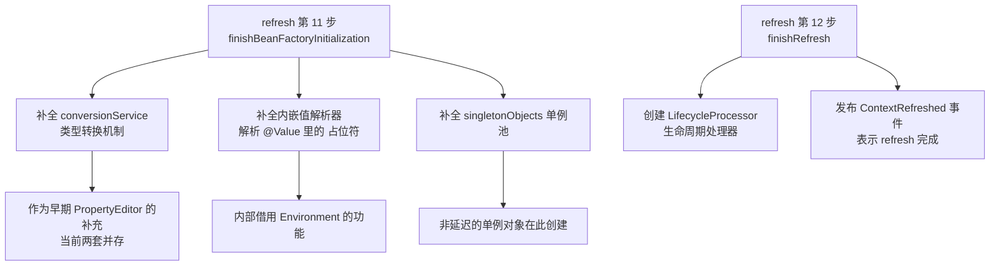

# Spring refresh 第 11、12 步：创建单例与完成 refresh

面试题：说一下 refresh 流程最后两步做了什么。

refresh 十二步走到收尾。第 11 步把 BeanFactory 剩余的部件补完整，并趁机把所有非延迟单例创建出来；第 12 步创建生命周期处理器，发布容器刷新完成事件。十二步走完，容器就真正可用了。这篇把最后两步过完。

## 先给结论

- 第 11 步 finishBeanFactoryInitialization：补全 conversionService、内嵌值解析器和 singletonObjects 单例池，非延迟的单例对象在这一步创建。
- conversionService 是一套类型转换机制，作为对早期 PropertyEditor 的补充，当前两套并存。
- 内嵌值解析器负责解析 @Value 里的 ${}，内部借用 Environment 的功能。
- 第 12 步 finishRefresh：创建 LifecycleProcessor 生命周期处理器，最后发布 ContextRefreshed 事件，表示 refresh 完成。

## 深入细节：第 11 步，补全 BeanFactory

第 11 步把 BeanFactory 剩余的几个部分补充完整。

### conversionService

conversionService 也是做类型转换的。有同学会问：之前提过 PropertyEditor 是做类型转换的，为什么还要一个 conversionService？

这是 Spring 的历史原因。最早 Spring 用 PropertyEditor 做类型转换，后来发现这套接口功能上有些欠考虑、不完整，于是又设计了另外一套接口，叫 conversionService，作为对 PropertyEditor 的补充。当前 Spring 中这两套转换系统是并存的，conversionService 并没有取代 PropertyEditor。

### 内嵌值解析器

embeddedValueResolvers 是解析 ${} 大括号的。之前解析 ${} 用到的是 Environment，这个内嵌值解析器相当于又封装了一次，它间接调用 Environment 中的功能来完成 ${} 的解析，只不过它是从属于 BeanFactory 的成员，专职做内嵌值的解析。

### 单例池 singletonObjects

最后一个比较重要的是 singletonObjects，从名字能看出来，它是单例对象的集合。

这一步，BeanFactory 会找到 beanDefinitionMap 中所有的单例对象。前提是非延迟单例：Bean 有一个属性标识延迟还是非延迟，非延迟的就在这一步把对应的实例对象创建出来；延迟的则等第一次用到时才创建。

创建时根据 BeanDefinition 的信息来建：是不是单例、有没有初始化方法、有没有依赖等等。之前提到的那些 BeanPostProcessor 在这个过程中都会派上用场，它们工作在 Bean 创建的各个阶段。

对象创建的三大阶段：一个是 Bean 的创建，一个是依赖注入，还有一个是初始化。每个阶段都有不同的 Bean 后处理器参与进来，实现功能上的扩展。Bean 创建的详细流程另有专门的面试题讲，这里不展开。

到第 11 步为止，BeanFactory 里面所有的成员都补充完整了，最重要的就是单例池里的非延迟单例对象都被创建出来。

## 深入细节：第 12 步，finishRefresh

第 12 步叫 finishRefresh，终于要完成 refresh 了。

这一步给 ApplicationContext 创建一个成员，叫 lifecycleProcessor，生命周期处理器。整个 Spring 容器中有很多 Bean，它们有自己独立的生命周期，有启动、停止这样的处理。注意这里的生命周期不是指初始化、销毁，你可以把它理解成一个服务：服务总有启动，将来可能把它停止。它指的是这种启动停止的生命周期。

生命周期处理器从何而来？先到容器里找，看有没有一个叫 lifecycleProcessor 的 Bean，有就直接用；没有的话，有一个默认的生命周期处理器。

它怎么控制生命周期？这个处理器内部有方法，会去调用 BeanFactory 中其他实现了 Lifecycle 接口的 Bean 的 start 方法；处理器的 stop 方法一调，就会间接调用这些实现了 Lifecycle 接口的 Bean 的 stop 方法。它起一个总控的作用，像个带头大哥：我的 start 一执行，你们这些 Bean 的 start 也都执行；我的 stop 一执行，你们的 stop 也都执行。

实际使用中不用直接去操作这个处理器，只要通过 ApplicationContext 调用它的 start 方法，就可以触发所有实现 Lifecycle 接口的 Bean 的 start；调 context 的 stop，就触发所有的 stop。

最后，发布一个 ContextRefreshed 事件，表示整个 Spring 容器已经 refresh 完成、初始化完成了。到此，refresh 的十二个阶段就全部走完。

## 面试怎么答

1. 第 11 步讲三件事：conversionService 补类型转换、内嵌值解析器解析 ${}、单例池创建非延迟单例。
2. 点出关键：非延迟单例在这一步才真正实例化，之前十步都在做准备。
3. 第 12 步讲两件事：创建 LifecycleProcessor 管启动停止，发布 ContextRefreshed 事件收尾。
4. 补一句生命周期语义：Lifecycle 管的是服务级的启动停止，不是初始化和销毁。

常见追问：

- **问**：延迟注入的单例什么时候创建？
  **答**：第 11 步只创建非延迟单例，延迟单例等第一次真正使用时才创建。
- **问**：为什么 conversionService 和 PropertyEditor 并存？
  **答**：历史原因。PropertyEditor 是最早的转换接口，功能不完整，Spring 又设计了 conversionService 补充，为兼容老代码没有移除旧的一套。

## 常见误区

- **误区一**：把 Lifecycle 的启动停止和 Bean 的初始化销毁混为一谈。前者是服务级生命周期，由 LifecycleProcessor 统一控制；后者是 Bean 创建销毁流程的一部分。
- **误区二**：以为所有单例在 refresh 一开始就建好。前 ten 步都在搭架子，非延迟单例到第 11 步才创建，延迟的更晚。
