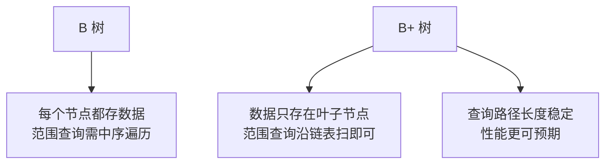

# B 树 vs B+ 树：三个区别

面试题：对比一下 B 树和 B+ 树。

上节课讲了为什么 MySQL 用 B+ 树做索引：更适合磁盘数据的索引，而且支持等值查询和范围查询。这节课把 BTree 和 B+Tree 摆在一起对比，搞清楚三个区别，索引部分就算串起来了。

## 先给结论

- 区别一：BTree 的键和值存储在每个节点上，不管叶子还是非叶子；B+Tree 的普通节点只存键，只有叶子节点存键和值。
- 区别二：B+Tree 的叶子节点之间用链表连接，方便范围查询和全表遍历；BTree 做遍历要用中序遍历，效率不高。
- 区别三：两者都是平衡的 n 叉树，根节点到叶子节点的距离都一样；但 BTree 找到键就可能找到值，不一定到达叶子，B+Tree 必须走到叶子节点才能找到值。

## 深入细节：三个区别逐个看

### 区别一：值和键存在哪

BTree 的键和值存储在每个节点上，不管你是叶子节点还是非叶子节点。图里从 1 到 16 这些都是键，虽然只画了键没画值，但要知道 BTree 每个节点里不光有键，也存储了它们对应的值。不管是非叶子节点还是边缘上的叶子节点，都是既有键又有值。

B+Tree 不一样：它的非叶子节点，也就是普通节点上，只存储键；叶子节点才会存储键和值。同样是从 1 到 16 这些键，非叶子节点只存键不存值，只有叶子节点上才存储值。

这是两者最大的区别。理由上节课讲过：B+Tree 非叶子节点只存键不存值，平均分叉数就会更多，树高就更小，磁盘 IO 更少。

### 区别二：键可能重复

既然 B+Tree 不存值，那它这个键就有可能重复。大家看，它的非叶子节点上有 05、09 和 0013，那它的叶子节点上也得有 05、09 和 0013。因为你得一路找到叶子节点，才能找到键对应的值，所以非叶子节点上的键会在叶子节点重复出现，造成一些键的重复。

BTree 就没有这个情况，因为它的值跟键关联在一起，键在非叶子和叶子节点上不会有重复现象。

### 区别三：叶子链表与遍历

B+Tree 的叶子节点之间采用链表进行了连接，图上有箭头表示。这样可以方便范围查询或者全表扫描、全表遍历。

如果是 BTree，想做遍历，比如从 01 到 0016 全部过一遍，得用中序遍历：找到节点以后还得找它的父节点才能找到相邻的元素，再一个个往下走，得用中序遍历去遍历，效率不是很高。

而 B+Tree 因为所有的键和数据都在叶子节点上，叶子之间又有链表连接，就可以很轻易地实现全表遍历：直接遍历所有叶子节点，非常简单，不需要复杂的中序遍历。

### 相同点与查询路径

相同点：不管 BTree 还是 B+Tree，它们都是平衡的 n 叉树，根节点到叶子节点的距离都一样。

查询路径上有差异：B+Tree 必须走到叶子节点才能找到值；BTree 稍微有些不一样，比如要找 5 对应的值，找到 5 以后，因为值跟键关联在一起，就不用继续找到叶子节点，也许到不了叶子就能找到值。同样找 5，B+Tree 就必须找到叶子节点才能找到它关联的值。

## 面试怎么答

1. 先给结论三条：值存哪、叶子链表、是否必须到叶子。
2. 每个区别配一句原因：只存键是为了增大分叉数压低树高，叶子链表是为了范围和全表遍历，必须到叶是因为值都在叶子。
3. 补相同点：都是平衡 n 叉树，根到叶子距离相同。
4. 串起上节课：正因为只存键、分叉多、树高低，MySQL 才选 B+Tree 做磁盘索引。

常见追问：

- **问**：B+Tree 的键重复是不是浪费？
  **答**：非叶子节点的键是索引路标，重复出现是为了让查找能一路落到叶子。换来的是分叉数大增、树高下降，IO 次数减少，这个交换划算。
- **问**：范围查询为什么 B+Tree 快？
  **答**：定位到范围起点后，沿着叶子链表顺序往后走即可，不用反复回到父节点做中序遍历。

## 常见误区

- **误区一**：以为 B+Tree 就是 BTree 加了个链表。存储位置不同是更根本的区别，链表是为此服务的。
- **误区二**：以为 B+Tree 的键不会重复。非叶子节点的键会在叶子节点重复出现，这是只存键的必然结果。

## 课件配图
> 以下配图取自阶段七课件对应讲义，与上文讲解一一对应，可作为图文对照辅助理解。
**索引基础**（课件讲义图示）

