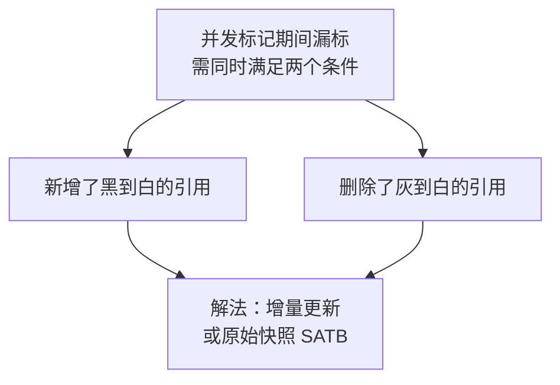

# JVM 垃圾回收：并发漏标问题与两种解法

面试题：什么是并发漏标，怎么解决？

三色标记假设标记期间没人打扰，但现在的垃圾回收器都朝着并发的方向努力：垃圾回收线程运行的同时，用户线程继续运行，减少暂停时间。问题就来了，用户线程一旦改动对象间的引用关系，就会干扰标记结果，产生漏标。这篇讲漏标怎么发生，以及增量更新和原始快照两种解法。

## 先给结论

- 系统里有两类线程：垃圾回收线程和用户线程。早期回收器运行 GC 就要 stop the world，用户线程暂停。
- 现在的并发回收器只在某些阶段并发，典型场景是老年代回收的标记阶段，此时用户线程不受干扰继续运行。
- 并发带来漏标：用户线程改动引用关系，已经处理过的黑色对象不会再被二次处理，被它引用的白色对象就会漏标，被误当垃圾回收。
- 两种解法：增量更新（Incremental Update）和原始快照（SATB，Snapshot At The Beginning），目标都是把标记过程中的变化记录下来，并发标记结束后再 stop the world 做一次重新标记。

## 深入细节：漏标是怎么发生的

看一个中间状态：黑色是已经处理过的对象，灰色是正在处理的对象，白色是尚未处理的对象。垃圾回收线程正在运行，与此同时用户线程也在运行，它就有可能改变当前这些对象的引用关系。

正常情况下，最右侧的白色对象有从根对象指向它的引用，将来它会变成黑色被保留下来。

假设用户线程做了两个改动：第一，把灰色对象和这个白色对象之间的引用关系断开，这样一来最终这个对象没人引用，会变成真正的白色对象被回收；第二，用户线程又把之前处理过的黑色对象和这个白色对象之间加了一个引用。

问题来了：这个白色对象现在有引用，不该被回收，回收它就错了。但垃圾回收线程已经处理过这个黑色对象了，没有任何控制的话，它不会第二遍再来关顾这个黑色对象。于是最后这个对象没被做标记，还被认为是白色的、可以被回收，这就是漏标。

还有第二种场景：垃圾回收运行过程中新增了对象，新增对象也可能被黑色对象引用，这样的新增对象最终也会被回收、被漏标。根源都一样：黑色对象已经处理过了，不会对它们进行二次处理。

## 深入细节：两种解法

两种方案目标类似，都是要把标记过程中的变化记录下来，不记录就可能漏标。

### 增量更新

增量更新的规则是：只要赋值发生，被赋值的对象就会被记录。

比如上面例子里，白色对象被赋值给了黑色对象的一个成员变量，也就是建立了引用关系，被赋值对象就是这个黑色对象。垃圾回收线程会监控所有的赋值动作，一旦发现发生这种赋值，就把被赋值的黑色对象记录下来。换句话说，这时候它已经不是黑色的了，又变回了灰色。

等并发标记做完，必须 stop the world，让用户线程先别运行，再对标记过程中记录下来的这些对象做一遍处理，这一步叫重新标记，前面那一步叫并发标记。这样就不会遗漏这些对象。

### 原始快照

原始快照记录的信息不一样。它首先记录新加的对象，也就是标记过程中新分配的对象，这个它能知道，把新增的白色对象记录下来。

另外，被删除引用关系的对象也会被记录。它同样监控引用的变更，监控所有成员变量的赋值操作。上面例子里断开了引用关系，这个断开的操作会被监控到，但记录的不是黑色对象，而是被断开引用关系的那个白色对象。

也就是说，原始快照记录的是新增的对象和删除掉引用关系的对象。

同样，并发标记结束以后，暂停用户线程进入重新标记阶段，把刚才记录的这些对象重新过一遍，防止遗漏。

不管是哪种方案，最终都是通过记录标记过程中的变化来解决漏标问题。

## 面试怎么答

1. 先给背景：GC 线程和用户线程并发跑，用户线程改引用会干扰标记。
2. 讲漏标场景：黑色对象已处理完不会被二次处理，被黑色对象新引用的白色对象漏标被误回收。
3. 给两种解法：增量更新记录被赋值的黑色对象，把它重新变灰；原始快照记录新增对象和被删引用的对象。
4. 点共同点：都是记录变化，都在并发标记后 stop the world 做重新标记收尾。

常见追问：

- **问**：为什么最后都要 stop the world？
  **答**：并发标记阶段用户线程在改引用，记录的变化只是快照，必须在用户线程暂停后把这些记录的对象重新处理一遍，才能保证标记结果准确。
- **问**：两种解法记录的对象为什么不一样？
  **答**：增量更新盯的是新建立的引用，把被引用的黑色对象拉回重处理；原始快照盯的是变化本身，把新增的对象和被删引用的对象都记账，重新标记时统一过一遍。路径不同，目标一致。

## 常见误区

- **误区一**：以为并发回收全程不暂停。并发标记之后仍有 stop the world 的重新标记阶段，只是暂停时间大大缩短。
- **误区二**：以为漏标只会发生在老年代。漏标的根源是并发标记期间引用被改，哪个阶段并发标记，哪个阶段就要处理漏标。

## 课件配图
> 以下配图取自阶段七课件对应讲义，与上文讲解一一对应，可作为图文对照辅助理解。
**JVM 垃圾回收**（课件讲义图示）

