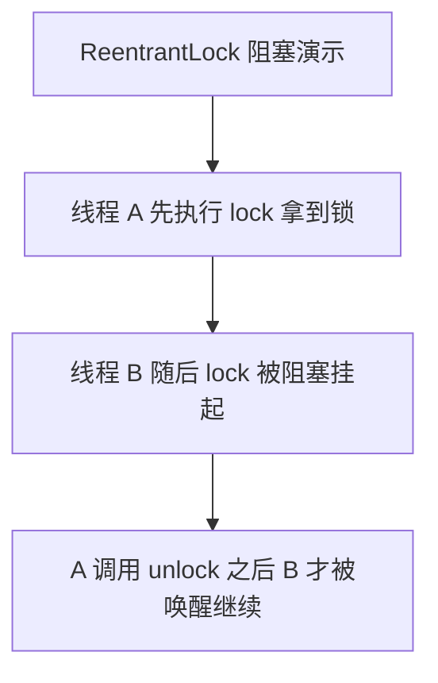

# Lock 阻塞队列演示：ReentrantLock 的底层结构

面试题：ReentrantLock 的阻塞队列是怎么工作的？

上一篇从语法、功能、性能三个层面对比了 Lock 和 synchronized。这篇用代码演示 Lock 的底层结构：重写 MyReentrantLock 的 toString 方法，把锁内部的数据结构打印出来，在调试过程里观察线程竞争锁时，owner、state、阻塞队列怎么变。可打断、可超时这些特性之前的视频讲过，这里不重复。

## 先给结论

- ReentrantLock 内部有几个关键成员：owner 记录锁的持有者，state 记录加锁状态，blocked queue 是获取锁失败的线程的等待队列，waiting queue 是条件变量的等待队列。
- owner 初始为 null，谁加锁成功就记谁；state 初始为 0，加锁成功加 1，重入累加，解锁减 1，归 0 表示锁无人占用。
- 获取锁失败的线程进入 blocked queue 等待，它是一个双向链表，队头是不关联任何线程的占位节点。
- 解锁时从队列找下一个等待线程唤醒，按入队顺序一个一个成为持有者。



## 深入细节：锁的内部结构

为了更好地理解 ReentrantLock 底层的数据结构，写一个 MyReentrantLock 类继承 ReentrantLock，不加扩展功能，只重写 toString 方法，把底层的详细数据结构打印出来。调用锁方法时直接打印这个锁对象，就能看到内部结构。

无人持锁时的状态是这样的：

- **owner**：锁的持有者，初始值为 null，表示没有线程获得这把锁。将来有线程加锁成功，它就变成对应线程。
- **state**：加锁状态，初始取值是 0，表示没有人对它加锁。有线程加锁成功就变成 1，数字会增加。Lock 是可重入锁，同一个线程加多道锁，这个数字会不断增加；每解锁一次数字减 1，解锁到 0 才表示这个锁又没有人占用。
- **blocked queue**：阻塞队列。获取锁失败时，线程进入这个阻塞队列来等待。现在队列里没有内容，表示还没有线程陷入等待。
- **waiting queue**：等待队列，对应条件变量，主要做线程同步。它是自己创建的，通过锁对象的 newCondition 方法创建出来。获得了锁以后条件不满足，想先把锁释放给别人用，当前线程就需要一个地方等待，这个位置就是 waiting queue。

底层结构上，blocked queue 是一个双向链表，waiting queue 是一个单向链表。waiting queue 可以有零到多个，这里创建了两个，所以打印出两个。创建条件变量走的是锁对象的 newCondition 方法，重写后的方法把条件变量按名字存起来，方便打印时区分：

```java
public Condition newCondition(String name) {
    Condition condition = super.newCondition();
    conditions.put(name, condition);
    return condition;
}
```

演示代码的骨架长这样，锁对象带两个条件变量 c1 和 c2：

```java
public class TestReentrantLock {
    static final MyReentrantLock LOCK = new MyReentrantLock(false);
    static Condition c1 = LOCK.newCondition(name: "c1");
    static Condition c2 = LOCK.newCondition(name: "c2");
    static volatile boolean stop = false;

    public static void main(String[] args) throws InterruptedException, IOException {
        // ... 省略部分代码 ...
    }
}
```

## 深入细节：四个线程竞争锁

创建 T1、T2、T3、T4 四个线程去获得锁，都调锁对象的 lock 方法。启动线程的代码大致这样，每个线程错开 100 毫秒启动：

```java
private static void learnLock() throws InterruptedException {
    System.out.println(LOCK);
    new MyThread(() -> {
        LOCK.lock();
        get("t").debug("acquire lock...");
    }, name: "t1").start();
    Thread.sleep(millis: 100);
    new MyThread(() -> {
        LOCK.lock();
        get("t").debug("acquire lock...");
    }, name: "t2").start();
    Thread.sleep(millis: 100);
    new MyThread(() -> {
        LOCK.lock();
        get("t").debug("acquire lock...");
    }, name: "t3").start();
}
```
故意让第一个线程先获得锁，其他线程依次晚 0.1 秒启动，把启动时间错开，保证顺序是预料的顺序。

debug 运行，当前状态：

- 能获得锁的是 T1，它是锁的持有者。owner 是 T1，state 是 1，加锁成功把最初的 0 改成了 1。此时打印出的锁状态是这样：

```text
Lock
owner[t1] state[1]
blocked queue
waiting queue [c1]
waiting queue [c2]
```

- T2、T3、T4 获得不了锁，进入 blocked queue 等待。队列里现在有三个线程：最前面是一个用来占位的节点，不对应任何线程；接着是 T2，因为 T2 第二个启动尝试获取锁，按顺序加入队列；然后是 T3、T4。底层是双向链表，控制台上用箭头表示。

调用锁对象的 unlock 方法把锁释放：从队列里找下一个等待锁的线程，把它唤醒，让它获得锁。切换过去看，当前持有者变成了 T2，state 仍然是 1。blocked queue 里少了一个线程，因为 T2 已经被唤醒去成为持有者，仍然被阻塞的是 T3 和 T4。

T2 能不能重复加锁？可以，再调一次 lock，重加一遍，state 从 1 变成 2，其他都不变。解锁就要解两道，调一次 unlock 只把数字减 1，再调一次才变成 0，变成 0 才意味着完全放弃对锁的占用，其他线程才有机会占用这把锁。

继续执行，下一个获得锁的是 T3：先把 state 从 1 变 0，T3 再把 0 变成 1，blocked queue 里只剩一个 T4。控制台上的调试输出依次是：

```text
[DEBUG] 15:35:36.436 [t1] - acquire lock...
[DEBUG] 15:37:37.875 [t2] - acquire lock...
[DEBUG] 15:39:19.467 [t3] - acquire lock...
```

T3 持锁时的锁状态打印出来是：

```text
Lock
owner[t3] state[1]
blocked queue
waiting queue [c1]
waiting queue [c2]
```

通过这个案例就理解了 blocked queue 的结构：按入队的顺序，一个一个唤醒下一个线程成为接下来的锁持有者。

这里留个问题：ReentrantLock 是非公平锁，非公平性体现在哪？从演示看唤醒还是按入队顺序，非公平性的体现下一个视频说明。

## 面试怎么答

1. 先给内部结构四件套：owner、state、blocked queue、waiting queue，各自干什么。
2. 讲 state 的变化规则：加锁加 1、重入累加、解锁减 1、归 0 释放，这是可重入的计数原理。
3. 讲 blocked queue 的行为：失败入队、解锁唤醒下一个、按入队顺序推进。
4. 补一句数据结构细节：blocked queue 是双向链表、waiting queue 是单向链表且可以有多个，对应多个条件变量。

常见追问：

- **问**：state 为什么能体现可重入？
  **答**：state 是加锁计数。同一个线程每加一次锁数字加 1，每解一次减 1，减到 0 才真正释放。重入几次就要解几次，数字对不上就说明解锁次数不对。
- **问**：blocked queue 和 waiting queue 有什么区别？
  **答**：blocked queue 里是竞争锁失败的线程，等锁释放被唤醒；waiting queue 里是拿了锁但条件不满足、主动调 await 释放锁等待的线程，等 signal 唤醒。一个双向链表，一个单向链表且可以有多个。

## 常见误区

- **误区一**：以为解锁一次就释放锁。重入几次就要解几次，state 归 0 才是真正释放。
- **误区二**：把阻塞队列和条件变量等待队列混为一谈。一个是抢锁失败的排队，一个是条件不满足的主动等待，唤醒方式也不同。
