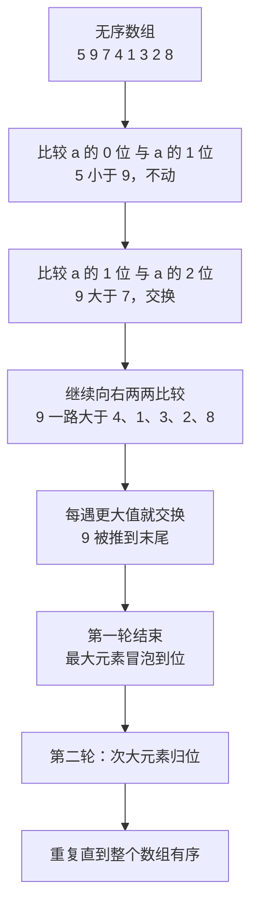

# 冒泡排序：相邻比较与交换

面试题：说一下冒泡排序的实现思路。

排序是面试的高频章节。学习目标有三个：掌握常见排序算法的实现思路，重点是思路不是逐行背代码；冒泡和快排这两个重点算法要求能手写且熟练；还要了解各算法的特性，比如时间复杂度、是否稳定。这篇从最简单的冒泡排序讲起，先把效果演示看明白，思路自然就清楚了。

## 先给结论

- 冒泡排序的关键：相邻的两个元素进行比较。
- 前一个小于后一个，位置可以不动；前一个大于后一个，交换两个元素的位置。
- 一轮比较走完，最大的元素被冒泡到数组末尾，完成一轮冒泡。
- 重复这个动作，直到所有元素排序完成。



## 深入细节：效果演示

有一个无序数组，用冒泡的方式排序。

刚开始选择索引 0 和索引 1 这两个元素进行比较。前一个小于后一个，位置不动。接下来把索引 1 和索引 2 的两个元素比较，发现前一个大于后一个，交换它俩的位置。

以此类推，继续下一对相邻元素。比如 9 大于 4，交换；9 大于 1，交换；9 大于 3，交换；9 大于 2，交换；9 大于 8，交换。

到此为止，最大的 9 已经移到数组的最后，相当于把最大的元素冒泡成功了，这完成了一轮冒泡。

接下来重复这个动作：第二轮，次大的元素冒泡到位；第三轮，继续把当前最大的冒泡到位。每一轮冒泡把一个当前最大值送到它最终该在的位置，直到所有元素排序完成。

演示用的数组是 5、9、7、4、1、3、2、8。第一轮里 5 和 9 比不动，9 一路向右交换，把 9 送到末尾。直观上看，就是大的元素像气泡一样一个个浮到右侧。

用代码把这个过程跑出来：

```java
public class BubbleSort {
    public static void main(String[] args) {
        int[] a = {5, 9, 7, 4, 1, 3, 2, 8};
        bubble(a);
    }

    public static void bubble(int[] a) {
        for (int j = 0; j < a.length - 1; j++) {      // 外层：控制轮数
            for (int i = 0; i < a.length - 1 - j; i++) { // 内层：相邻比较与交换
                System.out.println("比较次数" + i);
                if (a[i] > a[i + 1]) {
                    Utils.swap(a, i, i + 1);
                }
            }
            System.out.println("第" + j + "轮冒泡" + Arrays.toString(a));
        }
    }
}
```

## 面试怎么答

1. 先给一句话思路：相邻比较，小的留前，大的往后换，每轮把当前最大值冒到末尾。
2. 用演示数组走第一轮：从索引 0 和 1 开始，逐个比较相邻对，逆序就交换。
3. 补一句边界意识：每轮比较的对数比上一轮少一个，因为末尾已经就位的不再参与。
4. 强调冒泡和快排要求能手写，思路讲清楚后代码自然写得出来。

常见追问：

- **问**：冒泡排序的时间复杂度和稳定性了解吗？
  **答**：这是排序算法必须了解的特性。本课的目标就是既要会写冒泡、快排的代码，也要能说出各算法的时间复杂度和是否稳定，面试常作为组合追问。
- **问**：为什么叫冒泡？
  **答**：大的元素在一轮轮相邻交换中不断向右浮，像气泡上浮，最大的先到位，所以叫冒泡排序。

## 常见误区

- **误区一**：以为每一轮都要比较所有相邻对。实际上每轮结束末尾就位一个元素，下一轮少比一对。
- **误区二**：只满足于看演示。冒泡是要求能手写的重点算法，思路清楚之后要能把代码写熟。

## 课件配套可视化 Demo

> 本算法的交互式可视化页面已随本系列一并打包：[demos/day01_bubble_sort.html](/demos/java-suite/day01_bubble_sort.html)（纯 Canvas 实现，无需任何外部依赖，直接用浏览器打开即可）。

页面用柱状图逐步展示相邻元素比较与交换，以及每轮把当前最大值「冒泡」到末尾的过程，可直观看到比较次数与交换次数的变化。本系列 059–101 冒泡排序博客（初步实现、减少比较次数、减少冒泡次数、最终优化等）都能用同一页面边看边验证。
