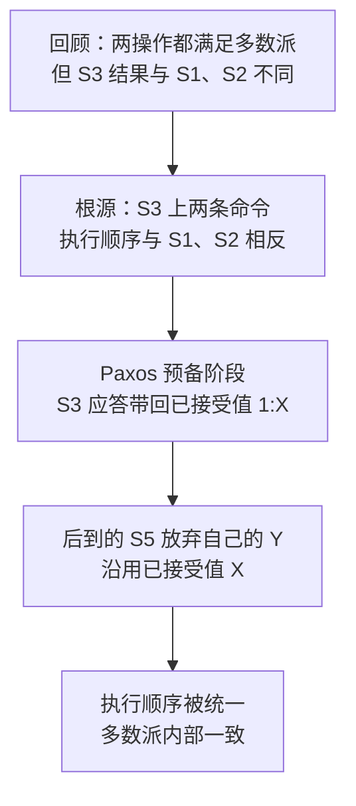

# Paxos 算法例5：用两阶段解决顺序问题

面试题：分布式系统中两个服务器都想修改同一个变量，能保证一致性吗？

有了 Paxos 算法的基础，回头看一开始提出的问题：分布式系统里两个服务器都想对同一个变量做修改，能否保证它们的一致性？答案是一个阶段搞不定，必须靠 Paxos 的两个阶段。这篇用 set x 0 和自增两个操作的冲突，把顺序问题讲清楚。

## 先给结论

- 只用一个阶段，搞不定多个修改操作的顺序问题，多数派内部都可能不一致。
- Paxos 把修改值、执行增删改命令分成 prepare 和 accept 两个阶段，用提案号约束执行顺序。
- 先 prepare 后 accept：一号提案的 accept 因最小提案号被推高而失败，set 操作不执行，自增操作获得一致性。
- 先 accept 后 prepare：后到者在 prepare 应答里拿到先执行的命令，用它替换自己的命令，最终结果统一。

## 深入细节：顺序问题是怎么回事

假设 x 的初始值是 5。两个操作：S5 做 set x 0，另一个服务器做自增 incr x。

如果没有问题，多数派已经返回说都接受了 x=0 这个值。但是对于自增操作，它就产生了矛盾。

重点看中间的 S3：S3 先做了 set x 0，然后再做了自增，因此它是在 0 的基础上做的自增，得到的结果是 x 等于 1。而 S1 和 S2 这两个服务器，还是在原始的 5 的基础上做的自增，所以得到的值是 x 等于 6。

虽然返回了一个多数派的结果，但多数派内部它都不一致，这三个服务器之间都不一致，返回多数派又有什么用处？

所以说，一个阶段搞不定这种顺序性的问题，就是执行多个修改操作它的顺序问题。

## 深入细节：Paxos 怎么解决

Paxos 算法把整个修改值、执行一些增删改的命令，分成了两个阶段：prepare 阶段和 accept 阶段。

还是刚才这两个操作：S1 执行 set x 0，S5 执行自增。过程简化一下，分两种情况。

### 情况一：先 prepare 后 accept

假设 S3 先黄后成，也就是先执行了二号提案的 prepare，然后再执行一号提案的 accept。

一号提案的 accept 在执行的时候会发现：当前的最小提案号已经比它自己的提案号大了。所以它这个 set x 0 操作根本就不会记录，而且会返回一个最小提案号 2 给 proposer S1。

S1 拿到以后，发现 2 已经大于它自身的那个提案号，这时候它整个接收值的操作就失败了，也就是它并不会去真正执行 set x 0 这个操作。

接下来，自增操作就可以获得一致性了。当然，set x 0 这个操作会在下一轮提案中继续执行。

这样就保证了顺序：所有服务器之间如果执行多条增删改的命令，这些命令之间也是一个顺序，不会出现 S3 在 0 的基础上自增、S1 和 S2 在 5 的基础上自增这种各干各的的情况。

### 情况二：先 accept 后 prepare

假设这回一号提案的 accept 已经执行完了，再执行二号提案的 prepare。先成后黄也没有问题。

这种情况下，S3 会把二号提案中的 acceptN 还有 acceptValue 分别更新成一号提案号和一号要执行的那个命令，也就是 set x 0 这个命令。也就是说，它最终会用 S1 的 set x 0 命令替换掉原本的自增命令。

所以接下来 S5 再继续做它的 accept 阶段的时候，发送的命令就是这个 set x 0 的命令，最终让结果统一为 0，这样也能达到一个一致性的结果。

## 面试怎么答

1. 先给问题：两个操作并发改同一个变量，一个阶段做不了，多数派内部都会不一致。
2. 用 set x 0 和自增讲矛盾点：S3 先 set 后自增得 1，S1、S2 在旧值上自增得 6。
3. 给解法：Paxos 分两个阶段，靠提案号定顺序。prepare 在前，先前的 accept 直接失败；accept 在前，后到者用先执行的命令替换自己的命令。
4. 收尾：两种顺序都能收敛到一致，Paxos 解决的就是这个顺序问题。

常见追问：

- **问**：为什么多数派返回了还是不一致？
  **答**：多数派只保证应答数量过半，不保证操作顺序相同。S3 先执行了 set 再自增，另外两台只在旧值上自增，三个节点结果不同，多数派照样内部打架。
- **问**：失败的 set 操作怎么办？
  **答**：选值失败后会重复流程，开启新一轮提案，下一轮再尝试执行，不会丢失。

## 常见误区

- **误区一**：以为多数派通过就等于一致。多数派只解决票数问题，顺序问题要靠两个阶段加提案号约束。
- **误区二**：以为 Paxos 保证某个操作一定成功。它保证的是一致性和顺序，单个操作失败后会重试，不是一次定音。
