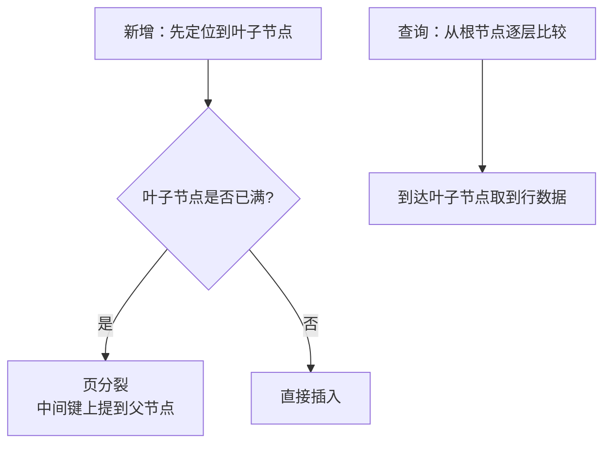

# B+树的新增与查询

面试题：B+树是怎么插入 key 的？查询为什么快？

B+树是 MySQL InnoDB 索引的底层结构，面试问 B+树，一般都落到两个问题上：新增 key 时节点满了怎么办，查询时是怎么定位的。前者考的是分裂规则，后者考的是树高和 I/O 次数。下面以五阶 B+树为例，把这两个操作走一遍。

## 先给结论

- 阶数决定每个节点里 key 的最大个数。五阶意味着每个节点最多放 4 个 key，一旦到第 5 个就必须分裂。
- 叶子节点分裂：左子节点放前 m/2 个 key，右子节点放剩下的，中间 key 进位到父节点，并且在叶子节点里仍然保留，因为 B+树的叶子节点包含全部 key。
- 非叶子节点分裂：左子节点放前 (m-1)/2 个 key，中间 key 进位到父节点后不保留，右子节点放剩下的。
- 查询和二叉查找树是一个思路：逐层比较，缩小范围。树高为 3 时，找到目标只要 3 次 I/O。

## 是什么：阶数与空树插入

阶数是 B+树里一个新概念，它决定了每个节点中 key 的最大数。以五阶为例，每个节点里的 key 最多只能是 4，一旦到达 5，这个节点就要分裂成两个新的节点。

最简单的情况是空树，一个节点都没有。往空树里新增 key，直接创建一个新节点，把 key 放进去就可以了。这个新节点既是叶子节点，也是根节点。比如插入 key 5，就创建一个包含 5 的节点，空树的插入操作就此完成。

## 深入细节：未满直接插入

继续往这个节点里加 key，规则是：如果当前节点里 key 的个数小于阶数，直接按 key 的大小升序插入，操作就结束了。

比如依次插入 8、10、15，节点里一共有 4 个 key，没有超过 5，按升序排列即可，结果是 5、8、10、15 这样一个节点。

## 深入细节：叶子节点分裂

如果再插入 16，key 的总数就到了阶数 5，违反规则，这时要分裂。当前这个节点是叶子节点，走叶子节点的分裂规则。

分裂就是把它分成左右两个子节点：左边包含 m/2 个记录，注意这里是 Java 中的整数除法，5 除以 2 结果还是 2；右边包含剩下的记录，同时把中间的 key 进位到父节点中。

具体到这个例子：分裂后左边是 5 和 8，右边是 10、15、16，中间的 10 进位到父节点。要注意，中间的 10 在叶子节点里仍然会保留，因为 B+树的特点是叶子节点中包含所有的 key，最终查找必须落到叶子节点上才能找到关联的值，所以 10 既要进位，叶子里的副本也不能删。

接着插入 17，没超限，直接插入。再插入 18，又到达阶数，再次分裂：前两个 10、15 作为左子节点，后三个 16、17、18 作为右子节点，中间的 16 进位到父节点，和原有的 10 放在同一个节点里。

## 深入细节：非叶子节点分裂

后来又插入了一批 key（19、20、21、22、6、9），这些插入都没有造成分裂，因为各节点中 key 的个数都没有超过阶数。

接下来插入 7，此时节点中 key 的个数到达阶数，要分裂。第一次分裂还是叶子节点分裂：5 和 6 作为左子节点，7、8、9 作为右子节点，7 进位到父节点。

但 7 进位之后，父节点的 key 个数也到了 5，也要分裂。这回它是非叶子节点了，分裂规则和叶子节点不一样：左子节点包含 (m-1)/2 个 key，五阶的话 5 减 1 除以 2 还是 2；中间 key 进位到父节点，但不保留；右子节点包含剩余的 key。

所以 7 和 10 作为左边子节点，16 进位成为新的根节点，右边子节点只包含剩下的 18 和 20。这就是非叶子节点分裂和叶子节点分裂最大的不同：叶子节点分裂时中间 key 会保留在右子节点里，非叶子节点分裂时中间 key 直接进位，右子节点不留。

## 深入细节：查询 key

查询和二叉查找树非常像，逐层比较缩小范围。以查询 15 为例，在树高为 3 的树上操作：

第一次 I/O 读根节点。15 和根节点中的 16 比较，15 比 16 小，走 16 左边的区间，右边不用看。

第二次 I/O 读内部节点，里面有 7 和 10 两个 key，把数据分成三个区间：小于 7、大于等于 7 小于 10、大于等于 10。15 落在大于等于 10 的区间，直接去这个区间找，前两个区间不用看。

第三次 I/O 读叶子节点，在叶子中找到 15。

也就是说，树高是 3 的情况下，只需要进行 3 次 I/O 就能找到最终的数据。这也是 B+树适合做索引的原因：树矮，I/O 次数少。

## 面试怎么答

1. 先讲阶数：阶数决定节点 key 的最大数，五阶最多 4 个 key，到 5 个就分裂。
2. 再讲两种分裂：叶子节点分裂左 m/2、中间 key 进位且叶子保留；非叶子节点分裂左 (m-1)/2、中间 key 进位不保留。
3. 最后讲查询：和二叉查找树一样逐层比较，树高 3 就 3 次 I/O，所以快。

常见追问：

- **问**：为什么 B+树叶子节点要保留全部 key？
  **答**：因为查询最终都要落到叶子节点才能取到关联数据，如果中间 key 在叶子里被删掉，按索引找下去就可能找不到值。
- **问**：为什么非叶子节点分裂时中间 key 不保留？
  **答**：非叶子节点的 key 只起路由和分界的作用，不作为数据存放，进位之后原节点就不需要再留一份。

## 常见误区

- **误区一**：以为叶子分裂和非叶子分裂规则一样。两者的左子节点 key 数算法不同（m/2 与 (m-1)/2），中间 key 是否保留也不同。
- **误区二**：以为插入一定触发分裂。只有插入后节点 key 数到达阶数才分裂，未满时按升序直接插入即可。

## 课件配图
> 以下配图取自阶段七课件对应讲义，与上文讲解一一对应，可作为图文对照辅助理解。
**索引基础**（课件讲义图示）

