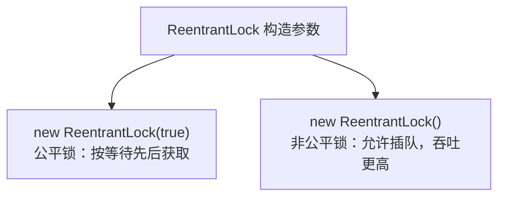

# Lock 公平锁与非公平锁演示

面试题：公平锁和非公平锁有什么区别？

ReentrantLock 的构造方法里有一个布尔参数，这个参数决定了它是公平锁还是非公平锁。面试问到公平和非公平，核心就一句话：公平锁按阻塞队列里的排队顺序（先入先出）分配锁，非公平锁不管排没排队，谁先抢到算谁的。下面用两个实验把这两种行为演示出来。

## 先给结论

- ReentrantLock 构造参数为 false 时是非公平锁（默认），改成 true 就是公平锁。
- 非公平锁下，锁释放后阻塞队列里等待最久的线程不一定拿到锁，队列外新来的线程可能插队。
- 公平锁下，必须按阻塞队列的入队顺序，排前面的线程先拿锁，后来的线程只能等前面全部拿完。
- tryLock(long, TimeUnit) 遵循公平/非公平设置，但无参的 tryLock 底层总是非公平的。



## 实验一：四个线程按间隔启动

先创建四个线程 t1、t2、t3、t4，为了能够预料它们的顺序，中间各加了 0.1 秒的时间间隔。每个线程内的代码一样：先对 lock 对象加锁，加锁成功后打印一条调试信息，然后睡眠 1 秒，再把锁释放。

先按非公平（默认参数）运行。t1 最先启动，其他线程还没起来，所以 t1 是锁的持有者。t2、t3、t4 依次启动，获得不了锁，只能进入阻塞队列等待。从锁的状态可以看到：owner 是 t1，state 是 1，阻塞队列里依次是 t2、t3、t4。

t1 一秒后释放锁，这时会从阻塞队列里按先入先出的顺序找到下一个线程，唤醒 t2，t2 获得锁；接着 t3、t4 依次获得锁，都间隔一秒。

可能有同学说，这看不出不公平呀，还是先入先出。这是因为当前场景里所有竞争线程都在阻塞队列里规规矩矩排着，当然有序。要看出不公平，得引入队列外的新线程。

```java
static final MyReentrantLock LOCK = new MyReentrantLock(true);   // true=公平, false=非公平

private static void learnLock() throws InterruptedException {
    System.out.println(LOCK);
    new MyThread(() -> {
        LOCK.lock();
        get("t").debug("acquire lock...");
    }, "t1").start();

    Thread.sleep(100);
    new MyThread(() -> {
        LOCK.lock();
        get("t").debug("acquire lock...");
    }, "t2").start();

    Thread.sleep(100);
    // t3、t4 同样间隔 0.1 秒依次启动
    ...
}
```

## 实验二：队列外不断创建新线程

再准备一个 while 循环，只要 stop 布尔变量是 false 就一直运行。每循环一次就创建一个线程，相当于不断创建大量线程。每个新线程都用 tryLock 尝试加锁。

这里用 tryLock 而不是 lock，是因为 tryLock 可以加一个时限，比如 10 毫秒：如果 10 毫秒还获取不到锁，它不会像 t2、t3、t4 那样在阻塞队列里一直等，而是直接返回 false，表示获得锁失败，线程自动销毁。这样做的目的是防止不断创建的线程把内存撑爆、把 CPU 跑满。

如果返回 false，什么都不做；如果返回 true，表示抢到锁，就打印线程信息，睡眠一秒后解锁，并把 stop 改成 true，停止循环，因为已经测到想看的結果了。

按非公平运行：t1 释放锁之后，等待最久的 t2 并没有拿到锁，而是一个编号为 6501 的新线程比 t2 提前获得了锁。再跑一次，又是另一个新线程插队，t2、t3、t4 的机会都很少。这就是非公平：队列外线程可以和队列内线程竞争，不管谁等得久。

再把构造参数改成 true，按公平运行：这次必须是阻塞队列里最先入队的 t2 先获得锁，然后 t3、t4，等它们都拿到锁之后，新创建的线程才有机会。

```java
while (!stop) {
    new Thread(() -> {
        try {
            boolean b = LOCK.tryLock(10, TimeUnit.MILLISECONDS);  // 只等 10 毫秒
            if (b) {
                System.out.println(Thread.currentThread().getName() + " acquire lock...");
                stop = true;
                sleep1s();
                LOCK.unlock();
            }
        } catch (InterruptedException e) {
            e.printStackTrace();
        }
    }).start();
}
```

注意这里用的是 `tryLock` 而不是 `lock`：`tryLock` 带时限，10 毫秒抢不到就直接返回 false、线程销毁，不会像 t2、t3、t4 那样在阻塞队列里干等，避免把内存和 CPU 撑爆。

## 面试怎么答

1. 先给区别：公平锁按阻塞队列先入先出发锁，非公平锁允许插队，谁抢到算谁的。
2. 讲代价：非公平锁吞吐量更高、上下文切换少，但可能造成线程饥饿；公平锁保证顺序，但性能差一些。
3. 讲源码细节：tryLock 带超时时间时遵循构造参数的公平性设置，但无参 tryLock 底层总是非公平的。

常见追问：

- **问**：为什么默认用非公平锁？
  **答**：非公平锁下线程不必严格排队，释放锁的瞬间如果有线程正好尝试获取，可以直接拿到，减少一次挂起和唤醒，吞吐量更高。绝大多数场景对绝对公平没有要求。
- **问**：公平锁会有什么问题？
  **答**：公平锁每次加锁都要检查队列、按序唤醒，线程挂起和切换更频繁，吞吐量比非公平锁低。

## 常见误区

- **误区一**：以为 tryLock 一定遵循公平设置。带超时的 tryLock 遵循，无参的 tryLock 源码里总是走非公平逻辑。
- **误区二**：以为非公平锁就是完全随机。队列内的线程依然按先入先出被唤醒，非公平指的是队列外线程可以参与竞争。
