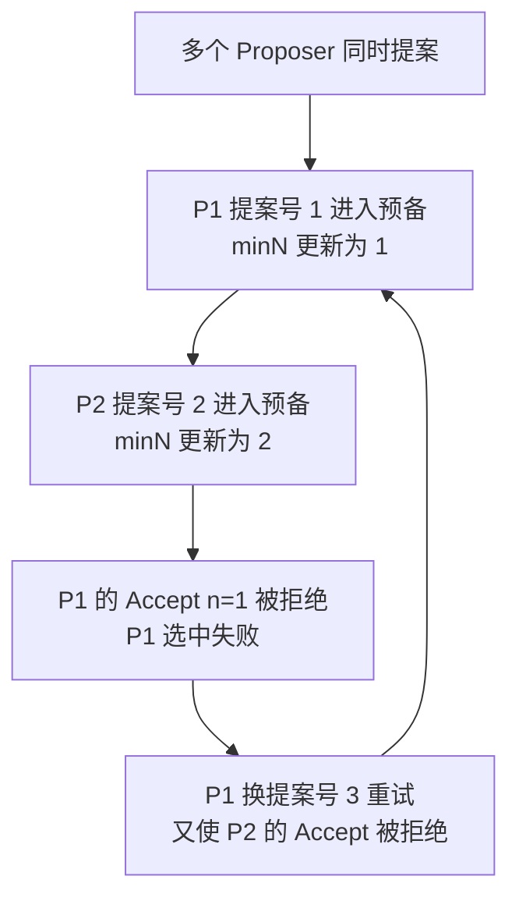

# Paxos 算法例 6：活锁问题

面试题：Paxos 有什么缺点？

Paxos 是分布式一致性算法的理论基础，面试问 Paxos，除了能讲清两阶段（prepare 和 accept）的流程，最好还能说出它的缺点。常见的答案有三条：效率低、难以理解、有活锁问题。前两条一句话就能带过，活锁问题需要展开讲，这也是引出 Raft 的切入点。

## 先给结论

- 缺点一：效率低。确定一个值需要两轮操作，先 prepare 让多数派通过，再 accept 让多数派通过，步骤很多。
- 缺点二：难以理解。有批评 Paxos 的评论说，全世界能够真正理解 Paxos 每个细节的人不超过五个，这当然是夸张，但侧面说明它的门槛比较高。
- 缺点三：活锁问题。两个提案者互相干扰，谁都无法最终选定值。
- 活锁的一个简单有效的解法是只保留一个提案者，这也正是 Raft 的思路。

## 深入细节：活锁是怎么发生的

看这样一个场景：一个提案还没有执行它的 accept 阶段，另一个提案的 prepare 阶段已经执行了，这就会影响接下来值的接收。

具体说，S5 的 prepare 先执行，S1 的 accept 还没执行，S1 发现有更新的 prepare 已经发生，就会把一号提案的值作废，重新开启一个三号提案，尝试把值改成 S5 提议的内容。一号提案就这样作废了。

反过来说，S5 影响了 S1，S1 会不会影响 S5 呢？机会是均等的。如果接下来 S1 先执行了 prepare，S5 的 accept 执行得稍晚一点，S5 的二号提案就被 S1 的三号提案干扰，S5 这次的选值也失败了，它得再开启一个四号提案。

这样不断循环往复，两边谁都不能选定值，这就是活锁问题。下面用「情况4：活锁问题」的流程图来演示：图中 1:x、2:y、3:z 等提案在不同节点间反复发送，prepared 状态之后跟着红色方块表示的失败状态，形成一个谁都无法推进的循环。

## 怎么解决

活锁的解法有一些，其中一个比较简单有效：采用单一的提案者，不允许存在多个提案者。两个提案者之间才可能产生这种互相干扰，如果只有一个提案者，就不会有这个问题。

当然这就和 Paxos 支持多提案者的设计对不上了。所以接下来会介绍 Raft 算法，来解决 Paxos 效率低、难以理解以及活锁这些问题。

## 面试怎么答

1. 先给三条缺点：效率低、难理解、有活锁。
2. 活锁重点讲场景：两个提案者的 prepare 和 accept 交错执行，互相作废对方提案，循环无法收敛。
3. 收尾到解法：限制为单一提案者，这正是 Raft 用单一 leader 的原因。

常见追问：

- **问**：活锁和死锁有什么区别？
  **答**：死锁是线程互相等待资源永远阻塞；活锁是大家都没闲着、一直在尝试，但互相打断导致事情推不下去，表现为空转。
- **问**：为什么 Raft 没有这个问题？
  **答**：Raft 里只有 leader 能发起提案，follower 不互相竞争，不存在多个提案者交错 prepare 把彼此作废的情况。

## 常见误区

- **误区一**：把活锁理解成死锁。两者表象不同，活锁是空转无法推进，不是永久阻塞。
- **误区二**：以为 Paxos 有正确性问题。Paxos 保证的是安全性，活锁影响的是活性，也就是系统能不能一直往前推进。
