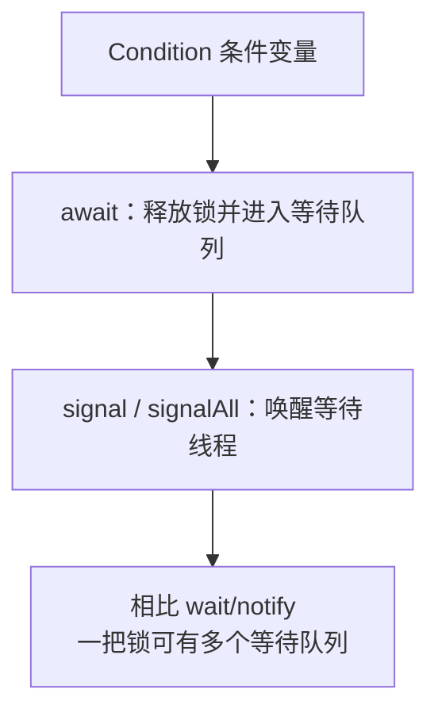

# Lock 条件变量演示

面试题：Condition 是怎么用的？await 之后线程去哪了？

ReentrantLock 配合 Condition 可以实现更精细的等待唤醒：持锁线程发现条件不满足时，不用傻等，可以放弃锁到 Condition 的等待队列里等着，条件满足了再被唤醒重新竞争锁。面试问 Condition，除了基本用法，最好能说清 await 之后线程在底层队列里怎么流动。下面用四个线程的 debug 演示一遍。

## 先给结论

- Condition 的典型用法：持锁线程条件不满足时调 await，释放锁并进入该 Condition 的等待队列；条件满足后调 signal 唤醒。
- await 的线程进入的是 Condition 自己的等待队列，不是锁的阻塞队列，锁会被释放，队列里的其他线程可以继续竞争。
- signal 唤醒等待队列里的线程后，它并不会立刻拿到锁，而是回到锁的阻塞队列尾部排队。
- synchronized 的 wait 被唤醒后优先级更高一些，Lock 的 Condition 唤醒后是直接排到阻塞队列尾部，行为不一样。



## 演示代码

演示用的测试类大致如下，一把 ReentrantLock 上创建两个 Condition：

```java
public class TestReentrantLock {
    static final MyReentrantLock LOCK = new MyReentrantLock(true);
    static Condition c1 = LOCK.newCondition();
    static Condition c2 = LOCK.newCondition();
}
```

创建四个线程，中间加 100 毫秒间隔，保证它们进入阻塞队列的顺序：

```java
private static void learnLock() throws InterruptedException {
    new MyThread(() -> {
        LOCK.lock();
        get("t1").debug("acquire lock...");
    }, name: "t1").start();
    Thread.sleep(100);
    new MyThread(() -> {
        LOCK.lock();
        get("t2").debug("acquire lock...");
    }, name: "t2").start();
    Thread.sleep(100);
    new MyThread(() -> {
        LOCK.lock();
        get("t3").debug("acquire lock...");
    }, name: "t3").start();
    Thread.sleep(100);
    new MyThread(() -> {
        LOCK.lock();
        get("t4").debug("acquire lock...");
    }, name: "t4").start();
}
```

调试过程中会用到的 Condition 关键方法：

```java
c1.await();
c1.signal();
c2.await();
c2.signal();
c2.signalAll();
LOCK.unlock();
```

## 底层结构的变化

初始状态和之前一样：T1 持有锁，T2、T3、T4 按刻意安排的顺序进入阻塞队列。此时锁的状态可以看成：

```text
owner[t1] state[1]
blocked queue ({@null})->({{t2}})->({{t3}})->({{t4}})
waiting queue [c1]
waiting queue [c2]
```

接下来 T1 发现条件不满足，代码不能继续运行，但它不能总占着锁，得把锁交给队列里等着的 T2、T3、T4。synchronized 时代可以调锁对象的 wait 方法，Lock 时代就调条件变量的 await。这里调 c1.await()，T1 被放到 c1 的等待队列里，锁同时释放，阻塞队列里的 T2 成为新的持有者。

此时锁的持有者是 T2，阻塞队列里还有 T3、T4 在等，而 T1 跑到了 c1 的等待队列里。

条件什么时候满足、T1 什么时候继续运行，由唤醒方决定。调 c1.signal()，如果等待队列里有多个线程就唤醒其中一个。但唤醒之后它去哪？并不会立刻抢到锁，而是加入阻塞队列的尾部排队。因为当前 owner 还占着锁，而且阻塞队列里有比它排队更久的 T3、T4，所以 T1 只能排在最后。

再往下，T2 释放锁并调 c2.await()，自己跑到 c2 的等待队列，T3 成为 owner；T3 也发现自己要等，同样调 c2.await() 进 c2 的等待队列，T4 成为 owner。

现在 T2、T3 都在等待队列里，这次用 c2.signalAll() 全部唤醒。signalAll 仍然按入队顺序逐一唤醒，唤醒后如果获得不了锁，就加入阻塞队列。所以最终阻塞队列变成 T1、T2、T3 的顺序排队等待。

从等待队列唤醒的线程不可能立刻运行，它会进入阻塞队列尾部继续排队，这就是 Lock 底层结构的完整流动路径。

顺带对比 synchronized：它的底层是 C++ 实现，没法这样 debug 展示，而且实现细节与 Lock 不太一样。synchronized 唤醒等待队列里的线程时，优先级会更高一些，而 Lock 里从等待队列唤醒的线程直接排到阻塞队列尾部。

## 面试怎么答

1. 先给使用场景：持锁线程条件不满足就 await 放锁等待，满足后 signal 唤醒。
2. 讲底层：await 进 Condition 自己的等待队列；signal 唤醒后不是直接拿锁，而是回阻塞队列尾部。
3. 做对比：和 synchronized 的 wait/notify 比，唤醒后的排队策略不同。

常见追问：

- **问**：signal 和 signalAll 怎么选？
  **答**：等待队列里只有一个线程或唤醒任意一个就行，用 signal；多个等待线程条件都可能满足、需要全部放行，用 signalAll。
- **问**：await 在 try/finally 里调 unlock 是必须的吗？
  **答**：是。lock 之后必须保证 unlock 一定执行，否则持锁线程异常退出会让其他线程永远拿不到锁。

## 常见误区

- **误区一**：以为 signal 之后线程立刻恢复执行。它只是从等待队列回到阻塞队列排队，还要重新竞争锁。
- **误区二**：以为 Condition 等待队列和锁阻塞队列是同一个。Condition 每个实例管理自己的等待队列，await 进的是这个独立队列。
