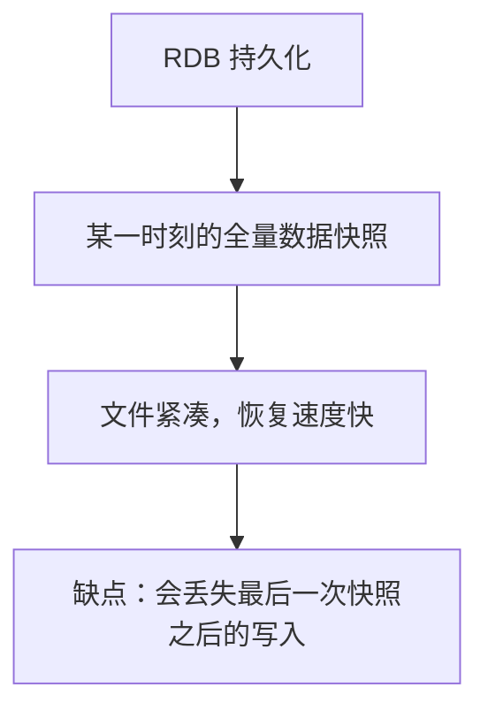

# Redis 持久化：RDB

面试题：Redis 的 RDB 持久化是怎么工作的？

AOF 以命令为单位记录写操作，RDB 则是另一种思路：把整个内存数据以二进制方式写入磁盘。它最大的优点是恢复速度特别快，缺点是两次快照之间可能丢数据。面试问 RDB，一般围绕原理、save 与 bgsave 的区别、快照机制和周期问题展开。

## 先给结论

- RDB 把整个内存数据以二进制方式写入磁盘，对应的持久化文件默认叫 dump.rdb。
- 恢复时直接加载二进制数据，速度快，不像 AOF 要把命令一条条重新执行。
- save 在主进程执行，会阻塞其他命令，影响性能；bgsave 创建子进程执行，不阻塞主进程，是默认方式。
- bgsave 基于快照机制，执行期间的新修改不会写进 RDB 文件，两次快照之间宕机会丢失这部分修改。
- RDB 的执行周期不好把握：频繁执行影响性能，不频繁又容易丢数据。



## 是什么：RDB 的原理

RDB 的原理很简单：把整个内存数据以二进制方式写入磁盘。

和 AOF 的区别在于，AOF 是以命令为单位，一条命令一条命令写入磁盘；RDB 是以二进制方式把整个内存数据写入磁盘。所以它最大的优点是恢复速度特别快：AOF 恢复是一条命令读出来重新执行一遍，下一条再执行，速度较慢；RDB 以二进制方式恢复，直接把数据加载进内存，速度非常快。

RDB 对应的持久化文件默认名字叫 dump.rdb，这个了解一下即可。

## 深入细节：save 与 bgsave

和 RDB 相关的命令有两个。

第一个是 save，它在主进程执行，所以不太好：执行 RDB 持久化期间，其他的增删改命令都会被阻塞，必须等 RDB 执行完才能恢复运行，会对性能和吞吐量产生影响。

比较推荐的是 bgsave，它会创建一个子进程来执行 RDB 持久化操作，避免阻塞。这是 Redis 的默认方式。可以看出它和 AOF 重写很像，都是创建子进程来干活。

但要注意，虽然 bgsave 不会阻塞主进程的增删改查，创建子进程期间仍然会有短暂阻塞，而且内存越大，阻塞时间越长。这也提示我们：RDB 操作不能频繁执行，频繁执行意味着频繁创建子进程，阻塞时间会越积越多。

bgsave 底层要创建子进程，所以也利用了快照机制。快照的好处是：执行 RDB 持久化期间即使有新数据写入，也不会影响原有的 RDB 操作，因为新数据的修改发生在主进程的内存，子进程读取的是快照，写入 RDB 文件的还是快照中的旧数据。

不过 bgsave 有个问题：它不会把这些新数据补充到 RDB 文件里。AOF 重写有重写缓冲区，快照建立之后的新修改会记录进去，最终补充到重写日志；RDB 不管这些新数据，从建立快照开始执行备份之后，后续的增删改都不会记录、不会补充到 RDB 文件。这就带来一个风险：两次快照之间如果宕机，中间的修改都会丢失。

配置文件里控制 RDB 执行周期的 save 参数，注释是这么写的：

```text
 # disaster will happen.
 # If the background saving process will start working again Redis will
 # automatically allow writes again.
```

## 深入细节：执行周期与缺点

RDB 到底什么时候执行，由一个 save 参数控制持久化周期。对照 redis.conf 看，它的配置规则是：900 秒内发生至少 1 次修改，执行一次 bgsave；300 秒内至少 10 次修改，执行一次；60 秒内至少 10000 次修改，执行一次。

也就是说修改越频繁，bgsave 执行越频繁；修改越少，间隔越长。注意这个参数名字虽然叫 save，底层用的其实是 bgsave 命令，所以都是创建子进程、以快照方式运行，不影响主进程。

这个周期其实不好把握，配置文件里的值只是经验值，不一定适合实际业务。频繁执行 bgsave 会影响性能；执行不频繁，两次快照之间宕机又容易丢失较多数据。频繁也不行，偶尔执行也不好，这是 RDB 最大的问题。

它的优点也很明确：将来恢复数据时速度快。至于有没有两全其美的办法，混合持久化就是答案。配置文件里的这段注释也专门强调了宕机风险：

```text
 # disaster will happen.
 # If the background saving process will start working again Redis will
 # automatically allow writes again.
```

## 面试怎么答

1. 先给原理：整个内存数据以二进制写磁盘，文件 dump.rdb，恢复快。
2. 对比两个命令：save 阻塞主进程，bgsave 用子进程不阻塞，是默认方式；但创建子进程有短暂阻塞，内存越大越明显。
3. 讲快照与丢失：快照期间的新修改不进 RDB，两次快照之间宕机会丢数据。
4. 讲周期：save 参数控制执行周期，频繁伤性能、稀疏丢数据，不好把握。

常见追问：

- **问**：bgsave 期间客户端还能写吗？
  **答**：能。主进程继续处理增删改，子进程基于快照写 RDB，互不阻塞；但新写的这部分数据不会进本次 RDB。
- **问**：为什么 RDB 恢复比 AOF 快？
  **答**：RDB 是二进制全量数据，直接加载；AOF 要把历史命令逐条重放，命令越多恢复越慢。

## 常见误区

- **误区一**：以为 bgsave 完全不阻塞。创建子进程那一刻仍有短暂阻塞，内存越大越久。
- **误区二**：以为 RDB 能保证不丢数据。它只能恢复到某一次快照的时间点，之后的修改在宕机时会丢。
