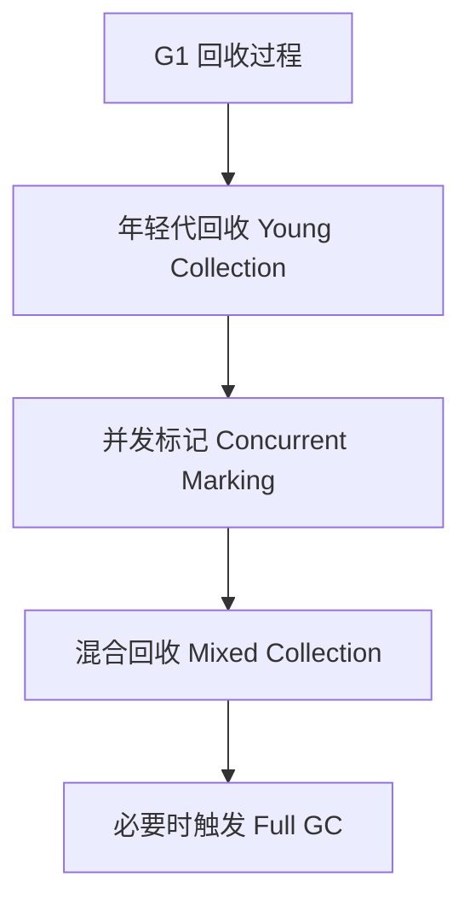

# G1 垃圾回收器：并发标记与混合收集

面试题：G1 的工作流程是怎样的？

上一篇讲了 G1 的整体特点和新生代回收，这篇讲剩下的两个阶段：并发标记和混合收集。这两个阶段是 G1 兼顾响应时间和吞吐量的关键：标记尽量不停顿，收集按需挑选区域，把停顿控制在预期内。

## 先给结论

- 并发标记的触发条件：老年代内存占比超过阈值，默认是达到整个堆内存的 45% 以上。
- 并发标记在老年代里找存活对象加标记，整个过程并发执行，不暂停用户线程；用原始快照法解决漏标问题，但重新标记阶段仍需 Stop-The-World。
- 混合收集不是一次性回收所有老年代，而是挑回收价值高的老年代区域，连同 Eden 和 Survivor 一起回收。
- G1 可以设置预期暂停时间，混合收集按这个目标挑选区域，可能重复执行多次。
- 如果收集速度跟不上对象分配速度，出现并发失败，会回退到一次 Full GC 作为保底。

## 深入细节：并发标记阶段

当老年代的内存越来越多，超过一个阈值，就会触发并发标记。这个阈值默认是老年代的内存占比达到整个堆内存的 45% 以上。

并发标记做的事情，就是在老年代里找到那些存活对象，给它们加上标记。这个过程是并发执行的，在此期间并不会暂停用户线程，这一点非常好。

当然，为了解决漏标问题，G1 采用的是原始快照法。最后还有一步重新标记，处理那些漏标对象，所以还是需要 Stop-The-World，需要暂停用户线程。但相比全程停顿，重新标记的停顿很短。

并发标记阶段完成，就可以进入第三个阶段，也就是混合收集。

## 深入细节：混合收集阶段

混合收集阶段，并不是一下子收集所有老年代的内存。那样的话暂停时间会比较长，达不到预期的暂停时间。

G1 里可以设计一个预期暂停时间，比如暂停不能超过多少毫秒，它可以设置。为了不超过这个预期暂停时间，它不是一次性把所有老年代区都回收，而是先挑出一些回收价值较高的老年代区。比如图里标红的这几个老年代，可能存活对象很少，所以回收价值非常高，因为存活对象少意味着能释放更多的内存；而其他一些老年代可能存活对象比较多，先回收它们，释放的内存少，回收价值就比较低。

所以混合收集会挑一些回收价值较高的老年代，连同当前的 Eden 区和 Survivor 区，一起做一次垃圾回收：把 Eden 和上次 Survivor 区里的幸存对象复制到新的 Survivor 区；上次 Survivor 区中达到晋升阈值的幸存对象，以及这些回收价值较高的老年代中的幸存对象，会复制到一个新的老年代区。这样一来，它们原来占用的内存就得到了释放，这就是完成了一次混合收集。

混合收集可能会重复执行多次：第一次在预定时间内可能只回收了三个老年代区，后续再执行几次混合收集，把剩余老年代占用的内存逐渐释放出来。

进行了多次混合收集之后，流程又循环回到新生代的垃圾回收，再重复执行并发标记、混合收集这些步骤。

## 深入细节：并发失败与保底

G1 里还可能出现并发失败：收集的速度已经小于需要分配新对象的速度，这时只能回退到保底策略，也就是一次 Full GC。Full GC 的暂停时间非常长。

对比来看，新生代回收、并发标记、混合收集这几个阶段，因为很多期间都是并发执行的，所以通常停顿时间比较短；而一旦回退 Full GC，停顿就不可控了。

## 面试怎么答

1. 先给三阶段：新生代回收、并发标记、混合收集，外加 Fallback Full GC 保底。
2. 讲并发标记：老年代占比超 45% 触发，并发标记加原始快照法，重新标记才 STW。
3. 讲混合收集：按预期暂停时间挑高价值老年代区，连同 Eden、Survivor 一起回收，可多次执行。
4. 点保底：收集跟不上分配会并发失败，退化为 Full GC。

常见追问：

- **问**：为什么混合收集不全量回收老年代？
  **答**：全量回收停顿会超过预期暂停时间目标。挑存活少、价值高的区域先回收，既能释放内存又能把停顿控制在目标内，剩下的留给后续几轮。
- **问**：并发标记用什么办法解决漏标？
  **答**：课程里讲的是原始快照法，配合最后的重新标记阶段修正，重新标记需要 STW。

## 常见误区

- **误区一**：以为 G1 全程不停顿。新生代回收和混合收集的复制阶段都要 STW，并发标记只是大部分时间不停。
- **误区二**：以为混合收集一次搞定老年代。它按暂停目标分批挑区域，通常要重复多轮。

## 课件配图
> 以下配图取自阶段七课件对应讲义，与上文讲解一一对应，可作为图文对照辅助理解。
**JVM 垃圾回收**（课件讲义图示）

