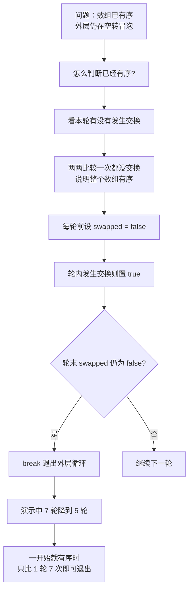

# 冒泡排序优化：减少冒泡次数

面试题：冒泡排序还能怎么优化？

上一篇把内层循环的比较次数改成逐轮递减，这一篇解决另一个明显的浪费：数组其实已经有序了，外层循环还在空转。思路是用一个标志位判断某一轮有没有发生交换，没有交换就说明已经有序，直接退出。

## 先给结论

- 判断数组是否有序，可以看某一轮冒泡有没有发生交换：一次交换都没有，说明整个数组已经有序。
- 每轮冒泡前设一个布尔变量 swapped，轮内发生交换就置为 true，轮末仍为 false 就 break 退出外层循环。
- 原来的 7 轮会减到 5 轮：数组第 4 轮后就已有序，但第 4 轮仍有交换（3 和 2），要到第 5 轮没有交换才退出。
- 如果数组一开始就有序，只需一轮比较 7 次，确认无交换后即可退出。



## 问题：有序之后还在冒泡

细心的同学可能注意到一个现象：第四轮冒泡结束以后，数组其实已经有序了。那还有必要再进行后续的两次冒泡吗？数组都有序了，再去冒泡比较没有太大意义。

所以接下来的优化，就是减少这些不必要的冒泡次数。

这个问题归结为：怎么判断数组已经有序、不需要继续冒泡了？大家想一想，如果我某一轮冒泡中，相邻元素两两比较，一次交换都没有发生，说明什么？说明数组已经整个有序了。因为两两都比较过一次还没有交换，顺序就是对的。

所以可以根据有没有发生交换，作为判断数组是否有序的条件。

## 优化：加交换标志位

具体做法：在每一轮冒泡之前，先设一个布尔变量 swapped，表示这一轮是否发生了交换。刚开始给它 false，表示没有交换。

一旦在这一轮的比较中发现前一个大于后一个、发生交换，就把 swapped 置为 true。发生交换意味着可能还要继续比较、继续冒泡，所以置真之后什么事都不做，让这一轮正常走完。

如果这一轮冒泡结束了，发现没有发生交换，说明数组已经有序，直接 break 退出外层循环，没有必要进行下一轮冒泡。

未加标志位时，代码是这样的：

```java
public static void bubble(int[] a) {
    for (int j = 0; j < a.length - 1; j++) {
        for (int i = 0; i < a.length - 1 - j; i++) {
            if (a[i] > a[i + 1]) {
                swap(a, i, i + 1);
            }
        }
        System.out.println("第" + j + "轮调试" + Arrays.toString(a));
    }
}
```

加上标志位和提前退出：

```java
public static void bubble(int[] a) {
    for (int j = 0; j < a.length - 1; j++) {
        boolean swapped = false; // 是否发生了交换
        for (int i = 0; i < a.length - 1 - j; i++) {
            if (a[i] > a[i + 1]) {
                swap(a, i, i + 1);
                swapped = true;
            }
        }
        System.out.println("第" + j + "轮调试" + Arrays.toString(a));
        if (!swapped) {
            break; // 优化：如果某轮没有交换，说明已排序完毕
        }
    }
}
```

其中交换两个元素的方法：

```java
public static void swap(int[] a, int i, int j) {
    int t = a[i];
    a[i] = a[j];
    a[j] = t;
}
```

## 优化效果

跑一下可以看到，比之前少了一轮，第六轮冒泡没有了。为什么第五轮仍然有？分析一下：第四轮冒泡的时候仍然发生了交换，把 3 和 2 做了一个交换，所以第四轮没办法结束；只有到第五轮，再做一二的比较以后发现这一轮没有发生交换，swapped 仍然是 false，于是在第五轮结束的时候 break 退出循环，不会进入第六轮。

这个例子不是特别明显，换一个一开始就有序的数组再看：一上来就是有序结果的情况下，只需要经过一轮冒泡就能确定它是有序的。因为比较了七次以后根本没有发生交换，第一轮冒泡结束之后就 break 退出循环，没有后续的第二轮、第三轮。

所以，通过判断是否发生交换来推断数组是否已经排好序，可以减少不必要的冒泡次数。

## 面试怎么答

1. 先给前两个优化做铺垫：外层轮数 length-1、内层比较 length-1-j 递减。
2. 再给核心优化：swapped 标志位，某轮无交换即有序，break 提前退出。
3. 算收益：普通情况从固定 7 轮降到提前退出，最好情况一轮结束，复杂度降到 O(n)。
4. 主动提交换位置记录法：记住每轮最后一次交换的位置，下一轮边界直接收缩到那里。

常见追问：

- **问**：加了 break 之后时间复杂度是多少？
  **答**：最好情况 O(n)，一轮确认有序；最坏情况仍是 O(n²)。平均情况和输入分布有关。
- **问**：除了标志位还能怎么减少无用比较？
  **答**：记录某一轮最后一次发生交换的下标，下一轮内层边界就缩到这个下标，因为后面的元素已经就位。

## 常见误区

- **误区一**：以为冒泡排序优化只是加个 break。比较次数递减、无交换退出、交换边界收缩，是层层递进的三个优化。
- **误区二**：以为加了 break 最坏情况会变好。最坏（完全逆序）仍是 O(n²)，优化只改善最好情况和常数。
