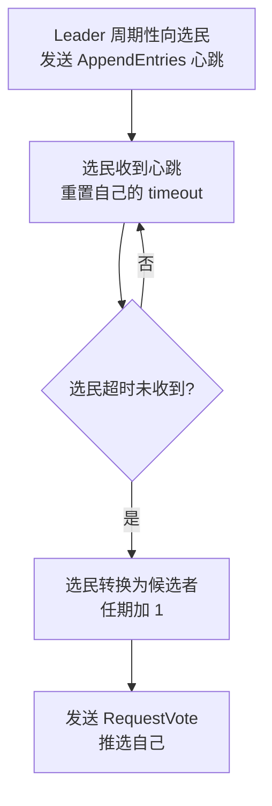

# Raft 算法：Leader 选举

面试题：Raft 的 Leader 选举过程是怎样的？

上一篇讲了 Raft 的整体结构，这篇展开第一部分：Leader 选举。Raft 用一个可视化网页把选举的关键过程演示得非常清楚，五个服务器 S1 到 S5，初始角色都是 Follower，跟着超时触发、拉票、计票走一遍，选举的规则就清楚了。

## 先给结论

- 每个服务器都有一个超时时间，超时未收到 Leader 心跳就会触发选举，Follower 变为 Candidate，任期加一。
- Candidate 先给自己投一票，再向其他服务器发投票请求。
- Follower 的投票规则：只把票投给本任期内收到的第一个投票请求，后面的请求一律拒绝。
- 拿到多数派选票的 Candidate 成为 Leader，其余恢复 Follower；同一时刻只可能有一个 Leader。
- Leader 任期内不断发心跳（AppendEntries）证明自己活着；Leader 挂了，其余服务器超时后重新选举，任期再加一。

## 深入细节：选举是怎么开始的

可视化网页里有五个服务器 S1、S2、S3、S4、S5，刚开始它们的角色都是 Follower，也就是选民，大家还没有产生一个 Leader，所以接下来要选一个。

什么时候触发选举？每个服务器外圈都有一个超时时间，随着时间的流逝越来越短，一旦到达超时时间，就触发接下来的选举动作。

比如 S1 先到达超时时间，颜色变了，由选民角色变成候选者角色，意思是我想成为下一任 Leader。这里还有一个数字 12，代表任期：第一任里面没有 Leader，我要成为第二任的领导者，所以数字变成 2。一旦触发超时，任期就加一。

然后 S1 开始向其余四台服务器发送投票请求，说请选我。

## 深入细节：投票规则与过半

S1 这边要等到这几个请求都返回、投它的票，票数过半才能当选。如果它正在作为候选者等结果的时候，有其他服务器也超时了，也想成为候选者，是允许的，比如 S5 的 timeout 也到了，状态同样变成候选者，也向剩余服务器发投票请求。

虽然可能同时出现多个候选者，但最终当选的只有一个 Leader。原因在投票规则。

Candidate 首先会自己投给自己一票，自己可以给自己投票。接下来能不能当选，就看剩余选民的投票。剩余选民的投票规则是：接到投票请求后，把票投给本任期内第一个见到的请求。

比如 S4 接到 S1 的投票请求，就会把票投给 S1，返回的是加号，表示投票。接下来 S5 的投票请求也到了 S4，S4 就不会再投给 S5 了，因为它在本任期已经把票投给第一个见到的 S1，S5 是后来的，返回减号，表示我已经投过了，不能再投。

这样一来，S2、S3、S4 都把票投给了 S1，S1 的票数过半；而 S2、S3、S4 给 S5 返回的都是减号，S5 只拿到自己那一票，过不了半。这就确保了 Leader 最终只能是 S1。S1 用红色标识成为 Leader，剩下的服务器恢复成选民，任期变成第二任。

## 深入细节：心跳与重新选举

Leader 在它的任期内，会不断向这些选民发送请求。为什么要不断发？要证明自己还活着。如果 Leader S1 挂了，剩下的选民就会造反，推选出一个新的 Leader；只要 Leader 还活着，就不能被替换。所以 Leader 要不断向 S2 到 S5 发送心跳请求，这类请求叫 AppendEntries。

再看 Leader 挂了的情况。网页里可以选中节点右键 Stop，模拟服务器停止。S1 挂了以后，S2 到 S5 的超时时间还在走，在超时内收不到 S1 的请求，它们就知道 S1 是不是已经挂了，自己有机会了。比如 S3 发现有机会，成为候选者，并向其他服务器发投票请求，如果票数过半，S3 就成为新一任的 Leader。这时候任期已经是第三任，因为每一轮任期都会让任期数加一。

## 面试怎么答

1. 先给触发条件：Follower 超时没收到心跳，转 Candidate，任期加一，开始拉票。
2. 讲投票规则：Candidate 先投自己，Follower 只投本任期第一个请求，所以竞争时先到先得，后来者拿不到票。
3. 讲过半当选：多数票当选 Leader，其余回 Follower；单 Leader 保证简化。
4. 讲心跳与重选：Leader 持续发 AppendEntries；挂了之后剩余节点超时再选，任期递增。

常见追问：

- **问**：为什么一个任期只会选出一个 Leader？
  **答**：每个 Follower 在一个任期内只投第一个收到的请求，票不重复投；而当选需要多数票，两个候选者不可能同时拿到多数票。
- **问**：任期号的作用是什么？
  **答**：任期是逻辑时钟，用来识别过期的 Leader 和过期的请求。任期号小的请求会被拒绝，防止旧 Leader 复活后干扰新 Leader。

## 常见误区

- **误区一**：以为多个 Candidate 会同时当选。Follower 只投一票且需过半，数学上就保证了唯一性。
- **误区二**：以为 Leader 选出来就一劳永逸。Leader 必须持续发心跳，挂了之后选民超时即发动下一轮选举。
