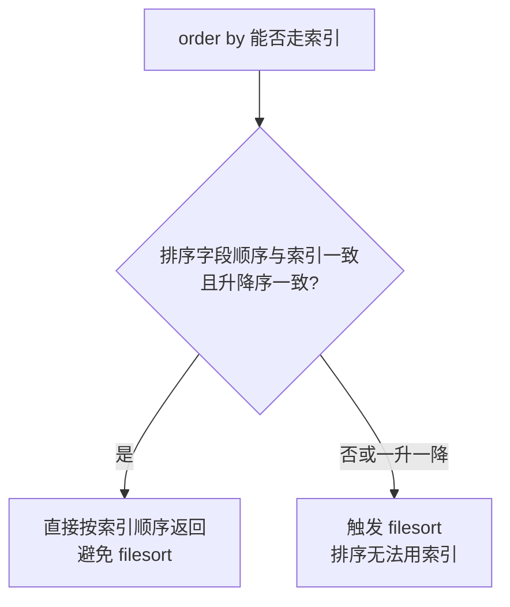

# 索引在排序中的生效与失效

面试题：索引在多列排序时怎么才能用上？

百万级数据准备好了，这篇用排序场景验证索引的生效与失效。核心结论有三条：多列排序必须用组合索引；要遵循最左前缀原则；升降序必须一致。每条都在 big_person 表上实测过。

## 先给结论

- 多列排序需要组合索引，只在单列上分别建索引，加速不了多列排序。
- 组合索引要遵循最左前缀原则：order by 的第一列必须是建索引时最左边的那一列。
- 多列排序时各列的升降序要一致，混用升序降序索引会失效。
- 用 explain 看执行计划，key 列能看出最终走了哪个索引，比反复跑 SQL 直观。



## 演示准备：现有索引

先看表里有多少数据：select count(*) from big_person，100 万条。随便查一条，可以看到有 ID、编号、Name（中文名字）、First name、Last name（英文名和姓）、Married（是否已婚）、Birthday、省市县、Email、Phone、Zip、Card（身份证号）、头像（头像图片地址）、intro（简介）这些列。

再学一个查看索引的命令：show index from big_person，查询表中所有索引。目前已经提前建好的有 primary 主键索引（建表时自动创建），以及后来建的两个单列索引 first_index 和 last_index，分别建在英文名这一列和英文姓这一列。

## 问题：两个单列索引救不了多列排序

有这样一条 SQL：

```sql
select * from big_person order by last_name, first_name limit 10;
```

要根据两列排序，刚才那两个单列索引能不能派上用场？直接执行这条 SQL，结果虽然出来了，只查前十条，但花了两秒多，实际开发中不可接受。显然分别建在两列上的单列索引没什么作用。

## 解决：建组合索引

真正的开发场景推荐建组合索引。先把 first_index 和 last_index 都删掉，新建一个索引建在姓和名这两列上：

```sql
create index last_first_idx on big_person(last_name, first_name);
```

建索引会花一点时间，这次花了快七秒，但这个时间值得。建完再执行刚才的排序查询，只用了 0.03 秒，性能提升近百倍，索引派上了用场。

## 用 explain 验证

以后判断索引有没有生效，用更简单的办法：在执行 SQL 前面加 explain，它会显示 MySQL 怎样优化这条 SQL 语句、实际用到了哪个索引。

```sql
explain select * from big_person order by last_name, first_name limit 10;
```

看结果里的 key 列，能看出最终走了哪个索引。这次 key 里就是刚才创建的 last_first_idx，说明这条 SQL 真正用上了索引。以后演示都用 explain，不必每次真跑 SQL，因为没走索引的查询可能非常慢。

## 原则一：最左前缀

多列排序要遵循最左前缀原则。建索引时 last_name 放在前面，是索引里靠左的列；排序时排在第一位的也必须是最左边的 last_name，而不是 first_name。

把顺序调换，first_name 在前、last_name 在后：

```sql
explain select * from big_person order by first_name, last_name limit 10;
```

key 列变成 none，说明不会走索引。真去执行，速度非常慢，要一秒多。

只带一个 first_name 也不行，因为它没有从最左前缀开始，优化器根本不会选择那个索引。所以 order by 的列必须从索引最左列开始，依次往后，中间不能断，不能用第一列加第三列跳过第二列。

## 原则二：升降序一致

多列排序时升降序还需要一致。last_name 和 first_name 都降序是可以应用索引的：

```sql
explain select * from big_person order by last_name desc, first_name desc limit 10;
```

key 列显示用上了索引。但如果不一致，比如 last_name 降序、first_name 升序：

```sql
explain select * from big_person order by last_name desc, first_name asc limit 10;
```

key 列变成 none，索引又失效了。

## 总结

用于排序时，索引的注意点有三条：

1. 一旦用了多列排序，一定要用组合索引，单列索引不行。
2. 多列排序要遵循最左前缀原则，order by 的第一个列必须是建索引时靠左的列，然后依次往后，中间不能断。
3. 多列排序时各列的升降序要一致，一致才走索引，不一致不走。

图中标黑的几种排序方式都可以应用索引，橙色和黄色的是警告，无法应用索引。

## 面试怎么答

1. 先给三条：组合索引、最左前缀、升降序一致。
2. 用数字佐证：单列索引两秒多，组合索引 0.03 秒，提升近百倍。
3. 演示方法：explain 看 key 列判断是否走索引。

常见追问：

- **问**：为什么单列索引帮不了多列排序？
  **答**：两个单列索引各自有序，但合不到一起，MySQL 仍要对结果做 filesort；组合索引按(last_name, first_name) 整体有序，直接按序读即可。
- **问**：最左前缀为什么不能跳过中间列？
  **答**：组合索引的有序性是先按左列排、左列相同再按下一列排，跳过中间列后后续列在全局上不再有序，无法利用。

## 常见误区

- **误区一**：在多列上分别建单列索引代替组合索引。对多列排序无效，反而多维护了索引。
- **误区二**：只关心排序的列，不关心升降序。混用升降序会让索引失效，这点最容易被忽略。
