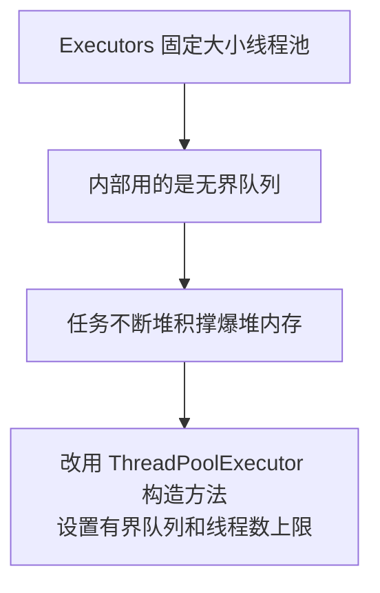

# 内存溢出情况一：误用固定大小线程池

面试题：项目中什么情况下会出现内存溢出？怎么解决的？

这道题几乎逢面试必问，而且很看重实战。只背概念拿不到分，面试官想听的是你真实踩过的坑和解决套路。这里总结三种最容易中的场景，先讲第一种：误用线程池。把演示跑一遍、把源码扒到底，这类题就能答得很稳。

## 先给结论

- 最容易出的内存溢出场景之一，是误用 `Executors` 工具类创建线程池。
- `Executors.newFixedThreadPool` 内部用 `LinkedBlockingQueue` 作任务队列，这是个无界队列，容量近似整数最大值，任务只进不消就会被无限堆积。
- 当核心线程被耗时任务占满、后续任务全部堆进队列时，任务对象会耗尽堆内存，抛出 `OutOfMemoryError`。
- 解决办法：不要用 `Executors` 自带的固定线程池，自己用 `ThreadPoolExecutor` 构造方法，按实际情况设置有界队列和线程数上限。任务超过队列容量时报错拒绝，至少不会拖垮整个程序。《阿里巴巴 Java 开发手册》也明确不建议用 `Executors` 创建线程池。



## 是什么：一个发送短信的演示

先读代码，场景是模拟发送短信：

```java
import java.util.concurrent.TimeUnit;

public class TestOomThreadPool {
    public static void main(String[] args) {
        ExecutorService executor = Executors.newFixedThreadPool(2);
        LoggerUtils.get().debug("begin...");
        while (true) {
            executor.submit(()->{
                try {
                    LoggerUtils.get().debug("send sms...");
                    TimeUnit.SECONDS.sleep(30);
                } catch (InterruptedException e) {
                    e.printStackTrace();
                }
            });
        }
    }
}
```

创建了一个固定大小的线程池，里面有两个核心线程。应用程序只要在跑，就可能有用户不断来注册，注册就要调用短信服务，所以用 `while (true)` 模拟不断发送：每次循环向线程池提交一个任务。任务里不去真正调第三方的发短信接口，只做了一个打印。

接下来模拟一种发送短信超时的情况。调第三方的短信服务，如果网络不好，或者第三方服务本身出了问题，调用就有可能超时。这里让它超时 30 秒，看会不会出问题。

为了让内存溢出的效果明显，别循环太多次，把堆内存设小：JVM 参数设置最大堆为 64 兆（`-Xmx64m`）。当然不设置也会溢出，只是需要运行的时间比较长。

## 为什么会内存溢出

跑起来可以看到：现在有两个线程在发送短信，但是由于这两个任务都超时了（每个任务要睡 30 秒），剩余提交的任务没有线程处理，它们全部提交到线程池的队列中。最终任务对象越堆越多，导致内存溢出错误 `OutOfMemoryError`。

有同学会问：为什么提交到队列就会导致内存溢出？直接看 `newFixedThreadPool` 的实现：

```java
public static ExecutorService newFixedThreadPool(int nThreads) {
    return new ThreadPoolExecutor(nThreads, nThreads,
            0L, TimeUnit.MILLISECONDS,
            new LinkedBlockingQueue<Runnable>());
}
```

线程池中的核心线程数和最大线程数都是 2（都是 `nThreads` 这个参数）。临时线程的生存时间是 0 秒，因为最大线程数和核心线程数相等，意味着没有临时线程，所以不需要设置它的生存时间。

关键在最后这个工作队列：用的是 `LinkedBlockingQueue`，这是个无界队列，里面可以放无限个任务。当然实际上是有限的，上限是整数的最大值，但也可以近似于无限了。

因此，当前两个任务发生超时的这 30 秒内，剩余的任务对象都会被加进这个任务队列（也叫工作队列）里。任务对象本身要占内存，越堆越多，最终把整个堆内存耗尽。这就是内存溢出的原因。

## 深入细节：怎么解决

解决方法很简单：不要用这个工具类，不要用 `Executors` 的 `newFixedThreadPool`，因为它使用的工作队列是无界队列，没有设置队列的上限，很容易把握不住，造成内存占用过多。

正确的做法是自己用线程池的构造方法，根据自己的实际情况设置一个有大小限制的任务队列（比如用 `ArrayBlockingQueue` 指定容量，再配上合适的拒绝策略）。这样将来任务超过了队列所能容纳的数量，它会报错拒绝，但至少不会让内存溢出，不至于让整个程序出问题。

这也是《阿里巴巴 Java 开发手册》等编程规范反复推荐的：线程池不要用工具类，手动创建，参数自己掌控。

## 面试怎么答

建议按这个顺序展开：

1. **先给场景**：我总结过三种容易内存溢出的场景，第一种是误用线程池，`Executors.newFixedThreadPool` 是典型。
2. **再讲机制**：固定线程池配无界 `LinkedBlockingQueue`，核心线程被耗时任务占满后，后续任务全部在队列里堆积，任务对象耗尽堆内存，抛 `OutOfMemoryError`。
3. **然后给方案**：不用工具类，手动构造 `ThreadPoolExecutor`，设置有界队列、合理线程数上限和拒绝策略；超容量时报错，程序不垮。
4. **加分项**：主动提一句《阿里巴巴 Java 开发手册》同样不建议用 `Executors`，说明这是团队规范层面的共识，不是个人经验。

常见追问：

- **问**：除了 `newFixedThreadPool`，工具类里还有哪个方法有坑？
  **答**：`newCachedThreadPool`。它的问题是线程数没有上限，会不断创建新线程直到耗尽系统线程资源，同样抛 `OutOfMemoryError`，下一篇专门讲。
- **问**：换成有界队列就万事大吉了吗？
  **答**：有界队列只是把 OOM 换成拒绝异常，保证程序不被拖垮；队列容量、线程数、拒绝策略还要结合实际业务配置，并且要有监控告警兜底。

## 常见误区

- **误区一**：以为线程数固定就不会出问题。`newFixedThreadPool` 的线程数确实固定，但无界队列会让任务无限堆积，照样 OOM。
- **误区二**：以为不把堆调到 64 兆就不会溢出。小堆只是让现象更快出现，默认堆下也会溢出，只是需要运行更长时间。
