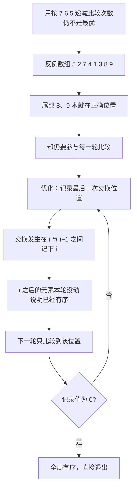

# 冒泡排序优化：进一步减少比较次数

面试题：冒泡排序还能怎么优化？

前面已经把冒泡排序的基本实现和第一层优化讲完了：每一轮的比较次数逐轮递减，8 个元素的数组第一轮比较 7 次，第二轮 6 次，之后每轮都比上一轮少一次。但这算不算最优解？不算。这一篇给出更狠的一招：记录最后一次交换的位置，用它直接决定下一轮要比较多少次。尾部天生有序的元素，一次都不该再比。

## 先给结论

- 冒泡排序的优化可以叠加两层：用布尔标志判断本轮有没有交换（无交换即有序，提前退出）；记录最后一次交换的位置，作为下一轮的比较次数。
- 只按 7、6、5 这样递减比较次数，处理不了「尾部多个元素本就位」的场景，会做大量无效比较。
- 每轮记录最后一次交换时前一个元素的索引，下一轮只比较到这个位置；这个值为 0，说明全局有序，直接退出循环。
- 面试至少写出布尔标志版；能写出记录交换位置的版本，是明显的加分项。



## 是什么：先看一个反例

拿一个 8 元素的数组：5、2、7、4、1、3、8、9。注意这里故意把 8 和 9 这两个最大、第二大的元素放在了最后，7 是第三大。

先跑一轮冒泡看问题在哪：

1. 第一次比较：5 和 2，需要交换位置。
2. 第二次比较：5 和 7，不用动。
3. 第三次比较：7 和 4，要交换位置。
4. 第四次比较：7 和 1，要交换。
5. 第五次比较：7 和 3，要交换。
6. 接下来 7 和 8，不用动；8 和 9，也不用动。

这样经历 7 次比较，做完了第一轮冒泡，能确定的最大元素是 9。按老优化，第二轮还需要比较 6 次。但仔细想：这个场景第二轮真的需要比较 6 次吗？没必要。

因为第一轮里面，8 和 9 比较过，5 和 7 也比较过，7 作为第三大的元素位置也已确定。第二轮再跟 7 比、再跟 8 比都没有意义，它们不参与比较也不会影响结果。所以逐轮递减比较次数并不是最优解。

## 深入细节：记录最后一次交换的位置

改进后的冒泡排序，数据不变，再走一遍。演示网页（冒泡改进版）用红色标识标出每一轮实际需要的比较次数，第一轮仍然是 7 次，和刚才一样：

- 第一次比较，交换；
- 第二次比较，不用动；
- 第三次比较，交换；
- 第四次比较，交换；
- 第五次比较，重点来了：这时记录一下最后一次交换发生的位置，也就是 7 和 3 交换时，7 所在的索引。此时 7 在索引 4 的位置，把 4 记录下来。

记录下来有什么用？继续看：第七次、第八次比较（7 和 8、8 和 9）都没有发生交换。既然最后一次交换之后没有任何交换，说明后续的 7、8、9 都已经有序。那么 4 这个位置就可以作为下一轮的比较次数：索引 4 前面有 5 个元素，5 个元素两两比较只需要 4 次。所以第二轮冒泡的比较次数就是 4，7、8、9 在第二轮完全不参与比较。

接着找规律，一轮一轮往下走：

- 第二轮：2 和 5 不用动，5 和 4 要交换，5 和 1 要交换，5 和 3 也要交换。注意，这一次交换算最后一次交换，记录 5 当前所在的索引，也就是 3，作为下一轮的比较次数。5 之后的元素都是有序的。验证一下：还剩 4 个元素，正好需要交换 3 次，这是正确的。
- 第三轮：2 和 4 不用动，4 和 1 要交换，4 和 3 也要交换。这同样是最后一次交换，记录此时的索引 2，下一轮比较次数就是 2。
- 第四轮：2 和 1 比较，需要交换，记录索引 0；随后 2 和 3 不用交换。最后一次交换的索引是 0，意味着下一轮不需要冒泡了，所有元素都有序，1、2、3 全部固定，排序结束。

总结一下这个改进：每轮记录最后一次交换元素（交换对中前一个元素）的索引位置，作为下一轮冒泡需要的比较次数；如果这个值是 0，意味着排序成功，直接退出循环。

把「最后一次交换的位置」记下来，代码这样写：

```java
public static void bubble_v2(int[] a) {
    int n = a.length - 1;           // n 表示本轮的比较次数
    while (true) {
        int last = 0;               // 记录本轮最后一次发生交换的索引
        for (int i = 0; i < n; i++) {
            System.out.println("比较次数" + i);
            if (a[i] > a[i + 1]) {
                Utils.swap(a, i, i + 1);
                last = i;           // 发生交换就更新 last
            }
        }
        n = last;                   // 本轮结束，把 last 交给 n
        if (n == 0) {
            break;                  // 零交换说明整个数组已有序
        }
    }
}
```

## 面试怎么答

分两层讲：

1. **基础层**：加一个布尔标志，本轮没有发生任何交换就说明数组已经有序，提前结束，最好情况一轮 O(n) 收工。
2. **进阶层**：记录最后一次交换的位置，下一轮的比较范围直接缩到这个位置，跳过尾部已有序的区间；交换位置为 0 即全局有序，退出循环。
3. **数据说话**：8 元素数组按递减优化要 7、6、5、4、3、2、1 共 28 次比较；用交换位置记录后是 7、4、3、2，第 5 轮一开始就退出，比较次数明显更少。

常见追问：

- **问**：为什么最后一次交换位置之后的元素可以认为已经有序？
  **答**：如果它们无序，这一轮在那些区域就一定发生过交换，不可能停在同一个位置之后再无交换。「最后一次交换」本身就说明其后全部就位。
- **问**：为什么记录的是交换对中前一个元素的索引？
  **答**：交换发生在 i 和 i+1 之间，记下 i，说明 i 之后的元素本轮没再动过、已经有序，下一轮只需要覆盖到 i 为止。

## 常见误区

- **误区一**：把每轮比较次数递减（7、6、5……）当成最优解。尾部多个元素天然有序时，这种做法仍然要做大量无效比较。
- **误区二**：以为记录了交换位置还要再单独判断有没有交换。位置为 0 本身就等价于本轮零交换，一个变量就够了，不需要两个标志位。
