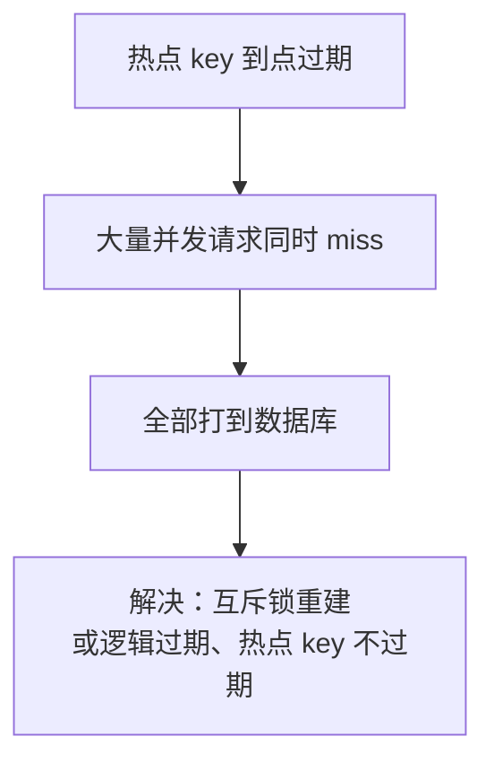

# Redis 缓存击穿

面试题：什么是缓存击穿？怎么解决？

Redis 缓存的几个经典问题，击穿、穿透、雪崩，几乎都是必问的。这篇先讲击穿：一个热点 key 过期，为什么能把数据库压垮，以及两种解决思路的取舍。搞懂了击穿，后面讲雪崩时「为什么加锁救不了雪崩」就好理解了。

## 先给结论

- 缓存击穿：某一个热点 key（大量用户都要访问，比如热点商品、热点新闻）在缓存和数据库中都存在，但它过期的那一瞬间，大量并发请求同时读不到缓存，全部穿透到数据库，可能把数据库压垮。
- 方案一（推荐）：热点数据不设置过期时间，从源头避免过期瞬间的并发穿透。
- 方案二（有损）：对「查询缓存没有、查询数据库、结果放入缓存」这三步操作加互斥锁，只放行一个客户端去查数据库并回填缓存，其余客户端阻塞等待，锁释放后缓存已有数据，大家直接从缓存读。
- 加锁会影响吞吐量，属于有损方案，一般首选热点数据不过期。

## 是什么：热点 key 过期的一瞬间

先记住缓存最重要的作用：保护数据库。它要把大部分的查询请求拦截在缓存这个级别，直接返回，不让请求到达身后的数据库。数据库是没有办法承受这么大并发量的，很容易就被压垮。

缓存击穿指的是：某一个热点 key 在缓存中有，在数据库中也有，不过我们给它设置了过期时间。当它过期的那一瞬间，可能有大量的用户都在访问它。这些用户在缓存里能不能找到这个 key？找不到了，因为它过期没了。没了的话，这些请求就都会去数据库查询。这样一来就把数据库给压垮了。

也就是说，这个热点 key 一失效，就让这些请求绕过了缓存、到达了数据库，最终出现大家都不想看到的结果。问题的前提有两个：必须是热点 key（有大量用户访问），并且恰好设置在过期的时间点上。

## 深入细节：两种解决方案

**方案一：热点数据不过期。** 既然是热点数据，为什么要让它过期？判断出缓存中哪些是热点数据，不让它们过期；那些不重要的数据，让它们及时过期。注意，「怎么判断哪些数据是热点」是另一个话题，这里不展开。这是最好的解决办法。

**方案二：对三步操作加锁。** 先想清楚查询的步骤：第一步，看看缓存中有没有；第二步，缓存没有，查询数据库；第三步，把数据库里的结果放入缓存。对这个场景（热点 key 已过期、缓存中没有），就对这三步操作加一把锁。

加锁有什么好处？锁最基本的特性是互斥的，只有一个客户端能获得锁，拿到锁的客户端才有权限把请求穿过缓存到达数据库。其他客户端会被阻塞，等这个客户端把三步事干完、锁释放，缓存中已经有数据了（它发现缓存没有，去找数据库，数据库中有，就把结果放入了缓存）。所以只有一个客户端访问了数据库，剩下的所有客户端再次查询时，直接从缓存中就能拿到数据，不用访问数据库。

最常见的加锁方式是用 Redis 的 `setnx`，流程用一个三个客户端的例子走一遍：

1. 三个客户端 A、B、C 同时来访问这个失效的热点 key。不加锁的话，缓存中一旦没有，三个请求最终都会到达数据库。
2. 加锁的做法：客户端 A 执行 `setnx lock.foo` 成功。`setnx` 的工作方式是看缓存（Redis）中有没有这个 key，有就失败，没有就成功，显然只有一个客户端能成功，A 相当于获得了这把锁，有权限执行后续操作。
3. B 和 C 也执行同样的 `setnx` 代码，但 A 已经获得锁，它们的 `setnx` 失败，只能先退出等待。
4. A 独享执行权：查询数据库，把热点 key 的值查出来，将查询结果放入缓存，然后 `del lock.foo` 把锁释放掉。
5. B、C 再次查询时，发现缓存中已经有数据，直接从缓存读取，请求不会到达数据库。

不过要清楚：这个方案并不是特别好，因为它会影响吞吐量。加锁之后，其他客户端暂时得暂停等待，它属于一种有损方案。所以一般推荐第一种：找到那些热点 key，不让它们过期。

## 面试怎么答

先给定义：某一个热点 key 在缓存和数据库中都存在，过期的一瞬间大量并发请求同时读不到缓存，全部打到数据库，压垮数据库。再给方案：首选热点数据不过期；其次对「查缓存、查数据库、回填缓存」三步加互斥锁，用 `setnx` 加锁、`del` 释放锁，保证只有一个请求回源数据库，其余客户端等锁释放后直接读缓存。最后补一句取舍：加锁有损吞吐，所以不过期才是首选。

常见追问：

- **问**：缓存击穿和缓存穿透有什么区别？
  **答**：击穿是 key 在数据库中存在，只是缓存过期了，属于「本来有、暂时没有」；穿透是 key 在数据库中根本不存在，请求每次都会打到数据库，缓存永远回填不上，解法也不同（比如缓存空值、布隆过滤器拦截）。
- **问**：锁加在什么粒度上？
  **答**：就加在当前访问的这个 key 上，比如 `lock.foo`，阻止的是其他客户端访问同一个 key；回填缓存后立即 `del` 释放，让等待的客户端尽快读到缓存。

## 常见误区

- **误区一**：以为加锁能解决一切缓存问题。加锁只适合单个或少数 key 的击穿场景；遇到大量 key 同时失效（雪崩），给所有 key 加锁不现实，缓存等于瘫痪，这一点在雪崩篇展开。
- **误区二**：以为热点数据也必须设过期时间。课程给的最佳实践恰恰相反：热点数据不过期，把过期让给非热点数据。

## 课件配图
> 以下配图取自阶段七课件对应讲义，与上文讲解一一对应，可作为图文对照辅助理解。
**缓存问题**（课件讲义图示）

