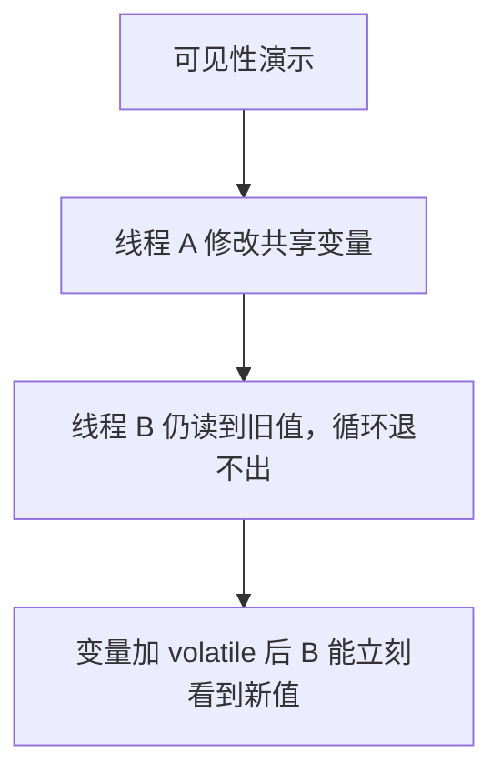

# volatile 可见性问题演示

面试题：什么是可见性问题？

volatile 这块内容，光背「保证可见性」五个字，面试一问就露馅。这篇先看一个停不下来的循环：一个线程把共享变量改成了 true，另一个线程却永远看不到，程序死活不结束。现象记住了，原理再讲一层，最后留个悬念：网上流传最广的那种解释，其实是有问题的。

## 先给结论

- 可见性：一个线程修改了共享变量，另一个线程没有读到它最新修改后的值。
- 演示现象：一个线程执行 `while (!stop)` 死循环，另一个线程 0.1 秒后把 `stop` 改成 `true`，循环停不下来，程序不结束。
- 网上的主流解释来自 JMM：内存划分主存和工作内存，每个 CPU 把共享变量复制一份副本到高速缓存，修改只落在副本上，没同步回主存，其他 CPU 读到的还是旧值。
- 这种讲法有漏洞，具体问题下一篇揭晓。



## 是什么：一个停不下来的循环

先读代码结构。主线程这边调用一个 `foo` 方法，`foo` 方法内执行一个 `while` 循环，循环条件是这个共享变量 `stop`：因为 `stop` 这个共享变量的初始值是 `false`，所以让循环条件总是成立，一开始这个循环就会不断运行。循环里的 `i` 是一个计数值，看看最终循环了多少次。

什么时候循环会停下来？肯定是要把 `stop` 从 `false` 改成 `true`，条件不成立了，它自然就停下来。谁把 `stop` 改成 `true`？看另一段代码：由另一个线程在 0.1 秒以后，把 `stop` 改成 `true`，目的当然就是让主线程这个循环停下来。

运行一下这段代码，看它能不能如预期停下来。结果是：等了很久，明显已经超过 0.1 秒了，但是这个循环并没有结束。「modify stop to true...」的日志已经打印，说明设置 `stop` 的代码都执行完了，`stop` 也已经从 `false` 改成 `true`。但很遗憾，主线程里边并没有看到它改成了这个 `true`，拿到的应该还是 `false`，所以它还在不断循环，最后的日志也没有打印，整个程序也没有结束。

这个现象就是著名的可见性问题：一个线程对共享变量做了修改，另外一个线程没有读到它修改后的最新值，于是就造成了这个死循环。

```java
// 可见性例子，运行时加 JVM 参数 -Xint 关闭 JIT 更容易复现
public class ForeverLoop {
    static volatile boolean stop = false;   // 去掉 volatile 就会死循环

    public static void main(String[] args) {
        new Thread(() -> {
            try { Thread.sleep(100); } catch (InterruptedException e) { e.printStackTrace(); }
            stop = true;
            get().debug("modify stop to true...");
        }).start();

        foo();
    }

    static void foo() {
        int i = 0;
        while (!stop) {
            i++;
        }
        get().debug("stopped... c:{}", i);
    }
}
```

`stop` 不加 volatile 时，虽然修改方的日志已经打印、`stop` 也确实变成了 true，但 `foo` 里的循环读到的还是旧值 false，于是永远停不下来。

## 深入细节：网上的主流解释

网上对于这个问题的解释，大部分都是从 JMM（Java 内存模型）的角度去讲的。JMM 里其实就相当于把整个内存划分成了主存和工作内存：主存存共享变量，也就是刚才看到的 `stop` 这样的静态共享变量；工作内存由每个线程去进行读取。

具体说法是：每个 CPU 对共享变量的操作，都会将主存中的共享变量复制一份副本到自己的高速缓存中，也就是复制到工作内存中，然后对这个副本进行操作。如果没有正确的同步，即使 CPU0 修改了它里面的变量，修改的也只是这个副本中的变量，没有把它同步到主存中；那其他 CPU 要用到这个变量的时候，读到的还是之前的旧值。他说这就是一种可见性问题。

听起来好像也没错，早年间讲并发编程也都是这么讲的。但随着认识不断加深，深入分析后就会发现这种讲法其实是有问题的，问题在哪，下一篇揭晓。

## 面试怎么答

先复现现象，再讲原理：描述 `while (!stop)` 循环停不下来的演示，给出可见性的定义，也就是一个线程修改共享变量、另一个线程读不到最新值。再答机制：JMM 把内存分成主存和工作内存，每个 CPU 操作共享变量时会把主存的值复制一份副本到高速缓存，对副本操作；没有正确同步时，修改只停留在副本里，没同步回主存，其他线程读到的还是旧值。收尾可以主动点一句：缓存副本只是表层解释，这个现象的根因还有更深的层次，把话题往 `volatile`、JMM 同步约定上引。

常见追问：

- **问**：多等一会就能看到新值吗？
  **答**：不能。可见性问题与等待时长无关，没有同步机制时，读线程可能一直读自己缓存里的旧副本，等多久都没用。
- **问**：这个例子怎么修？
  **答**：给 `stop` 加 `volatile`。`volatile` 保证一个线程修改了变量，其他线程能立刻读到最新值，正是用来解决可见性问题的。

## 常见误区

- **误区一**：以为多等一会就能看到新值。没有同步机制，读线程可能永远看不到修改。
- **误区二**：以为只有静态变量才有这个问题。任何被多线程共享的变量，实例变量、静态变量都一样。
