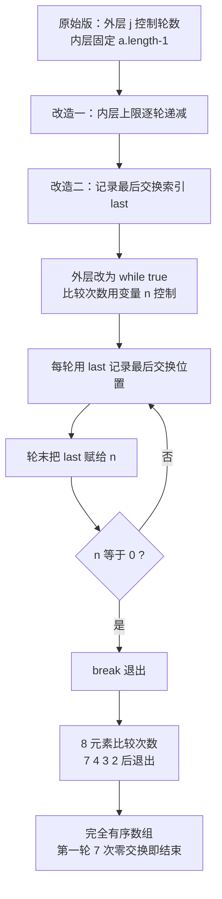

# 冒泡排序优化：最终实现

面试题：冒泡排序的优化版，最终怎么写？

前两篇把优化思想讲完了：每轮比较次数递减是一层，记录最后一次交换的位置是更进的一层。这篇落到实现：从原始版怎么一步步改成最终版，跑出来的比较次数是多少，面试到底写哪种。优化思想不值钱，能写对代码才值钱。

## 先给结论

- 最终实现综合两种优化：外层用 `while (true)`，内层比较次数用变量 `n` 控制；每轮用 `last` 记录最后一次交换的索引，轮末把 `last` 交给 `n`；`n == 0` 直接 `break`。
- 效果：8 元素数组的比较次数是 7、4、3、2，第 5 轮一开始 `n` 就变成 0，直接退出。
- 完全有序的数组第一轮 7 次比较零交换，`n` 为 0，第一轮就结束。
- 面试至少写出带 `swapped` 哨兵的版本；能写出 `last` 记录版本，更加分。



## 深入细节：从原始版一步步改造

原有的实现先保留做对照，把新代码写在新的方法里，再改出最终版。

**原始版。** 外层循环用 `j` 控制轮数，取值到 `a.length - 1`；内层循环用 `i`，刚开始也是 `a.length - 1`。判断相邻元素，如果前一个大于后一个，就交换。这是最原始的冒泡代码。

**改造一：减少每轮比较次数。** 让内层循环的上限逐轮递减，这个前面讲过，这里直接进入下一步。

改造二：记录最后一次交换的位置。
1. 用一个临时变量 `last = 0`，表示最后一次发生交换时，那个索引位置。为什么记前一个元素的索引？因为交换发生在 `i` 和 `i+1` 之间，记下 `i`，就说明 `i` 之后的元素本轮没再动过、已经有序。
2. 每发生一次交换，就把 `last` 改成 `i`，记录下来。
3. 但 `last` 每次都在变，还得再用一个变量来描述本轮比较次数。再来一个 `n`，最开始它的值是 `a.length - 1`。
4. 每次循环完了以后，把 `last` 给到 `n`，内层就按 `n` 次比较。
5. 什么时候退出循环？如果 `n` 这个比较次数已经是 0，说明整个数组有序，不用循环了，直接 `break` 退出外层循环。
6. 这样改造完以后，外层 `j` 的值一直没用上，所以外层循环直接写 `while (true)`。

最终版的代码长这样：

```java
public static void bubble_v2(int[] a) {
    int n = a.length - 1;          // n 控制本轮的比较次数
    while (true) {
        int last = 0;              // 记录本轮最后一次发生交换的索引
        for (int i = 0; i < n; i++) {
            System.out.println("比较次数" + i);
            if (a[i] > a[i + 1]) {
                Utils.swap(a, i, i + 1);
                last = i;          // 发生交换就更新 last
            }
        }
        n = last;                   // 本轮结束，把 last 交给 n
        System.out.println(Arrays.toString(a));
        if (n == 0) {
            break;                  // 零交换即有序，提前退出
        }
    }
}
```

这就是课件 day01 里 `BubbleSort.bubble_v2` 的实现，`last` 一个变量同时兼了「缩小下轮比较范围」和「给出退出信号」两件事。

跑一遍验证效果。刚开始比较了 7 次；第一轮以后，7、8、9 已经有序了，所以第二轮没必要比较那么多次，只需要比较 4 次；第三轮 5 也有序了，剩下的元素只需要比较 3 次；第 4 轮 4 也有序了，剩下的元素只需要比较 2 次；第 5 轮，1 和 2 交换完了以后，最后一次交换的索引位置是 0，`n` 的值变成 0，说明整个数组都有序，后续的冒泡直接退出。

再试一个完全有序的例子：第一轮 7 次比较，一次交换都没有发生，`last` 始终是 0，第一轮结束的时候 `n` 是 0，直接 `break`，不会进行后续第二轮的循环。

另外还展示了带 `swapped` 哨兵机制的版本：用一个布尔变量记录本轮是否发生交换，没有交换就说明有序，也可以提前结束。两种优化可以单独用，也可以合成最终版。

## 面试怎么答

先写代码再讲效果。代码要点：外层 `while (true)`，内层比较次数由 `n` 控制，交换时 `last = i`，每轮结束 `n = last`，`n == 0` 时 `break`。效果用数字说话：比较次数 7、4、3、2，第 5 轮一开始就退出；完全有序时一轮 7 次比较结束。复杂度：最好情况一轮 O(n)，最坏还是 O(n²)，但比较次数的常数明显下降。

常见追问：

- **问**：为什么 `n == 0` 就能断定全局有序？
  **答**：`n == 0` 等价于本轮零交换，零交换意味着所有相邻对都已就位，整个数组就是有序的。
- **问**：两种优化同时用会不会冲突？
  **答**：不冲突。`last` 既缩减了下一轮的比较范围，又在无交换时给出 0 的退出信号，一个变量兼两职，这正是最终版更优的原因。

## 常见误区

- **误区一**：只写 `swapped` 哨兵就交差。能跑对，但比较次数压不到下限，追问优化细节容易卡壳。
- **误区二**：把 `last` 记成后一个元素的索引。要记交换对中前一个元素的索引，才能保证下一轮的比较范围覆盖到所有可能无序的区域。
