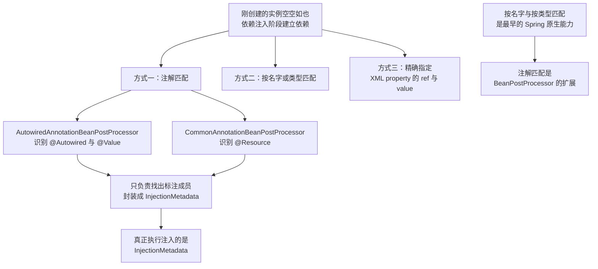

# Spring Bean 创建流程：依赖注入阶段

面试题：Spring 的依赖注入有哪些方式？底层是谁在干活？

上一篇讲了创建实例：bean 的实例虽然建出来了，但里面空空如也，还不能正确工作。依赖注入阶段就负责把它和容器中其他 bean 的依赖关系建立起来。这个阶段的知识点面试命中率很高，尤其是「注解解析和实际注入是不是同一个类干的」这种题，答错的人一大半。

## 先给结论

- 刚创建出来的 bean 实例空空如也，依赖注入阶段负责建立它和容器中其他 bean 之间的依赖关系。
- 方式分三大类：注解匹配、按名字或类型匹配、精确指定（XML `property` 标签的 `ref` 和 `value`）。
- 注解匹配靠两个后处理器：`AutowiredAnnotationBeanPostProcessor` 识别 `@Autowired` 和 `@Value`，`CommonAnnotationBeanPostProcessor` 识别 `@Resource`；它们只负责找出标注成员并封装成 `InjectionMetadata`，真正执行注入的是 `InjectionMetadata`。
- 按名字、按类型、精确指定是最早的 Spring 原生依赖注入能力；注解匹配是 BeanPostProcessor 对依赖注入功能的扩展。

## 深入细节：六条路径

**注解匹配一：AutowiredAnnotationBeanPostProcessor。** 注解里两个最常见的是 `@Autowired` 和 `@Value`，都可以标注成员变量或者成员方法。识别这两个注解的，就是 `AutowiredAnnotationBeanPostProcessor` 这个 bean 后处理器：它看看哪些成员变量或成员方法上标注了这些注解，把这些成员封装成一个 `InjectionMetadata`，最后由 `InjectionMetadata` 完成具体的依赖注入。

注意分工：具体干依赖注入的，是后面的 `InjectionMetadata`；这个 bean 后处理器只是负责找，看哪些成员加了这些注解，把它们找出来，后续的依赖注入由后面这个类完成。

这个后处理器在创建 bean 实例的阶段也见过一次：当时它解析构造器上加了 `@Autowired` 的构造器，优先采用那样的构造器来创建实例。除了构造器，它也能工作在依赖注入阶段，识别成员上的 `@Autowired` 和 `@Value`。

**注解匹配二：CommonAnnotationBeanPostProcessor。** 第二个注解大家也都见过：`@Resource`。它标注的成员也会被纳入依赖注入的范围。识别 `@Resource` 的是 `CommonAnnotationBeanPostProcessor`，它同样识别标注了 `@Resource` 的成员变量或成员方法，封装成 `InjectionMetadata`，最后由这个类完成依赖注入。

这两个后处理器都是通过匹配注解来完成依赖注入的。因为它们都是 bean 后处理器，可以认为它们是对正常依赖注入的功能扩展：最早的依赖注入没有这些功能，不能识别这些注解，这些能力是后处理器扩展出来的。

**按名字匹配：AUTOWIRE_BY_NAME。** 这是定义 bean 时可以加的一项配置。加了这个配置之后，它可以根据属性名来匹配：看看容器中有没有一个同名的 bean 对象，有就完成后续的依赖注入。注意它不考虑简单类型成员：比如有个 set 方法是 set 一个 String 的，它不会到容器里找一个字符串 bean，只考虑非简单类型成员。

**按类型匹配：AUTOWIRE_BY_TYPE。** 跟 by name 比较类似，也是定义 bean 时可以指定的配置。它根据属性 set 方法的参数类型进行匹配，根据这个类型到容器里找，看有没有一个同类型的 bean，有就可以完成后续的依赖注入。一个根据名字，一个根据类型。

**精确指定。** 最后一种不进行任何匹配，精确指定：这个属性就是需要某个 bean，或者就是需要某个值。最早学 XML 配置时都见过，通过 `property` 标签，用 `ref` 指定具体要引用哪个 bean，或者用 `value` 指定具体要引用哪个值。它的底层对应 `applyPropertyValues`：根据 mbd（BeanDefinition）的 propertyValues 进行依赖注入。

**resolveDependency。** AUTOWIRE_BY_TYPE 按类型查找时，实际执行查找的是 `resolveDependency`，它是依赖注入的核心查找方法，用来查找要装配的值。它能识别的东西很多：`Optional`、`ObjectFactory` 及 `ObjectProvider`、`@Lazy` 注解、`@Value` 注解（`${}`、`#{}`、类型转换）、集合类型（`Collection`、`Map`、数组等）、泛型和 `@Qualifier`（用来区分类型歧义）、`primary` 及名字匹配（同样用来区分类型歧义）。

这个阶段要注意一个分层：后面三种方式（by name、by type、精确指定）相当于最早的 Spring 就带的依赖注入功能；前面两种根据注解来匹配的，可以看成是 bean 后处理器对依赖注入功能的一个扩展。

## 面试怎么答

先给分类：注解匹配、按名字或类型匹配、精确指定，三类一口气说完。再点关键组件：两个后处理器加 `InjectionMetadata` 的分工，`resolveDependency` 的查找能力，`applyPropertyValues` 对应 XML `property` 的底层实现。最后拔高一层：注解方式是后处理器扩展，另外三种是 Spring 原生依赖注入，这个分层很多候选人答不出来，是明显的区分点。

常见追问：

- **问**：`@Autowired` 和 `@Resource` 有什么区别？
  **答**：识别它们的后处理器不同，`@Autowired` 由 `AutowiredAnnotationBeanPostProcessor` 处理，`@Resource` 由 `CommonAnnotationBeanPostProcessor` 处理，但最终都封装成 `InjectionMetadata` 完成注入。另外 `@Resource` 是 JSR-250 标准注解，默认先按名字再按类型解析；`@Autowired` 是 Spring 自己的注解，默认按类型解析。
- **问**：InjectionMetadata 是后处理器的一部分吗？
  **答**：不是。后处理器负责扫描注解、把标注成员的信息封装成 `InjectionMetadata`，实际执行注入的是 `InjectionMetadata`，两个类分工不同。

## 常见误区

- **误区一**：以为注解解析和实际注入是同一个类干的。后处理器只负责找，`InjectionMetadata` 才负责注入。
- **误区二**：以为 AUTOWIRE_BY_NAME 会把 String 属性也当 bean 去找。简单类型成员不在它的匹配范围内。
